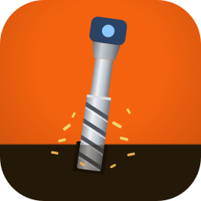

<p align="center"></p>

# MillCreator

Open-source CNC milling software, written in Rust: design or import shapes, give every layer an operation and a bit,
look at the job in 3D and write G-code. It is the sibling of [LightCreator](https://github.com/michalsarna/LightCreator)
(laser) and shares its core and interface code through [baseCreator](https://github.com/michalsarna/baseCreator),
pinned to a tag in `crates/millcreator/Cargo.toml`.

> ⚠️ A milling machine is dangerous and this program has been tested on a TwoTrees TTC450Pro and works there, but not on other machines. It writes G-code and
> can **stream it to a GRBL machine** (connect, home, frame, start, stop). Test every job in the air first. See the wiki page *Safety and Limitations*.

## Screenshots


More pictures (devices, the bit library, the 3D view, the preview from above, the connection and more) are on the
[screenshots page](docs/SCREENSHOTS.md).

The wiki has the full documentation in English and Polish: <https://github.com/michalsarna/MillCreator/wiki>
(all pictures are on its *Screenshots* page).

## What it does

* **Devices:** a list of machines (work area, travel in Z, safe height, spindle range, speeds), each with up to eight
  cameras and a live **Camera** tab; add, edit, duplicate, export and import; **I have no device** makes a stand-in
  called Dummy. The list is kept for every project.
* **Layers:** 64 layers with an operation (cut outside the line, cut inside, follow the line, pocket, drill), a bit,
  depth, pass depth, step over, feeds and spindle speed.
* **Bit library:** ready-made bits and your own (kept for every device), seven kinds (flat, ball nose, bull nose,
  V-bit, engraving, tapered ball nose, drill), each with a picture that shows the letter of every dimension where it is
  measured; import and export as JSON.
* **Material:** wood in three colours, metal, plastic in a colour you choose, and the thickness.
* **Preview:** a window with the block of material, the cuts and the moves at the safe height, in 3D (turn / zoom /
  reset) or from above as a plan, with an animation (play, pause, speed, repeat); the shown area is 10 % larger than the
  project. The **Toolpaths** button of the control bar draws the paths over the work area.
* **The machine:** a GRBL controller on a serial port or a network socket (set in the device: port, baud rate, the GRBL version from 0.7 to 1.1 and newer, streaming,
  homing after connecting); **Connect**, **Home**, **Frame** (the tool goes round the box of the work at the safe
  height), **Start** (also **From line…** and a check of the program in the controller's check mode) and **Stop** of
  the job, **Save G-code**, pause and resume, a console. The **Control** tab has the work and machine position, zero
  and G54 … G59, jogging (steps, hold to move, keyboard), probing with a touch plate or a 3D probe, and macros; a job
  stops at a change of the bit and offers to probe Z again. The **Machine** menu has the settings of the controller
  (`$$`: search, backup before the first change, restore), calibration (steps per millimetre, squareness),
  diagnostics with statistics and maintenance reminders, and alarms and errors are explained in your language. The
  device can be filled in from the controller, keeps copies of the controller settings (a change is noticed at connecting), and a tool length sensor gives every new bit the Z of the first. A rotary attachment can be set in the device (the Y axis turns the
  work; the drawing may not be higher than the way round it).
* **Toolpaths and G-code:** profiles, pockets, lines and drilling with passes; GRBL-style G-code with a pause to change
  the bit; warnings (no bit, deeper than the material, outside the work area, spindle out of range).
* **Project file:** `.cre`, shared with LightCreator; MillCreator keeps its own `mill` section (layers, material, device
  snapshot, the bits used) and leaves the sections of other programs untouched.
* **Shared with LightCreator:** the window, menus and editor, 310 clipart pictures, import of SVG, PDF, Illustrator and
  LightBurn projects and UGS Designer designs, 30 languages (the shared texts and MillCreator's own), 14 colour schemes.

What is not there: tabs, ramps, V-carving, 3D relief, collision checks. See [FEATURES.md](FEATURES.md).

## Install

Ready-made packages for Windows, macOS and Linux are on the [Releases page](https://github.com/michalsarna/MillCreator/releases); see [INSTALL.md](INSTALL.md).

## Examples

[`examples/`](examples) has a small badge (`badge.svg`) to import, a plaque to mill as a project (`plaque.cre`: the outline cut out, four holes drilled, a pocket and an engraved star, with a bit for each layer; open it with *File → Open*) and the G-code the program makes from it (`plaque.nc`, GRBL). `cargo test -p millcreator write_examples -- --ignored` writes the last two again.

## Building

```sh
cargo run -p millcreator                       # start empty
cargo run -p millcreator -- drawing.svg        # open a file
cargo test --workspace
```

Add `--features camera` for live camera capture. On Linux the GUI needs the usual X11/Wayland and OpenGL libraries
(`libxkbcommon-x11`, `libgl1`).

To work on baseCreator and MillCreator together, point Cargo at your checkout of baseCreator (do not commit this file):

```toml
# .cargo/config.toml
[patch."https://github.com/michalsarna/baseCreator"]
base-core = { path = "../baseCreator/crates/base-core" }
base-ui   = { path = "../baseCreator/crates/base-ui" }
```

## Icon

`assets/icons/millcreator.svg` is the icon: the orange background and the brown base of the baseCreator icon, with an end
mill going into the base. `tools/make-icons.sh assets/icons/millcreator.svg millcreator` renders the PNGs, the `.ico` and
the `.icns` (needs inkscape; the `.icns` needs macOS). The screenshots are made by
`cargo test -p millcreator render_screenshots -- --ignored`.

<p align="center">
  <a href="SUPPORT.md">
    
  </a>
</p>

## Credits and licence

MillCreator is licensed under either of [Apache License 2.0](LICENSE-APACHE) or the [MIT license](LICENSE), at your option. Copyright (c) 2026 MillCreator contributors.

Unless you explicitly state otherwise, any contribution intentionally submitted for inclusion in MillCreator by you, as defined in the Apache-2.0 license, shall be dual licensed as above, without any additional terms or conditions.

It is built on many open-source projects, fonts and icon sets: see [CREDITS.md](CREDITS.md) and [`assets/LICENSES.md`](assets/LICENSES.md).
