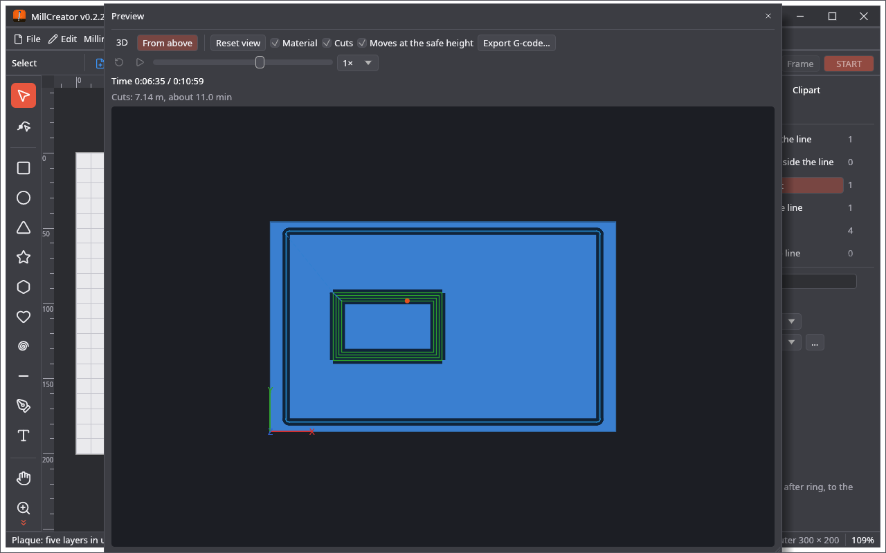
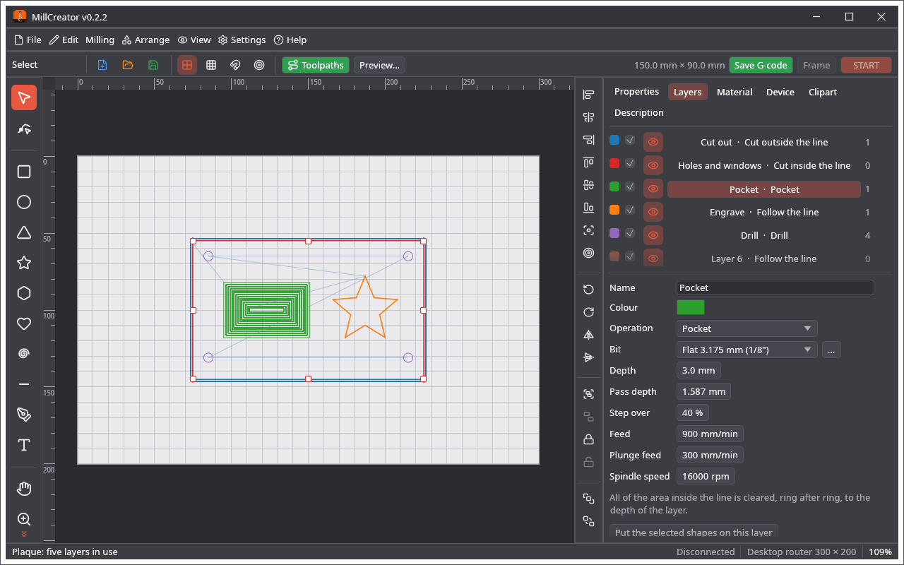
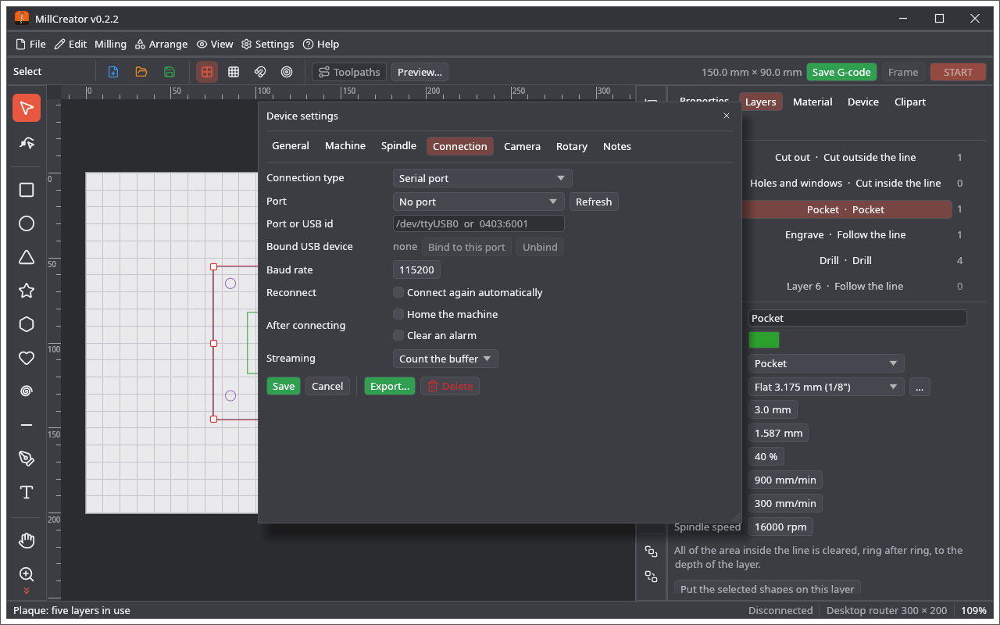
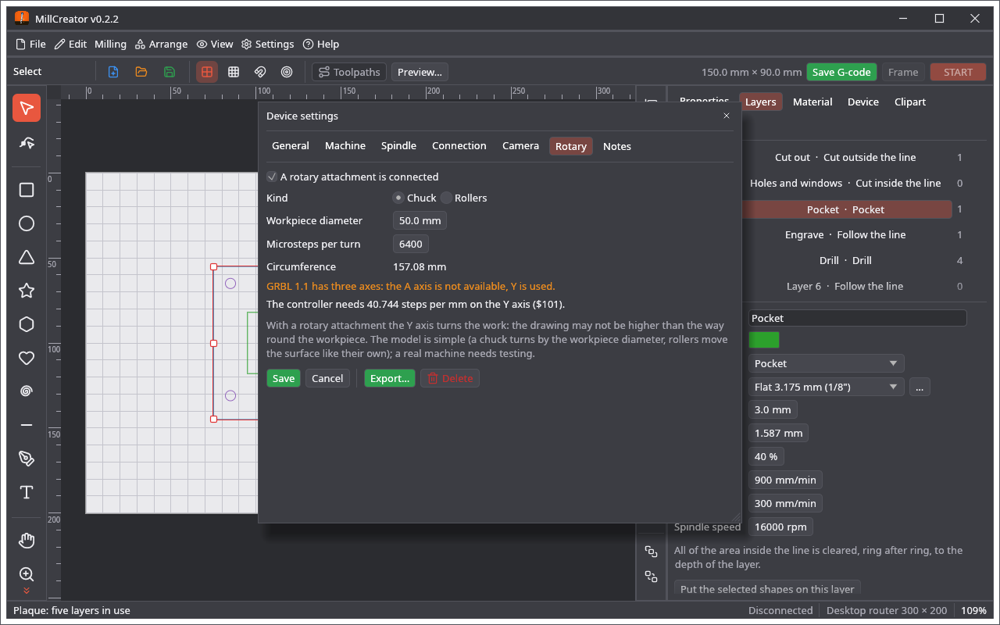

# Screenshots

All pictures are rendered headlessly from the real UI (`cargo test -p millcreator render_screenshots -- --ignored`). Back to the [README](../README.md).

| | |
|---|---|
|  |  |
| Start screen: the devices, then a new design or a file | Adding a device: name, units, machine zero |
|  |  |
| Device settings, Camera page | A plaque on five layers; Properties tab |
|  |  |
| Layers tab: pocket layer with its bit, depth and feeds | Material tab |
|  |  |
| Device tab | Clipart gallery |
|  |  |
| Description tab | Bit library: flat end mill |
|  |  |
| Bit library: V-bit with its angle | Bit library: bull nose with the corner radius R |
|  |  |
| Bit library: tapered ball nose | Bit library: engraving bit with its tip T |
|  |  |
| Bit library: drill with its point angle | 3D view of the job: block, cuts and moves at the safe height |
|  |  |
| 3D view turned and zoomed, played to 55 % | Plastic in a colour of your choice |
|  |  |
| Preview from above, with the animation controls | The Toolpaths button draws the paths over the work area |
|  |  |
| Device: the connection to the GRBL controller | Device: a rotary attachment |
|  |  |
| Device tab: connect, home, pause, console |  |
