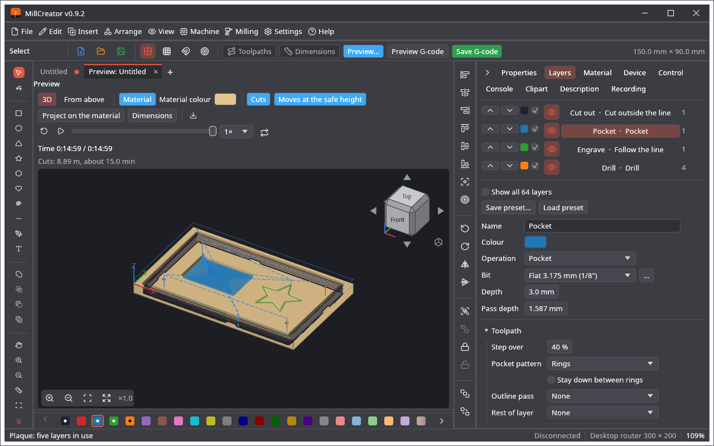
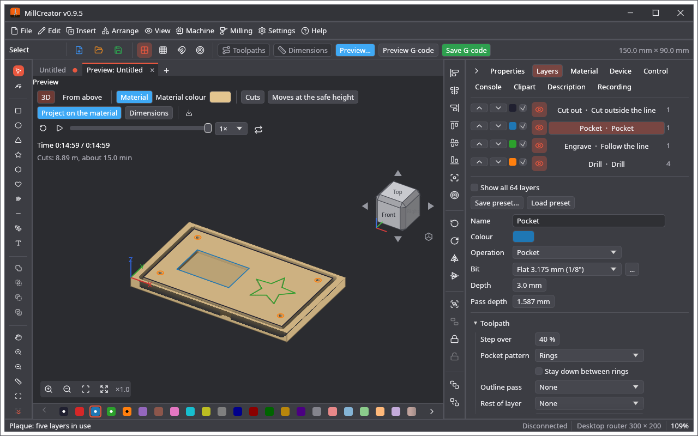
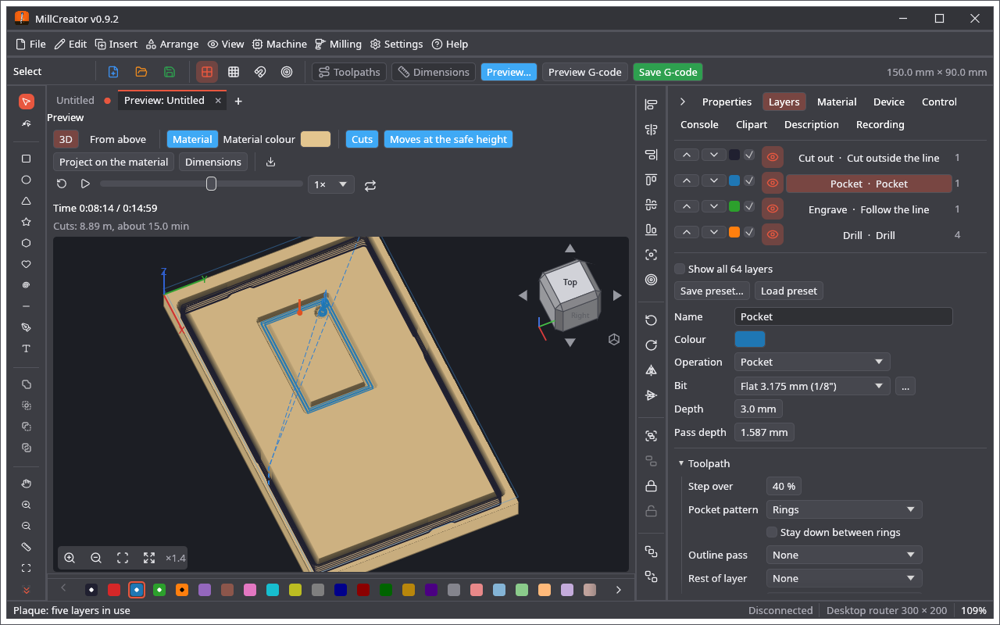

🌐 [English](3D-View-and-G-code) · [Polski](Widok-3D-i-G-code) · [简体中文](3D-View-and-G-code-ZH) · **한국어**

> ⚠️ 이 페이지는 영어판을 기계 번역한 것으로, 부정확한 부분이 있을 수 있습니다. 의심스러우면 [영어판](3D-View-and-G-code)을 기준으로 하십시오. 수정 제안을 환영합니다.

# 3D 보기와 G-code

## 공구 경로
프로그램은 도형, 레이어, 비트, 장치로부터 기계의 움직임을 만듭니다. 좌표는 작업 영역의 좌표입니다: X는 오른쪽, Y는 내게서 먼 쪽(편집기는 Y를 아래로 세므로 도면이 뒤집힙니다), Z = 0은 재료 윗면이고 그 아래는 음수입니다(또는 **Z를 재료 바닥에서 측정**(Z counts from the bottom of the material)을 켠 **프로젝트 설정**(Project setup) 후에는 바닥으로부터의 높이).

* **윤곽**은 비트 반지름만큼 떨어져 도형을 돌며, 레이어 깊이까지 여러 패스로 내려갑니다. 다음 패스는 비트를 들지 않고 이어집니다.
* **포켓**은 윤곽선에서 안쪽으로 스텝오버만큼 떨어진 링으로, 또는 래스터로 파냅니다([레이어와 작업](Layers-and-Operations-KO) 참고).
* **선 따라가기**는 선을 따라 갔다가 돌아오며 패스를 거듭합니다.
* **드릴**은 패스 깊이만큼씩 쪼아 내려가고 그 사이사이 표면으로 나옵니다.
* 절삭 사이에 비트는 **안전 높이**로 올라가 재료 위 이동 속도로 그곳에서 이동한 뒤, 표면 위 1 mm까지 빠르게 내려가 플런지 이송 속도로 파고듭니다.

**공구 경로**(Toolpaths)(작업 영역 위 막대의 초록색 버튼)는 도면 위에 절삭을 레이어 색으로, 재료 위 이동을 청회색으로 그립니다. 다시 누르면 숨겨집니다. 경로는 도면이 바뀔 때마다 따라갑니다.

## 미리 보기
**미리 보기…**(Preview…)(작업 영역 위의 버튼) 또는 **밀링 → 작업 3D 보기…**(Milling → 3D view of the job…)(Ctrl+Shift+P)는 *Preview: 프로젝트 이름*이라는 제목의 **미리 보기**(Preview) 탭을 엽니다. 도면처럼 작업 영역의 탭이므로 다른 창 영역으로 끌어 옮기거나, 오른쪽 클릭해 **별도 창에서 열기**(Open in a separate window)를 고를 수 있습니다(**메인 창으로 돌아가기**(Back to the main window)로 되돌립니다). X로 닫습니다. 미리 보기는 활성 도면을 따르며 프로젝트가 바뀔 때마다 프로그램을 다시 만듭니다.

작업 영역 중 작업 부분만, 각 방향으로 **작업보다 10 % 크게** 선택한 재료와 그 두께의 블록으로 보여 줍니다.

| 조작 | 기능 |
|---|---|
| **3D** / **위에서**(From above) | 3D 화면, 또는 바로 위에서 본 작업 평면도(회전할 수 없음) |
| 왼쪽 아래의 확대/축소 막대(확대, 축소, **보기 초기화**(Reset view), **모든 개체 맞추기**(Fit all objects)) 또는 더블 클릭 | 확대/축소; 작업 영역에 맞춘 처음 시점으로 돌아가기; 모든 개체 맞추기 |
| **재료**(Material), **절삭**(Cuts), **안전 높이에서의 이동**(Moves at the safe height) | 각 부분을 표시하거나 숨김; 파란 테두리가 안전 높이입니다 |
| **재료 색**(Material colour) | 프로젝트의 재료는 바꾸지 않고 보기에서만 재료 색을 바꿈(**자동**(Automatic)은 고유 색으로 돌아감; 보기 설정과 함께 저장) |
| **재료 위에 프로젝트 표시**(Project on the material) | 도면의 도형을 재료 윗면 위에 레이어 색으로 표시(표시 중인 레이어만); 처음에는 꺼짐 |
| 다운로드 아이콘 | **가공된 조각을 STL로 내보내기…**(Export the milled piece as STL…)(아래 참고) |
| 왼쪽 끌기 | 시점 회전 |
| 오른쪽 또는 가운데 끌기 | 화면 이동 |
| 마우스 휠 | 확대/축소 |
| 애니메이션 | **처음으로**(Back to the start), **재생**(Play) / **일시 정지**(Pause), 슬라이더, **애니메이션 속도**(Animation speed)(0.25×~25×), **반복**(Repeat); 작업이 슬라이더 위치까지 비트 표시와 함께 보입니다 |

**재료**는 가공되는 상태의 원자재입니다. 비트의 홈이 슬라이더가 간 데까지 각 비트의 실제 모양으로(V-비트는 깊을수록 넓어짐) 윗면에 새겨집니다. **절삭**은 그 위에 비트의 경로를 레이어 색으로 더합니다. 버튼 아래에는 슬라이더까지와 전체의 **시간**(Time), 절삭 길이와 시간 추정, 작업의 경고(비트가 없는 레이어, 재료나 기계 이동 거리보다 깊음, 범위를 벗어난 스핀들 속도, 작업 영역 밖, 비트에 비해 너무 작은 선…)가 있습니다.

새겨진 블록은 격자 위의 그림이며(작은 작업일수록 촘촘함), 시간은 이송 속도로부터의 추정입니다. 장치의 가속도(**기계**(Machine) 페이지)가 있으면 모든 이동의 가속과 감속, 느려지는 모서리, GRBL의 짧은 미리 읽기(이동 15개)를 계산하고, 레이어가 바뀌는 곳에서 기계가 멈추는 것도 반영합니다. 가속도가 없으면 길이를 이송 속도로 나눈 값입니다. G-code 뷰어도 장치에 대해 같은 방식으로 파일의 시간을 잽니다.

**가공된 조각을 STL로 내보내기…** 기능은 홈이 새겨진 원자재를 슬라이더가 간 데까지(끝에서는 작업 전체) 밀리미터 단위의 바이너리 STL 모델로 저장합니다. **밀링 → 릴리프를 STL로 내보내기…**(Milling → Export relief as STL…)는 다른 내보내기로, 그림의 릴리프만 저장합니다.

**회전축 장치가 있으면**(장치 설정 → 회전축, 켜짐) 미리 보기는 공작물을 X를 따라 놓인 **원통**으로 보여 줍니다. 프로그램의 Y는 표면을 도는 방향이므로 도면이 원통에 감기며, 작업의 가운데가 위를 향하고, 절삭과 안전 높이 이동은 표면을 따릅니다. 절삭은 축을 향해 내려갑니다. 화면은 한 바퀴 전체이므로 둘레보다 높은 작업은 같은 자리에 두 번 겹쳐 보입니다(프로그램이 경고합니다). 회전축에서는 가공된 조각을 STL로 내보내지 않습니다(평평한 판이 되기 때문입니다).

## 텍스트로 보는 G-code: G-code 미리 보기

**G-code 미리 보기**(Preview G-code)(작업 영역 위 **G-code 저장**(Save G-code) 옆)는 켜져 있는 포스트프로세서를 거쳐 프로젝트의 프로그램을 만들고, 파일을 쓰지 않고 **탭에 텍스트로** 보여 줍니다(*Preview G-code: name.nc*). **G-code 내보내기…**(Export G-code…)가 쓰는 것과 같은 프로그램이며 `(MillCreator: name of the project)`로 시작합니다. 프로젝트마다 이런 탭은 하나이며, 버튼을 다시 누르면 그 탭이 보입니다.

* 텍스트는 **색으로 구분되며**(G와 M 워드, 축, 속도와 공구, 줄 번호, 주석) 손으로 **편집할 수 있습니다**. 편집한 탭에는 점이 표시되고 막대에 *손으로 변경됨*(*Changed by hand*)이 표시됩니다.
* 탭의 **G-code 저장**은 텍스트를 그대로 파일로 씁니다.
* **다시 만들기**(Make again)는 프로젝트에서 다시 만듭니다. 편집한 내용이 있으면 첫 클릭에서 **편집 내용을 버릴까요?**(Lose the edits?)라고 묻고, 두 번째 클릭에서 만듭니다.
* **분석**(Analyse)은 텍스트의 공구 경로를 **G-code 분석**(G-code analysis) 탭에서 보여 줍니다.
* **줄 번호와 단계(Stages):** 왼쪽에 줄 번호가 표시되고(화면에만 표시되며 파일에는 들어가지 않음), 각 도형의 첫 줄 옆에 이름(**도형 1**, **도형 2**…)이 표시됩니다. 오른쪽 **단계** 목록에는 시작, A면과 B면, 각 레이어, 요소와 도형, 각 정지(M0), 작업 끝마다 작은 상자가 있으며, 클릭하면 그 줄이 텍스트 맨 위로 옵니다. 보기의 첫 줄이 속한 단계가 강조 표시됩니다.
* 편집하지 않은 동안 텍스트는 마지막 변경 후 0.5초 뒤에 저절로 **프로젝트를 따라갑니다**: 프로젝트를 저장할 때, **설명**(Description) 탭의 텍스트(메모)가 바뀔 때, 장치 설정(사용자 G-code 포함)이 바뀔 때, 포스트프로세서를 켜거나 끌 때. 손으로 편집한 내용은 이것 때문에 버려지지 않습니다. 도면의 변경은 다음 저장 후, 또는 **G-code 미리 보기**나 **다시 만들기**로 나타납니다.
* 편집한 탭을 닫으면 **닫기 전에 작업을 저장할까요?**(Save your work before closing?)라고 묻습니다: **저장**(Save), **버리기**(Discard), **취소**(Cancel).

이 탭은 미리 보기처럼 다른 창 영역이나 자체 창으로 옮길 수 있습니다.

## G-code 내보내기
**G-code 저장**(작업 영역 위의 버튼), **밀링 → G-code 내보내기…**(Milling → Export G-code…)(Ctrl+E) 또는 **파일 → 내보내기 ▸ G-code 내보내기…**(File → Export ▸ Export G-code…)는 파일(`name.nc`; `.gcode`와 `.ngc`도 고를 수 있음)을 묻고 프로그램을 씁니다. 상태 표시줄은 어디에 저장했는지 알려 주고 작업 경고를 다시 보여 줍니다. **설정 → 보기 옵션… → 저장 후 G-code 미리 보기**(Settings → View options… → Preview G-code after saving)(기본값은 꺼짐)를 켜면 저장한 파일이 **G-code 분석**에서 열립니다.

파일은 GRBL 방식입니다.

* 헤더 주석 `(MillCreator: name)`과 `(Device: name)`, 그다음 프로젝트 **설명** 탭의 줄마다 `(Note: …)` 한 줄(주석이 깨지지 않도록 괄호와 세미콜론은 바뀝니다; 최대 100자짜리 60줄);
* `G21 G90 G17`, 작업 좌표 워드를 골랐다면 그 워드(`G54` … `G59`), 그리고 시작용 장치 사용자 G-code;
* 레이어마다 `(Layer: name)` 주석; 스핀들은 `M3 S…`, 스핀들이 시작될 때 장치의 대기 `G4 P…`; 재료 위 이동은 `G0`, 플런지와 절삭은 이송 속도와 함께 `G1`;
* **모든 것이 어디서 시작하고 끝나는지 알려 주는 주석**(파일을 읽고 멈춘 작업을 찾을 수 있도록): 레이어 수, 이동 수, 절삭 길이를 담은 `(Job: …)`; 각 `(Layer: name)` 아래에는 작업에서의 부분과 작업 종류, 깊이와 단계, 이송 속도, 스핀들, 비트; `(Contour 2 of 5 start: … mm round)` / `(Contour 2 end)`, `(Line …)`, `(Hole …)`, `(Picture …)`, `(Depth 1 of 3: … mm)`, 포켓의 벽·파내기·정삭 패스, V-카빙과 그 링, 첫 얕은 패스, **한 번에 요소 하나**(One element at a time)일 때 `(Element 1 of 4 start)`, `(End of layer …)`, `(End of the job)`. 주석은 최대 70자입니다(GRBL 버퍼의 128자를 세는 송신기는 더 긴 줄을 보내지 않습니다). 장치 설정의 **주석 제거**(Remove comments)는 모두 뺍니다;
* 끝에서: 안전 높이로 올라가고, `M5`, 원점 위로 돌아가고, 끝용 장치 사용자 G-code, 그리고 `M30`.

다음 레이어가 다른 비트를 쓰면 파일은 스핀들을 끈 뒤 `M0 (Change the bit to: …)`로 멈춥니다. **공구 교환기**가 있으면 교체는 대신 `T<n> M6`입니다(라이브러리에서 비트에 **교환기 번호**(Changer number)가 필요합니다). **절삭유**(`M7` / `M8`, `M9`)와 **집진기** 줄은 레이어를 따릅니다. **프로젝트 설정**이 있으면 프로그램은 고른 원점에서 셉니다(장치에 다른 코드가 없으면 `G54`). *Z를 재료 바닥에서 측정*이면 모든 Z는 바닥으로부터의 높이입니다. 장치의 사용자 G-code, 파일의 맨 처음과 맨 끝, 그 변수, **사용자 파일 형식**(Own file format)은 장치 설정의 **G-code** 페이지에 있습니다([장치와 카메라](Devices-and-Cameras-KO)). 플러그인의 **포스트프로세서**(예: *G-code dialects*의 Mach3 / Mach4 / UCCNC 또는 LinuxCNC)는 마지막에 파일을 다시 씁니다. **시작**(Start)으로 시작한 작업은 포스트프로세서 없이 보내집니다.

모든 작업의 움직임은 쓰인 그대로 파일과 미리 보기에 있습니다: 램프, 헬릭스, 고정 탭, 각 깊이에서의 V-카빙 링.

## G-code 분석
**파일 → G-code 파일 보기…**(File → View G-code file…)(시작 화면에도 있으며, 창에 G-code 파일을 끌어 놓아도 됩니다)는 어떤 G-code 파일이든 파일 이름이 붙은 탭인 G-code 분석(**G-code 뷰어**(G-code viewer))에서 엽니다: 공구 경로(Z가 바뀌면 3D, 아니면 평면), **이송 이동 표시**(Show travel moves), **높이별 색**(Colour by height), 절삭 길이와 시간. 끌면 이동하고(3D에서는 회전; 오른쪽 끌기나 Shift+끌기로 이동), 휠은 확대/축소하며, Esc로 닫습니다.
