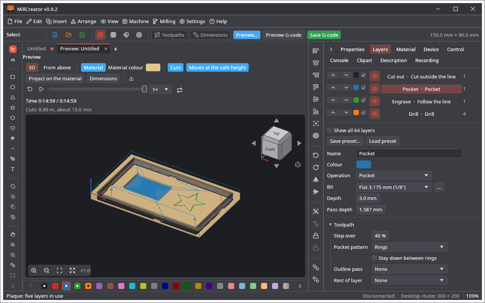
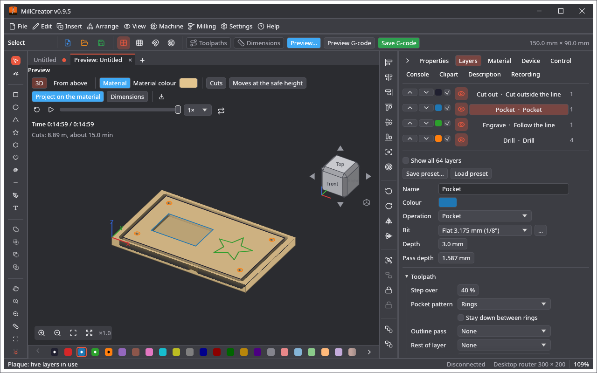
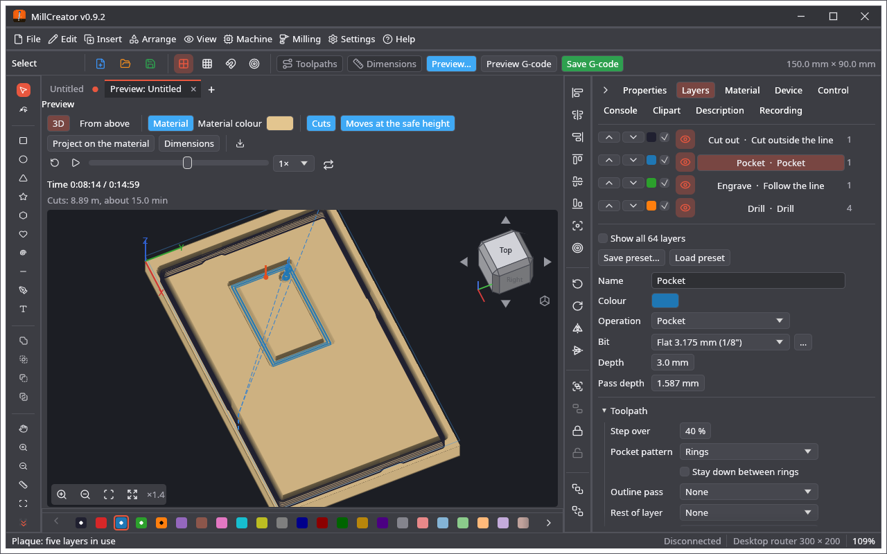

🌐 [English](3D-View-and-G-code) · [Polski](Widok-3D-i-G-code) · **简体中文** · [한국어](3D-View-and-G-code-KO)

> ⚠️ 本页由英文版机器翻译而成，可能有不准确之处。如有疑问，请以[英文版](3D-View-and-G-code)为准。欢迎提出修改建议。

# 3D 视图与 G-code

## 刀具路径
程序根据图形、图层、刀具和设备生成机器的运动。坐标为工作区的坐标：X 向右，Y 远离你（图纸会被翻转，因为编辑器的 Y 向下计数），Z = 0 位于材料顶面，向下为负（或者，在 **项目设置**（**Project setup**）中启用 **Z 从材料底部算起**（**Z counts from the bottom of the material**）后，为相对于材料底面的高度）。

* **轮廓**（**Profiles**）以刀具半径绕图形运行，分层切到图层的深度；下一层紧接着进行，不抬刀。
* **型腔**（**Pockets**）从轮廓向内以环形清除，各环相隔步距，或以光栅方式清除（参见[图层与操作](Layers-and-Operations-ZH)）。
* **沿线加工**（**Follow the line**）沿线条走过去再返回，一层接一层。
* **钻孔**（**Drill**）以每层切深为步长啄钻，中间退出到表面。
* 在两次切削之间，刀具上升到 **安全高度**（**safe height**），并以材料上方的移动速度在该高度移动，然后快速下降到表面以上 1 mm 处，再以下刀进给切入。

**刀具路径**（**Toolpaths**，工作区上方工具栏中的绿色按钮）在图纸上以图层的颜色绘制切削，以蓝灰色绘制材料上方的移动；再按一次即可隐藏。路径会跟随图纸的每次更改。

## 预览
**预览…**（**Preview…**，工作区上方的按钮）或 **铣削 → 任务的 3D 视图…**（**Milling → 3D view of the job…**，Ctrl+Shift+P）打开 **预览**（**Preview**）标签页，标题为 *Preview: 项目名称*。它与图纸一样是工作区的一个标签页：可以把它拖到另一个窗格，或右键单击并选择 **在单独窗口中打开**（**Open in a separate window**）（**返回主窗口**（**Back to the main window**）把它放回去）。其叉号用于关闭它。预览跟随当前图纸，并在项目每次更改后重新生成程序。

它只显示任务的区域，在每个方向上 **比任务大 10%**，以所选材料及其厚度的块料形式显示。

| 控件 | 作用 |
|---|---|
| **3D** / **俯视**（**From above**） | 3D 画面，或从正上方看到的任务平面图（无法旋转） |
| 左下角的缩放条（放大、缩小、**重置视图**（**Reset view**）、**显示全部对象**（**Fit all objects**））或双击 | 缩放；返回适合工作区的初始视图；显示全部对象 |
| **材料**（**Material**）、**切削**（**Cuts**）、**安全高度上的移动**（**Moves at the safe height**） | 显示或隐藏各部分；蓝色框为安全高度 |
| **材料颜色**（**Material colour**） | 视图中材料的颜色，不会改变项目的材料（**自动**（**Automatic**）恢复材料自身的颜色；随视图设置保存） |
| **在材料上显示项目**（**Project on the material**） | 在材料顶面上以图层颜色显示图纸中的图形（仅显示的图层）；初始关闭 |
| 下载图标 | **将铣削后的工件导出为 STL…**（**Export the milled piece as STL…**，见下文） |
| 左键拖动 | 旋转视图 |
| 右键或中键拖动 | 移动画面 |
| 鼠标滚轮 | 缩放 |
| 动画 | **回到开头**（**Back to the start**）、**播放**（**Play**）/ **暂停**（**Pause**）、滑块、**动画速度**（**Animation speed**，0.25× 至 25×）和 **重复**（**Repeat**）；任务显示到滑块所在位置，并标出刀具 |

**材料** 是铣削过程中的坯料：刀具的沟槽按滑块到达的位置雕刻在其顶面上，并使用每把刀具的真实形状（V 形刀越深越宽）。**切削** 在其上方以图层颜色添加刀具的路径。按钮下方显示：到滑块位置为止的 **时间**（**Time**）和总时间、切削长度及其时间估算，以及任务的警告（图层没有刀具、比材料或机器行程更深、主轴转速超出范围、超出工作区、对刀具而言过小的线条……）。

雕刻后的块料是基于网格的画面（小任务的网格更细），时间是根据进给得出的估算：有了设备的加速度（**机器**（**Machine**）页面）时，它会计算每次移动的加速和减速、较慢的转角以及 GRBL 较短的前瞻（15 段移动），并且机器在更换图层处会停下；没有加速度时，时间就是长度除以进给。G-code 查看器以相同的方式为该设备计算文件的时间。

**将铣削后的工件导出为 STL…** 把带有沟槽的坯料（到滑块所在位置为止；在末尾时为整个任务）保存为以毫米为单位的二进制 STL 模型。**铣削 → 将浮雕导出为 STL…**（**Milling → Export relief as STL…**）是另一种导出：仅导出图片的浮雕。

**使用旋转附件时**（设备设置 → 旋转轴，已开启），预览把工件显示为沿 X 方向的 **圆柱**：程序的 Y 是绕其表面的方向，因此图纸会缠绕在圆柱上，任务的中间朝上，切削和安全高度上的移动沿表面进行。切削朝向轴线向下。画面覆盖整整一圈，因此高于圆周的任务会在同一位置显示两次（程序会发出警告）。对于旋转轴，铣削后的工件不会导出为 STL（那将是一块平板）。

## 以文本形式显示 G-code：预览 G-code

**预览 G-code**（**Preview G-code**，位于工作区上方 **保存 G-code**（**Save G-code**）旁边）通过已启用的后处理器生成项目的程序，并 **在标签页中以文本形式**（*Preview G-code: name.nc*）显示，而不写入文件。它与 **导出 G-code…**（**Export G-code…**）写入的程序相同，以 `(MillCreator: name of the project)` 开头。每个项目只有一个这样的标签页；再次按该按钮会显示它。

* 文本带有 **着色**（G 和 M 字、坐标轴、速度和刀具、行号、注释），并且 **可以手动编辑**。有编辑的标签页会用一个圆点标记，其栏中会显示 *已手动更改*（*Changed by hand*）。
* 标签页中的 **保存 G-code** 把文本按原样写入文件。
* **重新生成**（**Make again**）从项目重新生成程序。有编辑时，第一次单击会询问 **放弃编辑？**（**Lose the edits?**），第二次单击才会重新生成。
* **分析**（**Analyse**）在 **G-code 分析**（**G-code analysis**）标签页中显示文本的刀具路径。
* 没有编辑时，文本会在最后一次更改半秒后自动 **跟随项目**：在项目保存时、**描述**（**Description**）标签页的文本（备注）更改时、设备的设置（包括其自定义 G-code）更改时，以及后处理器开启或关闭时。手动编辑绝不会因此被丢弃；图纸的更改会在下次保存后出现，或在使用 **预览 G-code** 或 **重新生成** 时出现。
* 关闭有编辑的标签页时会询问 **关闭前保存你的工作吗？**（**Save your work before closing?**）：**保存**（**Save**）、**放弃**（**Discard**）或 **取消**（**Cancel**）。

与预览一样，该标签页可以移到另一个窗格或单独的窗口中。

## 导出 G-code
**保存 G-code**（工作区上方的按钮）、**铣削 → 导出 G-code…**（**Milling → Export G-code…**，Ctrl+E）或 **文件 → 导出 ▸ 导出 G-code…**（**File → Export ▸ Export G-code…**）会询问文件名（`name.nc`；也可以选择 `.gcode` 和 `.ngc`）并写入程序。状态栏会说明文件保存到了哪里，并重复任务的警告。启用 **设置 → 视图选项… → 保存后预览 G-code**（**Settings → View options… → Preview G-code after saving**，默认关闭）后，保存的文件随后会在 **G-code 分析** 中打开。

文件为 GRBL 风格：

* 文件头注释 `(MillCreator: name)` 和 `(Device: name)`，然后项目 **描述** 标签页中的每一行对应一行 `(Note: …)`（括号和分号会被替换，以保证注释完整；最多 60 行，每行 100 个字符）；
* `G21 G90 G17`，选择了工件坐标系时的工件坐标字（`G54` … `G59`），以及设备用于开始的自定义 G-code；
* 每个图层一个 `(Layer: name)` 注释；主轴为 `M3 S…`，启动时有设备设定的等待 `G4 P…`；材料上方的移动用 `G0`，下刀和切削用带进给的 `G1`；
* **说明每部分在哪里开始和结束的注释**（便于阅读文件和找到停止的任务）：`(Job: …)` 包含图层数、移动数和切削长度；每个 `(Layer: name)` 下方为其在任务中的部分和操作、深度及其分层、进给、主轴和刀具；`(Contour 2 of 5 start: … mm round)` / `(Contour 2 end)`、`(Line …)`、`(Hole …)`、`(Picture …)`、`(Depth 1 of 3: … mm)`，型腔的侧壁、清除和精加工走刀，V 雕及其各环，首次浅切，启用 **一次一个元素**（**One element at a time**）时的 `(Element 1 of 4 start)`，`(End of layer …)` 和 `(End of the job)`。注释最多 70 个字符（按 GRBL 缓冲区 128 个字符计数的发送程序绝不会发送更长的行）。设备设置中的 **删除注释**（**Remove comments**）会略去所有注释；
* 结尾：上升到安全高度，`M5`，回到零点上方，设备用于结束的自定义 G-code，以及 `M30`。

当下一个图层使用另一把刀具时，文件会在主轴关闭后以 `M0 (Change the bit to: …)` 暂停。使用 **换刀装置**（**tool changer**）时，换刀改为 `T<n> M6`（刀具需要在刀具库中设置其 **换刀位号**（**Changer number**））。**冷却液**（**Coolant**，`M7` / `M8`、`M9`）和 **吸尘器**（**dust collector**）的代码行跟随各图层。使用 **项目设置** 时，程序从你选择的零点开始计算（在 `G54` 中，除非设备使用其他代码）；启用 *Z 从材料底部算起* 时，每个 Z 都是相对于底面的高度。设备的自定义 G-code、文件最开头和最末尾的内容、其变量以及 **自定义文件格式**（**Own file format**）位于设备设置的 **G-code** 页面上（[设备与摄像头](Devices-and-Cameras-ZH)）。插件提供的 **后处理器**（**postprocessor**，例如 *G-code dialects* 中的 Mach3 / Mach4 / UCCNC 或 LinuxCNC）会在最后重写文件。用 **开始**（**Start**）启动的任务在发送时不经过后处理器。

每种操作的移动在文件和预览中都与写入的完全一致：斜坡、螺旋、连接桥、V 雕在各自深度上的环。

## G-code 分析
**文件 → 查看 G-code 文件…**（**File → View G-code file…**，启动界面上也有，或者把 G-code 文件拖放到窗口上）在 G-code 分析中打开任意 G-code 文件，即以文件命名的标签页（**G-code 查看器**（**G-code viewer**））：其刀具路径，平面显示，或在 Z 变化时以 3D 显示，**显示空行程移动**（**Show travel moves**）、**按高度着色**（**Colour by height**）、切削长度和时间。拖动用于移动（在 3D 中用于旋转；右键拖动或 Shift+拖动用于移动），滚轮用于缩放，Esc 关闭它。
