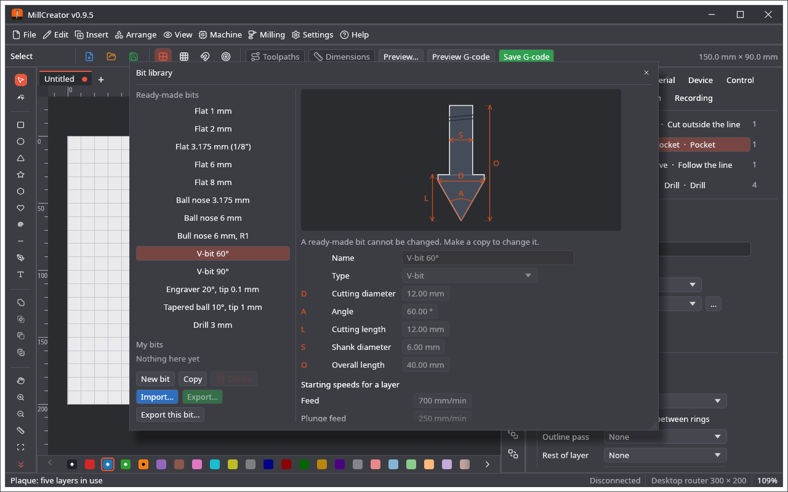
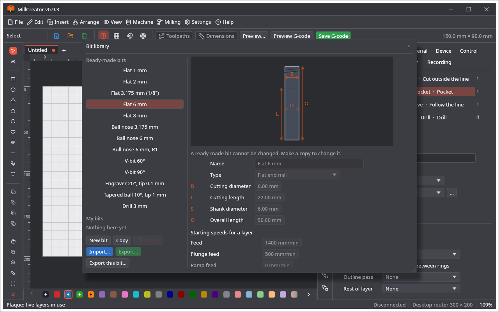
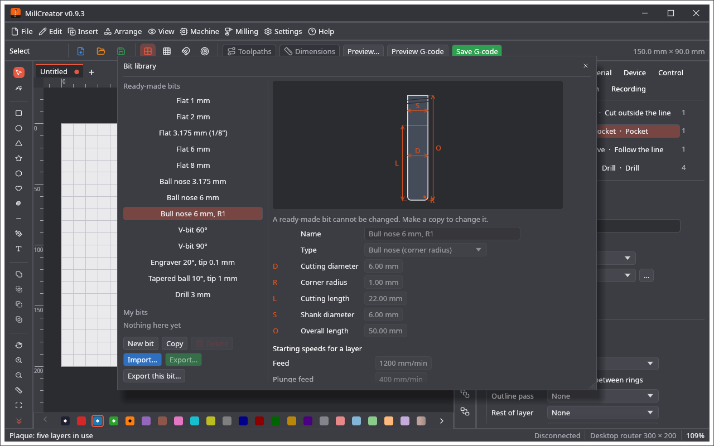
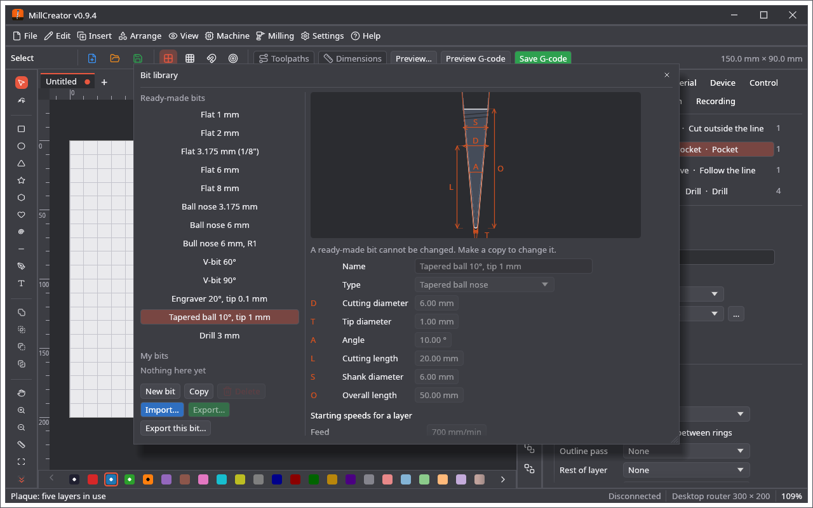
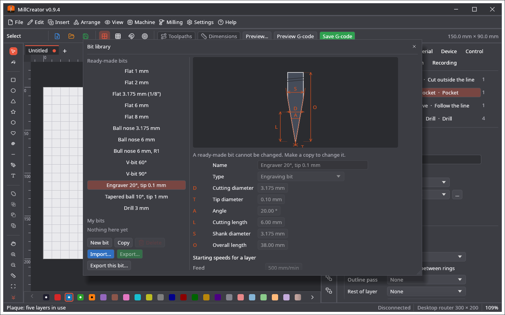

🌐 [English](Bit-Library) · [Polski](Biblioteka-frezow) · [简体中文](Bit-Library-ZH) · **한국어**

> ⚠️ 이 페이지는 영어판을 기계 번역한 것으로, 부정확한 부분이 있을 수 있습니다. 의심스러우면 [영어판](Bit-Library)을 기준으로 하십시오. 수정 제안을 환영합니다.

# 비트 라이브러리

**밀링 → 비트 라이브러리…**(Milling → Bit library…)(또는 레이어의 비트 옆에 있는 **…** 버튼)는 라이브러리를 엽니다. 왼쪽에는 프로그램의 **기성 비트**(ready-made bits)와 **내 비트**(My bits)가 있고, 오른쪽에는 선택한 비트의 그림, 치수, 시작 속도, 메모가 있습니다.

## 그림
모든 비트 종류는 단면으로 그려지며, **각 치수를 재는 위치에 그 글자**가 표시됩니다: D는 가장 넓은 절삭부를 가로질러, L은 절삭부를 따라, O는 비트 전체를 따라, S는 생크를 가로질러, R은 모서리에서, A는 옆면의 각도로, T는 팁을 가로질러 잽니다. 같은 글자가 입력 필드 옆에도 있습니다. 긴 생크는 끊김 표시와 함께 짧게 그려집니다.

|  |  |
|---|---|
| 평엔드밀 | 불노즈 |
|  |  |
| 테이퍼 볼엔드밀 | 조각용 비트 |

## 종류와 치수
| 종류 | 치수 |
|---|---|
| 평엔드밀 | D 절삭 지름, L 절삭 길이, S 생크 지름, O 전체 길이 |
| 볼엔드밀 | D, L, S, O (반지름은 D/2) |
| 불노즈 (모서리 반지름) | D, R 모서리 반지름, L, S, O |
| V-비트 | D, A 각도, L, S, O |
| 조각용 비트 | D, T 팁 지름, A 각도, L, S, O |
| 테이퍼 볼엔드밀 | D, T 팁(볼) 지름, A 테이퍼 각도, L, S, O |
| 드릴 | D, A 선단 각도, L, S, O |

## 내 비트
* **새 비트**(New bit)는 단순한 기본값으로 비트를 만듭니다. **복사**(Copy)는 선택한 비트(기성 비트도 가능)의 복사본을 내 비트에 만듭니다. **삭제**(Delete)는 내 비트를 지웁니다. 기성 비트는 바꾸거나 지울 수 없으므로, 바꾸려면 복사하십시오.
* 숫자가 유효해지는 즉시 변경 내용이 저장됩니다(절삭 길이는 비트보다 길 수 없고, 모서리 반지름은 지름의 절반을 넘을 수 없으며, 팁은 비트보다 넓을 수 없습니다). 잘못된 숫자는 비트 아래에 설명이 나오며 저장되지 않습니다.
* **내 비트는 모든 장치에 대해 한 번만 보관됩니다.** 프로그램 설정과 함께 저장됩니다.
* **내보내기…**(Export…)는 내 비트 전체를 JSON 파일로 씁니다. **이 비트 내보내기…**(Export this bit…)는 선택한 비트(기성 비트도 가능)를 씁니다. **가져오기…**(Import…)는 그런 파일을 읽습니다. 모든 비트를 검사하고 고유한 ID와 이름을 붙이며, 숫자가 잘못된 비트는 빠지고 그 이름이 표시됩니다. 더 새로운 형식이나 4 MB가 넘는 파일은 거부됩니다.
* 프로젝트는 레이어가 사용하는 비트를 담고 다닙니다([프로젝트 파일](Project-File-KO) 참고). 그 비트가 없는 곳에서 열면 **내 비트**에 추가되고 상태 표시줄에 그렇게 표시됩니다.

## 시작 속도
각 비트에는 이송 속도, 플런지 이송 속도, **램프 이송 속도**(ramp feed)(램프나 헬릭스로 내려갈 때; 0 = 플런지 이송 속도), 스핀들 속도, 패스 깊이(지름의 백분율), 스텝오버(백분율), 날 수가 있습니다. 레이어는 비트를 고를 때 이 값을 가져옵니다. 그 아래에는 지름과 **날 수**(Flutes)로 계산한 **절삭 속도 (Vc)**(Cutting speed), **날당 이송 (fz)**(Feed per tooth), **날당 플런지**(Plunge per tooth)가 있습니다. 하나를 입력하면 스핀들 속도나 이송 속도가 바뀝니다([레이어와 작업](Layers-and-Operations-KO#절삭-속도와-날당-이송) 참고). 기성 비트의 수치는 무른 목재와 플라스틱을 위한 조심스러운 출발점입니다. **내 기계, 재료, 커터에 맞게 조정하십시오.**

**교환기 번호**(Changer number)는 공구 교환기에서 비트의 자리입니다. **공구 교환기**(Tool changer)가 켜진 장치(장치 설정, 스핀들 페이지)에서는 프로그램이 `T<number> M6`으로 비트를 요청하고 멈추지 않고 계속합니다. 0은 비트가 교환기에 없다는 뜻이며, 기계는 평소처럼 손으로 교체하도록 멈춥니다. 이 번호는 사용자 G-code의 변수 `{tool_number}`이기도 합니다.
