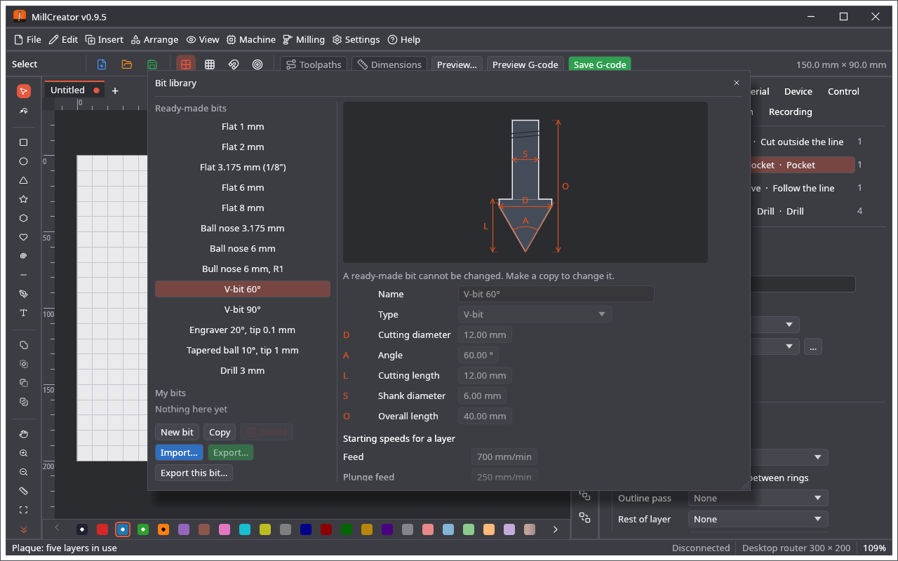
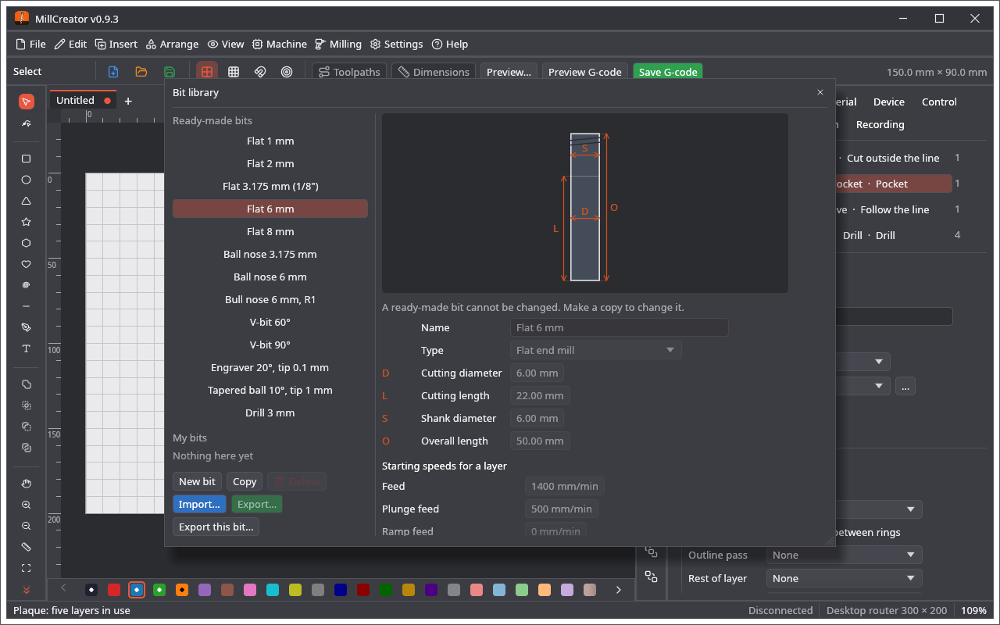
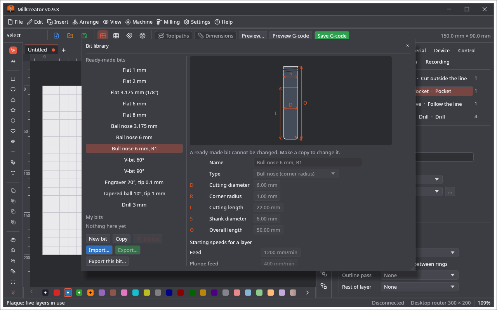
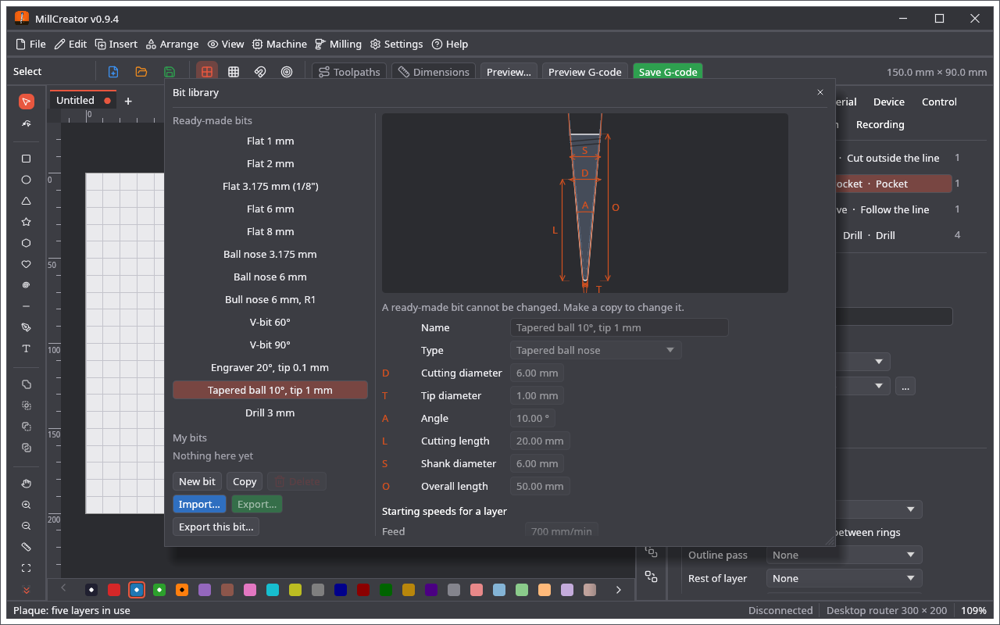
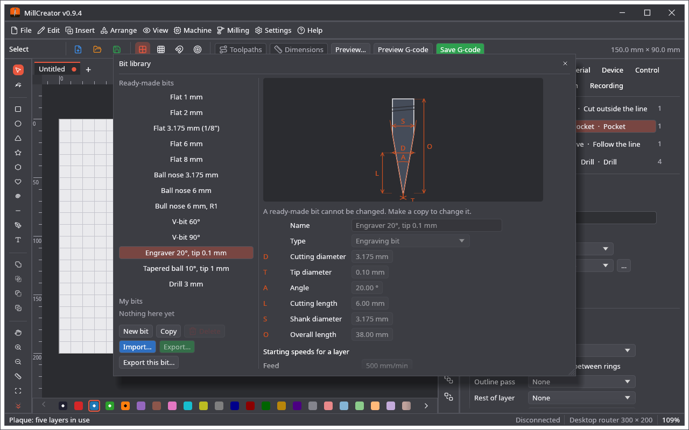

🌐 [English](Bit-Library) · [Polski](Biblioteka-frezow) · **简体中文** · [한국어](Bit-Library-KO)

> ⚠️ 本页由英文版机器翻译而成，可能有不准确之处。如有疑问，请以[英文版](Bit-Library)为准。欢迎提出修改建议。

# 刀具库

**铣削 → 刀具库…**（**Milling → Bit library…**，或图层刀具旁边的 **…** 按钮）打开刀具库。左侧：程序的 **现成刀具**（**ready-made bits**）和 **我的刀具**（**My bits**）。右侧：所选刀具的图片、尺寸、初始速度和备注。

## 图片
每种刀具都以剖面图绘制，并 **在每个尺寸的测量位置标出其字母**：D 横跨最宽的切削部分，L 沿切削部分，O 沿整把刀具，S 横跨刀柄，R 在转角处，A 为侧面的角度，T 横跨刀尖。输入字段旁边也标有相同的字母。较长的刀柄会以断开的方式画短。

|  |  |
|---|---|
| 平底立铣刀 | 牛鼻刀 |
|  |  |
| 锥度球头刀 | 雕刻刀 |

## 类型和尺寸
| 类型 | 尺寸 |
|---|---|
| 平底立铣刀 | D 切削直径、L 切削长度、S 刀柄直径、O 总长 |
| 球头刀 | D、L、S、O（半径为 D/2） |
| 牛鼻刀（圆角半径） | D、R 圆角半径、L、S、O |
| V 形刀 | D、A 角度、L、S、O |
| 雕刻刀 | D、T 刀尖直径、A 角度、L、S、O |
| 锥度球头刀 | D、T 刀尖（球头）直径、A 锥角、L、S、O |
| 钻头 | D、A 顶角、L、S、O |

## 你自己的刀具
* **新建刀具**（**New bit**）以普通的默认值创建一把刀具；**复制**（**Copy**）把所选刀具（包括现成刀具）复制到你的刀具中；**删除**（**Delete**）移除你自己的一把刀具。现成刀具无法更改或删除；如需更改，请先复制一份。
* 只要数值有效，更改就会立即保存（切削长度不能比刀具更长，圆角半径不能超过直径的一半，刀尖不能比刀具更宽）。错误的数值会在刀具下方给出说明，并且不会被保存。
* **我的刀具只保存一份，适用于所有设备**，随程序的设置一起保存。
* **导出…**（**Export…**）把你的所有刀具写入一个 JSON 文件；**导出此刀具…**（**Export this bit…**）写出所选的刀具（也可以是现成刀具）。**导入…**（**Import…**）读取这样的文件：每把刀具都会被检查，获得自己的 ID 和名称，数值错误的刀具会被略去并列出名称。较新的格式或超过 4 MB 的文件会被拒绝。
* 项目会携带其图层使用的刀具（参见[项目文件](Project-File-ZH)）。在缺少这些刀具的地方打开项目时，它们会被添加到 **我的刀具** 中，状态栏会给出提示。

## 初始速度
每把刀具都有进给、下刀进给、**斜坡进给**（**ramp feed**，用于斜坡或螺旋下降；0 = 下刀进给）、主轴转速、每层切深（直径的百分比）、步距（百分比）以及刃数。选择刀具时，图层会采用这些值。它们下方根据直径和 **刃数**（**Flutes**）计算出 **切削速度 (Vc)**（**Cutting speed (Vc)**）、**每齿进给 (fz)**（**Feed per tooth (fz)**）和 **每齿下刀量**（**Plunge per tooth**）；输入其中一个会改变主轴转速或进给（参见[图层与操作](Layers-and-Operations-ZH#切削速度和每齿进给)）。现成刀具的数值是针对软木和塑料的保守起点：**请根据你的机器、材料和刀具进行调整**。

**换刀位号**（**Changer number**）是刀具在换刀装置中的位置：对于开启了 **换刀装置**（**Tool changer**，设备设置的主轴页面）的设备，程序会用 `T<number> M6` 调用该刀具，并且不暂停地继续。0 表示该刀具不在换刀装置中，机器会像往常一样停下来等待手动换刀。该编号也是自定义 G-code 中的变量 `{tool_number}`。
