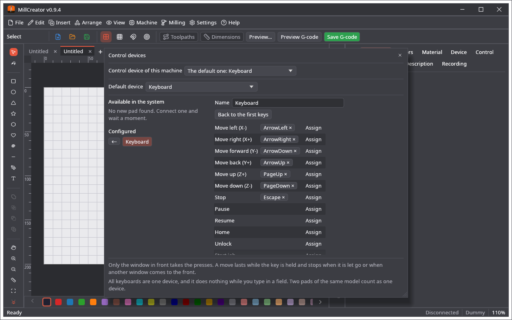

🌐 [English](Control-Devices) · [Polski](Urzadzenia-sterujace) · **简体中文** · [한국어](Control-Devices-KO)

> ⚠️ 本页由英文版机器翻译而成，可能有不准确之处。如有疑问，请以[英文版](Control-Devices)为准。欢迎提出修改建议。

# 控制设备

可以用 USB 手柄或键盘驱动机器。**机器 → 控制设备 ▸**（**Machine → Control devices ▸**）有两个条目：**控制设备设置…**（**Control device settings…**）打开设备及其按键的窗口，**本机的控制设备…**（**Control device of this machine…**）为当前打开的机器选择设备。

## 设备

窗口中有两个列表。**系统中可用**（**Available in the system**）显示键盘以及尚未设置的已连接手柄，**已配置**（**Configured**）显示已经设置好的设备。箭头按钮把设备从一个列表移到另一个列表。移回去的设备会保留其按键，以防它再次被使用。

* 计算机上的所有键盘算作一个设备：系统不会告诉窗口按下的是哪个键盘。
* 每种手柄型号是一个设备，有自己的按键；同一型号的两个手柄算作一个。
* **默认设备**（**Default device**）选择每台机器和每个程序都使用的设备（除非某台机器有自己的设备），或选择 **无默认设备**（**No default device**）。你配置的第一个设备会成为默认设备。

设备和默认设备在 LightCreator、MillCreator 和 PenCreator 之间共享。在一个程序中所做的更改会在一秒内传到其他程序。

## 按键

动作旁边的 **分配**（**Assign**）会等待在所选设备上按下按键。一个按键或按钮只做一件事：把它分配给另一个动作时，会从第一个动作上取下。摇杆相当于两个按钮，每个方向一个。按键上的 **×** 用于移除它，**恢复初始按键**（**Back to the first keys**）重新开始。**最后按下**（**Last pressed**）显示设备发送的内容，这对按钮没有名称的手柄很有帮助。

新设备只有移动和停止。任何会开启某样东西的动作，在你为其分配按键之前都没有按键。每个设备都保存三个程序的全部按键；这里显示的是 MillCreator 能做的事情：

移动 X、Y 和 Z，停止，暂停，继续，回原点，解锁，开始任务，边框，**主轴开 / 关**（**Spindle on / off**，以控制标签页上的转速），**气冷开 / 关**（**Air on / off**，M7）以及 **水冷开 / 关**（**Water on / off**，M8）。

## 机器的设备

**本机的控制设备…** 为当前打开的机器选择一个设备。一个设备可以服务多台机器。没有自己的设备或其设备已被移除的机器使用默认设备。没有默认设备时，什么也不会发生。

## 工作方式

* 只有最前面的窗口接收按键，并且按键会发送到该窗口中打开的机器。
* 按住按键期间移动持续进行（GRBL 1.1）；在较旧的控制器上，每按一次走一步。当你松开按键、另一个窗口切到前面、手柄断开或你更换机器时，移动会停止。
* 任务期间只有停止、暂停和继续有效。
* 设置窗口打开期间机器不会响应：你正在选择按键。
* 当你在字段中输入或按住 Ctrl、Cmd 或 Alt 时，键盘不起作用。连接了机器时，其按键发送到机器，而不是编辑器：使用初始按键时，方向键将不再移动所选图形，直到你断开连接。
* 控制设备不能代替急停开关。请把手放在真正的急停开关附近。

## 备份

设备、其按键以及默认设备都包含在三个程序各自的备份中（`app.ron` 中的 `control_devices`），而机器所选择的设备随机器保存。恢复会替换所有三个程序中的定义，因为它们是共享的；不含这些内容的旧备份不会改动它们。在磁盘上，它们保存在共享数据文件夹中的 `control_devices.json` 中。
