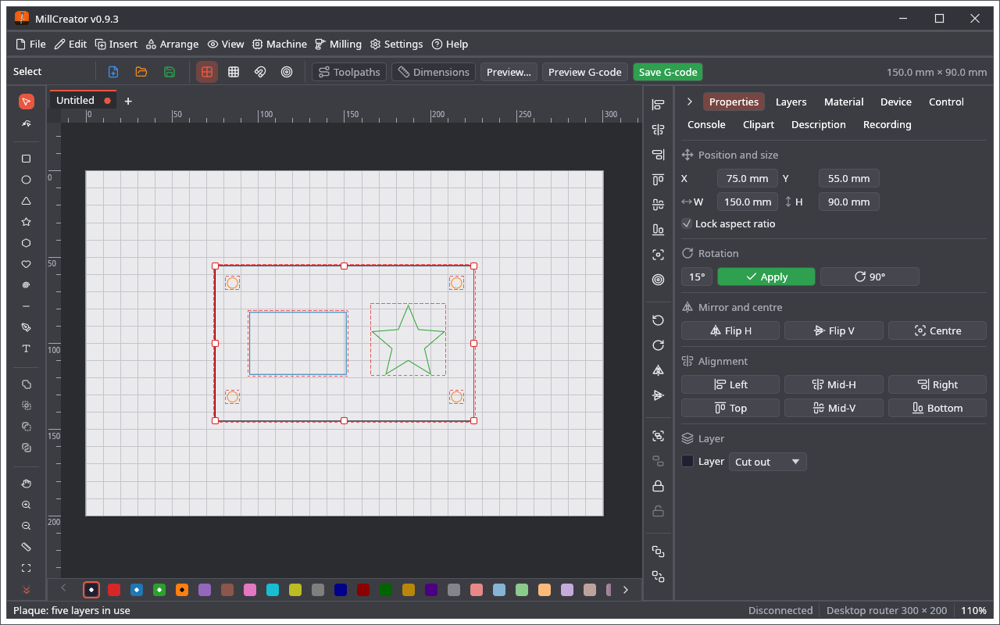
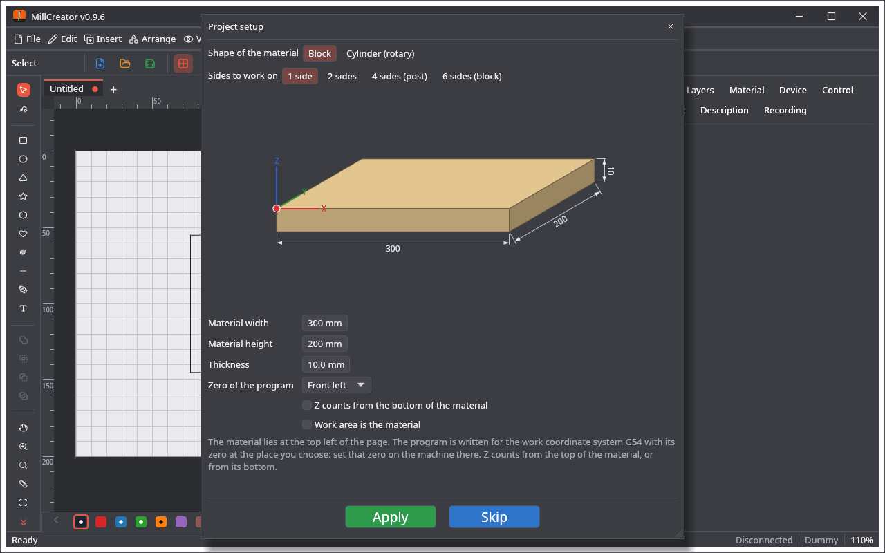
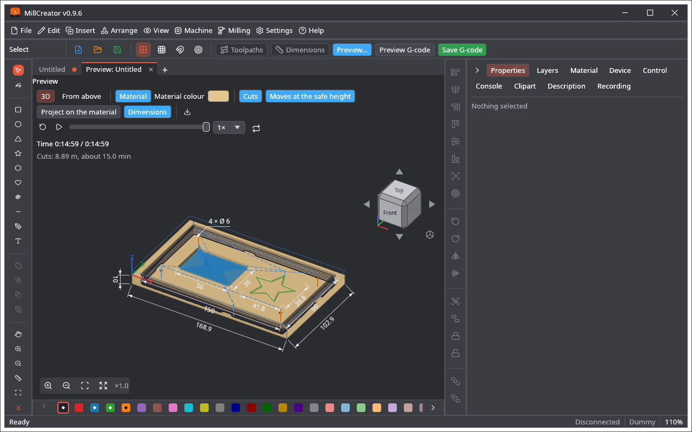
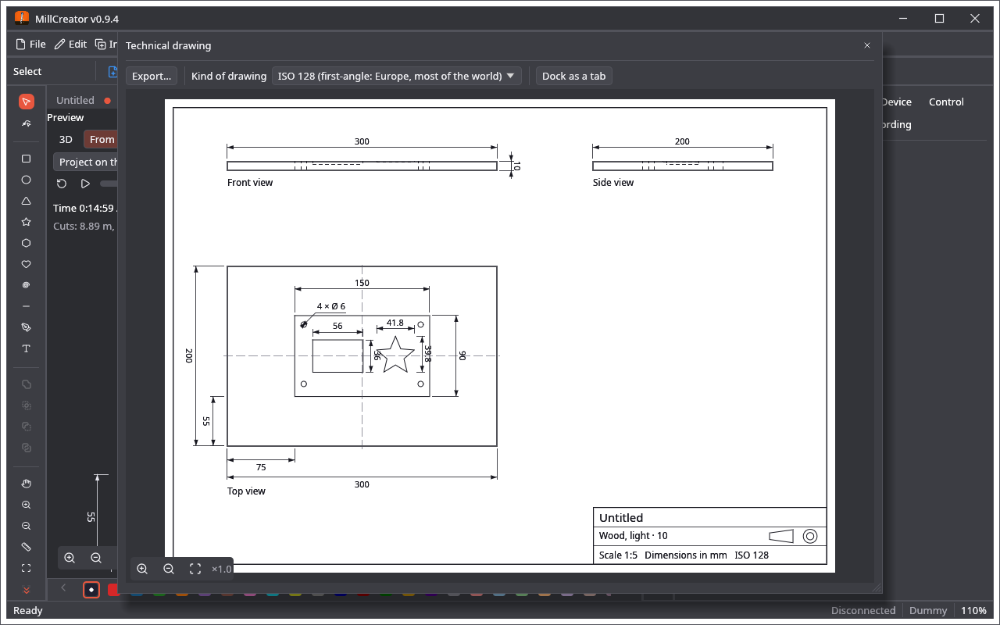

🌐 [English](Design-Tools) · [Polski](Narzedzia-projektowe) · [简体中文](Design-Tools-ZH) · **한국어**

> ⚠️ 이 페이지는 영어판을 기계 번역한 것으로, 부정확한 부분이 있을 수 있습니다. 의심스러우면 [영어판](Design-Tools)을 기준으로 하십시오. 수정 제안을 환영합니다.

# 디자인 도구

편집기는 baseCreator의 편집기로, LightCreator와 같습니다.

* **도구**(Tools)(왼쪽): 선택, 노드 편집, 사각형, 타원, 삼각형, 별, 다각형, 하트, 나선, 선, 펜, 텍스트, 이동, 확대, 축소. 글자 키로 도구를 고릅니다(V, N, R, E, Y, S, G, K, I, L, P, T, H, Z, X: [키보드 단축키](Keyboard-Shortcuts-KO) 참고). 개체를 삽입하는 도구는 **삽입**(Insert) 메뉴에도 있습니다. 새 도형은 활성 레이어에 들어갑니다.
* **핸들**(Handles)은 선택 항목을 옮기고, 크기를 바꾸고, 돌리고, 기울입니다. **정렬 막대**(arrange bar)(오른쪽)는 맞춤, 분배, 순서, 그룹, 뒤집기, 잠금을 합니다.
* **속성**(Properties) 탭: 위치와 크기, 회전, 대칭, 맞춤.
* **편집**(Edit) 메뉴: **실행 취소**(Undo), **다시 실행**(Redo), **복사**(Copy), **붙여넣기**(Paste), **복제**(Duplicate), **삭제**(Delete), **모두 선택**(Select all). 그룹, 잠금, 순서, 맞춤, 불리언 연산, 오프셋, 모서리 둥글리기는 **정렬**(Arrange) 메뉴에 있습니다. 모든 항목과 단축키: [메뉴](Menus-KO).
* **격자와 맞추기:** 보기 메뉴와 **설정 → 보기 옵션…**(Settings → View options…)
* **가져오기:** **파일 → 열기…**(File → Open…)는 SVG, PDF, Illustrator 파일(PDF 호환 또는 예전 PostScript 방식)과 `.cre` 프로젝트를 읽습니다. 끌어 놓기도 됩니다. 각각 별도의 탭에서 열립니다. **파일 → 가져오기 → SVG 가져오기…**(File → Import → Import SVG…)(Ctrl+I)와 **Adobe Illustrator / PDF / EPS / VectorCraft 가져오기…**(Import Adobe Illustrator / PDF / EPS / VectorCraft…)는 경로를 열린 도면에 추가하며, 각 경로는 색이 가장 가까운 레이어에 들어갑니다(SVG의 그림은 활성 레이어에). Illustrator 레이어가 있는 파일은 색 기준으로 할지 그 레이어 기준으로 할지 묻습니다. **파일 → 가져오기 → DXF 가져오기…**(File → Import → Import DXF…)(또는 **파일 → 열기…** 및 끌어 놓기)는 ASCII `.dxf`(R12 이상)를 읽습니다. 선, 벌지가 있는 폴리라인, 호, 원, 타원, 스플라인, 블록(배율과 회전 포함)이 밀리미터 단위의 윤곽선으로 들어오며(파일의 단위를 읽습니다), 호와 원은 곡선이 됩니다. 0.01 mm 이내에서 맞닿는 선은 하나의 경로가 되므로, 그려진 사각형은 하나의 닫힌 도형이 됩니다. DXF의 레이어는 아직 도형이 없는 프로젝트 레이어에 차례로 들어갑니다(상태 표시줄에 어디로 갔는지 표시됩니다). 선이 아닌 것(텍스트, 해치, 치수)은 제외되며 그 이름이 표시됩니다. 바이너리 DXF는 먼저 ASCII로 저장해야 합니다. **파일 → 가져오기 → LightBurn / MillMage 프로젝트 가져오기…**(File → Import → Import LightBurn / MillMage project…)는 LightBurn의 `.lbrn2` / `.lbrn`와 MillMage의 `.mage`를 읽습니다. 사각형, 타원, 다각형, 별, 곡선이 있는 경로, 그룹, 텍스트가 윤곽선으로 들어옵니다(LightBurn과 MillMage의 레이어는 여기서 의미가 없습니다). **UGS 디자인 가져오기…**(Import UGS design…)는 UGS Designer의 `.ugsd` 파일을 읽습니다. 경로, 사각형, 타원, 텍스트, 그림, 숨겨진 개체까지 들어오며, 각 절삭 방식(바깥쪽, 안쪽, 경로 위, 포켓, 드릴)은 깊이, 이송 속도, 스핀들 속도를 가진 레이어 설정이 되고, 파일의 공구 지름을 가진 평엔드밀 비트가 라이브러리에 추가됩니다. 가져오기는 도형을 열린 도면에 추가하며(실행 취소 한 번으로 되돌릴 수 있습니다), 파일의 레이어는 아직 도형이 없는 곳에만 사용합니다.
* **다른 프로그램의 파일, 양방향:** DXF(현재 방식과 R12, *legacy*), Illustrator(예전 PostScript 방식 포함), 그림이 있는 SVG, LightBurn(`.lbrn2`, `.lbrn`) 및 MillMage(`.mage`) 프로젝트를 읽고, 같은 형식으로 다시 씁니다. **파일 → 내보내기**(File → Export)가 이를 씁니다: **SVG 내보내기…**(Export SVG…) 외에 **DXF 내보내기…**(Export DXF…)(현재 방식), **DXF R12 (레거시) 내보내기…**(Export DXF R12 (legacy)…), **Adobe Illustrator 내보내기…**(Export Adobe Illustrator…), **LightBurn 프로젝트 내보내기…**(Export LightBurn project…)(`.lbrn2`, 또는 파일 이름을 그렇게 지으면 `.lbrn`), **MillMage 프로젝트 내보내기…**(Export MillMage project…). 곡선은 유지되며(DXF는 0.01 mm로 평탄화합니다), 그림은 SVG, LightBurn, MillMage 파일에 들어가고 DXF와 Illustrator 파일에서는 제외됩니다(몇 개가 제외되었는지 프로그램이 알려 줍니다).
* **클립아트:** 그림 310개의 갤러리와 내 그림, 온라인 검색([LightCreator와 같음](https://github.com/michalsarna/LightCreator/wiki/Clipart-Gallery)). 그림은 일반 도형으로 배치됩니다.
* 도형 위에서 **마우스 오른쪽 버튼**을 누르면 컨텍스트 메뉴가 열립니다: 복사, 붙여넣기, 복제, 삭제, 모두 선택, 그룹, 그룹 해제, 잠금, 잠금 해제, 뒤집기, 회전, *정렬*(*Arrange*) 하위 메뉴(순서, 맞춤, 중앙 맞춤, 노드 편집, 경로로 변환), *도형 연산*(*Shape operations*) 하위 메뉴(합집합, 교집합, 빼기, 배타적 합, 도형 오프셋, 모서리 둥글리기, 곡선으로 변환; **정렬** 메뉴에도 있습니다). 그림이면 *이미지 조정…*(*Adjust image…*)과 *이미지 트레이스…*(*Trace image…*)도 있습니다. 선택 항목에 맞지 않는 항목은 회색입니다.
* **연결과 내보내기(정렬 메뉴):** **경로 자동 연결…**(Auto-join paths…)은 허용 오차 이내에서 맞닿는 선택된 선들을 더 긴 경로로 잇고, 한 바퀴 돌아오는 경로는 닫습니다. **허용 오차로 경로 닫기…**(Close path with tolerance…)는 두 끝이 그만큼 가까운 경로만 닫습니다(같은 작은 창, 처음 값 0.1 mm). **SVG 내보내기…** 및 **PLT / DXF 내보내기…**(Export PLT / DXF…)(파일 → 내보내기)는 도면 전체를 윤곽선으로 쓰고, **선택 영역을 SVG로 내보내기…**(Export selection as SVG…) / **DXF로…**(as DXF…)는 선택한 도형(아무것도 선택하지 않았으면 전체)을 다른 프로그램용으로 씁니다. SVG는 곡선을 유지하고, DXF는 프로젝트 레이어마다 DXF 레이어가 하나씩 있는 R12입니다.
* **그림(비트맵):** **파일 → 가져오기 → 이미지 가져오기…**(File → Import → Import image…)(또는 PNG, JPG, BMP, GIF, WebP 파일을 창에 끌어 놓기)는 가져오기 대화 상자를 엽니다: 회전, 뒤집기, 밝기, 대비, 감마, 자동 레벨, 반전, 크기. **이미지 조정…**(Adjust image…)(속성 탭의 *이미지*(*Image*) 구역 또는 **정렬 → 이미지 조정…**)은 페이지의 그림을 바꾸고, **이미지 트레이스…**(Trace image…)(같은 버튼 또는 **정렬 → 이미지 트레이스…**)는 어두운(또는 밝은) 영역을 윤곽선으로 바꿉니다(임계값, 잡티 필터, 단순화, 곡선 다듬기). 이 윤곽선은 다른 도형처럼 가공됩니다. 그림을 레이어에 넣으면 레이어가 **그림**(Picture) 작업으로 바뀌고 그림이 조각됩니다([레이어와 작업](Layers-and-Operations-KO) 참고). 다른 작업을 가진 레이어에서는 표시만 되고 가공되지 않습니다. **정렬 → 스타일 트레이스…**(Arrange → Style trace…)는 그림을 21가지 스타일(꼬불선, 나선, 점묘, 해칭, 흐름선, 한 줄 그리기…) 중 하나의 선으로 다시 그립니다: [스타일 트레이스](Style-Trace-KO)를 참고하십시오.
* **이미지 편집…**(Edit image…)(**정렬** 메뉴, 마우스 오른쪽 버튼 메뉴, 또는 **그림 스타일**(Picture styles) 탭의 주황색 버튼)은 선택한 그림의 사진 편집기를 엽니다: **브러시**(brush), **지우개**(eraser)(흰색으로 칠합니다), **복제 도장**(clone stamp)(Ctrl+클릭, Mac에서는 Cmd+클릭으로 복사할 곳을 정한 다음 칠합니다), 클릭한 곳 주변의 비슷한 회색 영역을 **채우기**(fill). 회색조 전용이며 크기, 경도, 불투명도, 허용 오차, 실행 취소와 다시 실행이 있습니다. 휠은 확대/축소하고, 오른쪽 또는 가운데 버튼은 그림을 이동합니다. 도면은 **적용**(Apply)을 눌러야 바뀝니다.
* **이미지로 변환…**(Convert to image…)(도형을 선택하고 그 안에 그림이 없을 때)은 도형들을 하나의 그림으로 바꿉니다: 미리 보기, 해상도(DPI), 크기, 채워진 닫힌 도형, 선 두께. **변환 후 개체 삭제**(Delete the objects afterwards)는 도형을 지우고, **개체 숨기기**(Hide the objects)는 미리 보기에서만 윤곽선을 뺍니다.
* **이미지 트레이스**(Trace image)와 **스타일 트레이스**(Style trace) 창의 **그림 숨기기**(Hide the picture)는 미리 보기에 결과만 보여 줍니다.
* **사이드 패널:** 탭을 끌어 다른 곳에 놓습니다(순서는 기억되며 백업에도 들어갑니다). 탭 왼쪽의 작은 화살표는 패널을 숨깁니다. 탭 이름이 있는 좁은 띠가 남으며, 이름을 클릭하면 그 탭으로 패널이 열립니다.
* **탭과 창 영역:** 열린 도면, 미리 보기, 프로젝트의 G-code 텍스트, G-code 파일 분석, 카메라는 모두 **탭**입니다. *보기 → 분할 보기*(*View → Split view*)는 작업 영역을 최대 세 개의 창 영역으로 나눕니다(좌우 또는 상하; *단일 보기*(*Single view*)는 모든 탭을 다시 한데 모읍니다). 창 영역마다 자체 탭 막대가 있으며 선택 목록은 없습니다. **탭을 끌어** 다른 창 영역에 놓거나(또는 같은 막대의 다른 자리에) 탭 메뉴(오른쪽 클릭)를 사용하십시오: *창 영역 N으로 이동*(*Move to pane N*)(다른 창 영역, 그리고 공간이 있으면 새 창 영역), *별도 창에서 열기*(*Open in a separate window*)(미리 보기, G-code 텍스트, 카메라; 창은 위치를 기억하며 **메인 창으로 돌아가기**(Back to the main window)는 탭을 되돌립니다), *탭 닫기*(*Close tab*). 창 영역의 마지막 탭을 닫으면 그 창 영역이 닫히고 나머지가 자리를 채웁니다. 무엇도 두 번 열리지 않습니다. 이미 열린 프로젝트를 열면 그 탭이 표시되고, 프로젝트마다 미리 보기, 카메라 보기, G-code 텍스트는 하나씩입니다. 다른 창 영역의 도면은 보기용으로 표시되며 자체 확대/축소를 가집니다. 클릭하면 활성 도면이 됩니다. 배치는 기억됩니다. 단계별 안내: [창 영역과 탭](Panes-and-Tabs-KO).
* **레이어 이름:** *설정 → 보기 옵션 → 레이어 이름 표시*(*Settings → View options → Show layer names*)(기본값은 꺼짐)는 작업 영역 아래 레이어 줄에서 도형이 있는 레이어의 색 옆에 레이어 이름을 씁니다(긴 이름은 잘리고 전체 이름은 툴팁에 있습니다. 줄이 가득 차면 옆으로 스크롤됩니다).
* **변수 이름:** *설정 → 보기 옵션 → 변수 이름 표시*(*Settings → View options → Show variable names*)(기본값은 꺼짐)는 사용자 G-code용 변수가 있는 모든 필드의 이름표 옆에 변수 이름을 기울임꼴과 괄호로, 예를 들어 *(tool_diameter)* 형식으로 보여 줍니다. 클릭하면 `{tool_diameter}`가 클립보드에 복사되어 사용자 G-code 상자에 바로 붙여 넣을 수 있습니다.
* **G-code 미리 보기:** *G-code 저장*(*Save G-code*) 옆의 버튼은 프로젝트의 프로그램을(포스트프로세서를 거쳐) 만들어 **탭에 텍스트로** 보여 줍니다(*Preview G-code: name.nc*). 색으로 구분되며(G와 M 워드, 축, 속도, 주석) 편집할 수 있습니다. 탭의 *G-code 저장*은 파일로 쓰고, *다시 만들기*(*Make again*)는 프로젝트에서 다시 만들며(편집한 내용이 있으면 첫 클릭에서 *편집 내용을 버릴까요?*(*Lose the edits?*)라고 묻습니다), *분석*(*Analyse*)은 G-code 분석에서 그 공구 경로를 보여 줍니다. 편집하지 않았으면 텍스트는 프로젝트를 저절로 따라갑니다(저장, 메모 변경, 장치 또는 포스트프로세서 변경 후). 편집한 탭에는 점이 표시되며, 닫을 때 저장할지 묻습니다. 자세한 내용은 [3D 보기와 G-code](3D-View-and-G-code-KO#텍스트로-보는-g-code-g-code-미리-보기)에 있습니다. *설정 → 보기 옵션 → 저장 후 G-code 미리 보기*(*Settings → View options → Preview G-code after saving*)(기본값은 꺼짐)는 *G-code 저장*을 할 때마다 저장한 파일을 분석에서 엽니다.
* **Esc**는 선택을 해제합니다. **Esc 두 번**(0.5초 안에 Esc를 한 번 더)은 선택 도구로 돌아갑니다.
* **작업 영역 위의 막대:** 도구 이름, **새로 만들기**(New), **열기…**(Open…), **저장**(Save), 격자와 맞추기 스위치, 이어서 **공구 경로**(Toolpaths)(비트의 경로가 도면 위에 그려지는 동안 초록색), **미리 보기…**(Preview…)(미리 보기 탭), **카메라 보기**(Camera view)(장치에 카메라가 있을 때), **G-code 미리 보기**(Preview G-code), **G-code 저장**(Save G-code), 그리고 오른쪽에 선택 항목의 크기가 있습니다. 작업 영역 아래의 상태 표시줄에는 프로그램 메시지, 연결, 프로젝트의 장치, 확대 배율, 포인터 위치가 표시됩니다.
* 편집기 아래의 **레이어 막대**(Layer bar): 64가지 색의 한 줄(점은 도형이 있는 레이어를 표시합니다). 클릭하면 선택한 도형이 그 레이어로 들어가고, 더블 클릭하면 레이어 옵션이 열립니다.
* 작업 영역은 장치의 작업 영역이며, 단위는 장치의 단위입니다.

## 텍스트

**텍스트 (T)**(Text)를 고르고 페이지를 클릭하면 텍스트가 나타나고 입력 필드가 있는 **속성**(Properties) 탭이 열립니다. 그곳에서 글꼴, 크기, 굵게와 기울임, 자간과 행간, 정렬을 설정합니다. **곡선으로 변환**(Convert to curves)은 텍스트를 노드를 편집할 수 있는 도형으로 바꿉니다. 새 텍스트는 마지막으로 바꾼 텍스트의 설정을 이어받습니다.

## 배치, 복사, 생성 (정렬 메뉴 → *도그본 / T-본 모서리…* 다음의 명령)

**삽입**(Insert) 메뉴에는 개체를 삽입하는 왼쪽 팔레트의 도구(사각형, 타원, 삼각형, 별, 다각형, 하트, 나선, 선, 폴리라인 / 펜, 텍스트; 사용 중인 도구에 체크 표시), 플러그인의 생성기, 온라인 클립아트가 있습니다.

* **격자 배열…**(Grid array…)은 선택 항목을 열과 행으로 복사합니다(*열 간격*(*Column distance*), *행 간격*(*Row distance*)). 원본과 복사본은 선택된 상태로 남습니다. **원형 배열…**(Circular array…)은 선택 항목의 가운데를 중심으로 *전체 각도*(*Total angle*)에 걸쳐 복사본을 놓습니다(360°는 한 바퀴 전체이며 원본 위에 복사본이 놓이지 않습니다). *복사본 회전*(*Turn the copies*)은 복사본을 위치에 맞게 돌리고, 끄면 옮기기만 합니다. 최대 2000개까지 복사합니다.
* **경로를 따라 복사…**(Copy along path…): 도형을 선택한 다음 경로를 **마지막에** 선택합니다. 복사본은 경로를 따라 *간격*(*Distance*)마다 놓이며(첫 번째는 시작점에, 마지막은 맞으면 끝점에), 원하면 경로에 맞게 회전합니다. **경로 위의 텍스트…**(Text on path…): 텍스트를 선택한 다음 경로를 마지막에 선택합니다. 텍스트의 윤곽선이 *시작*(*Start*)부터 경로를 따라 휘어집니다(그 뒤에는 텍스트가 아니라 윤곽선입니다).
* **도형으로 트리밍…**(Trim by shape…): 선을 선택한 다음 닫힌 도형을 **마지막에** 선택합니다. 선 중에서 도형 안쪽(또는 체크 상자에 따라 바깥쪽) 부분이 남으며, 윤곽선과 교차하는 곳에서 잘립니다. **중복 제거**(Remove duplicates)는 같은 레이어에서 윤곽선이 같은 도형을 삭제합니다(선택 항목, 또는 아무것도 선택하지 않았으면 도면 전체). **분리**(Break apart)는 윤곽선이 여럿인 도형을 윤곽선마다 도형 하나로 바꿉니다. **단순화…**(Simplify…)는 선에서 *허용 오차*(*Tolerance*) 이내에 있는 점을 없앱니다(점이 수천 개인 도면의 G-code가 짧아집니다).
* **일련번호 텍스트…**(Serial text…): 텍스트를 선택합니다. 텍스트가 격자로 복사되며 `{n}`이 증가합니다(*첫 번호*(*First number*), *증분*(*Step*), *자릿수*(*Digits*), *복사본 수*(*Copies*)). 또는 **CSV 파일 읽기…**(Read a CSV file…)로 파일의 행마다 복사본 하나를 만들고 `{1}`, `{2}`… 를 그 열 값(쉼표 또는 세미콜론 구분)으로 바꿉니다. 복사본은 실제 도형이므로 모든 프로그램이 이것으로 G-code를 만듭니다.
* **바코드 / QR 코드…**(Barcode / QR code…)는 **QR** 코드(*크기*(*Size*)) 또는 **Code 39** 바코드(대문자, 숫자, `- . $ / + %`, 공백; *막대 너비*(*Bar width*)와 *높이*(*Height*))를 활성 레이어에 윤곽선으로 놓습니다. 사각형을 비트에 맞을 만큼 크게 만드십시오.
* **도형 네스팅…**(Nest shapes…)은 선택한 도형을 페이지 모서리에서 시작하는 *영역 너비*(*Area width*) × *영역 높이*(*Area height*)의 영역에 *간격*(*Distance*)을 두고 채워 넣습니다. **실제 윤곽선 기준**(By the real outlines)(기본값은 켜짐)을 켜면 실제 모양대로 채웁니다. 작은 부품이 큰 부품의 구멍에 들어가고, L자가 다른 부품의 모서리에 들어가며, 그룹은 한 부품으로 유지되고, **회전**(Turning)을 켜면 부품이 반 바퀴, 4분의 1 바퀴 또는 8분의 1 바퀴씩 돌 수 있습니다. **들어가지 않는 것은 새 시트로**(What does not fit goes on new sheets)는 나머지를 새 시트에 놓습니다. 시트마다 같은 레이어와 재료를 가진 새 탭이 생깁니다(저장해 두고 이번 작업 뒤에 실행하십시오). 이 옵션 없이는 들어가지 않는 것이 제자리에 남습니다. 끄면 도형을 상자 기준으로 줄지어 채웁니다(*회전 허용*(*Allow turning*)은 키가 큰 도형을 눕힙니다).
* **측정…**(Measure…)은 선택 항목의 크기, 위치, 면적, 길이를 보여 주며, 두 도형이면 중심 사이와 상자 사이의 거리를 보여 줍니다. 창이 열려 있는 동안 선택을 따라갑니다.

## 카메라 오버레이(보기 메뉴)와 트레이스 대화 상자

**보기 → 오버레이 가져오기…**(View → Overlay from…)는 사진, 도면, 스캔을 **도면 아래에** 두거나(**그림 불러오기…**(Load picture…)), 장치 카메라의 실시간 화면을 둡니다(**카메라 시작**(Start camera), **프레임 고정**(Freeze frame); 카메라 탭의 **오버레이**(Overlay) 버튼도 있습니다). **맞추기: 작업 영역에서 네 모서리 끌기**(Align: drag the four corners on the work area)를 체크하고 그림의 모서리를 재료나 작업 영역의 모서리로 끌어 놓거나(그림은 원근 변환으로 따라갑니다), 장치와 함께 저장되는 **기준점**(Reference points)을 지정하십시오. **불투명도**(Opacity), **오버레이 표시**(Show overlay), **작업 영역으로 초기화**(Reset to work area), **좌우 뒤집기**(Flip H), **상하 뒤집기**(Flip V), **90° 회전**(Rotate 90°), **제거**(Remove)가 같은 창에 있으며, **보기 → 카메라 오버레이 표시**(View → Show camera overlay)로 표시하거나 숨깁니다. 그림은 프로젝트와 함께 저장됩니다. **이미지 트레이스**(Trace image) 대화 상자에서는 스크롤 휠이나 **확대**(Zoom in), **축소**(Zoom out), **보기 초기화**(Reset view) 버튼으로 그림을 확대/축소할 수 있으며, 초록색 **트레이스**(Trace) 버튼이 윤곽선을 만듭니다.

## 자, 선택, 노드 막대

* **자 (M)**(Ruler): 팔레트에서 **축소 (X)**(Zoom out) 다음의 도구입니다. 한 점에서 다른 점으로 끌거나 두 점을 클릭하면, 도면 위의 선이 길이, ΔX, ΔY, 각도를 프로그램 단위로 보여 줍니다. 도형의 노드 가까이의 점은 그 노드에 붙습니다(그렇지 않으면 맞추기가 켜져 있을 때 격자에 붙습니다). 도형의 직선 구간(사각형의 변, 선)을 클릭하면 그 구간을 잽니다. 측정은 다음 측정, **Esc**, 또는 다른 도구를 고를 때까지 남습니다. 도면은 전혀 바뀌지 않습니다.
* **도구 사용 중 오른쪽 클릭**(도형, 펜, 노드 도구, 자…)은 **Esc** 두 번과 같습니다. 아무것도 선택하지 않은 상태로 **선택 (V)**(Select)로 돌아갑니다. 펜으로 그리던 선은 먼저 끝납니다. 선택 도구에서 오른쪽 클릭은 이전처럼 컨텍스트 메뉴를 엽니다.
* **여러 개체 선택:** 선택 전체의 테두리 외에 개체마다 얇은 점선 테두리가 있습니다.
* **노드 막대**는 이름 뒤에 단축키를 보여 줍니다: **모서리 (C)**(Corner), **직선으로 (L)**(To line), **곡선으로 (S)**(To curve), **노드 추가 (I)**(Add node), **노드 삭제 (D)**(Delete node), **둥글게 (R)**(Round), **끊기 (B)**(Break). **열기 / 닫기**(Open / close)는 없어졌습니다. **끊기 (B)** 버튼은 경로를 열고, 경로의 한쪽 끝을 다른 끝에 놓으면 경로가 닫힙니다.
* **만들지 않는 레이어**(출력이 꺼진 레이어)의 개체는 작업 영역 쪽으로 흐리게 표시됩니다.

## 미리 보기: 버튼과 치수

* 미리 보기 막대의 옵션은 **버튼**입니다. 켜져 있는 동안 연한 파란색이며(카메라 보기 버튼처럼), 클릭하면 켜지거나 꺼집니다.
* **치수**(Dimensions)는 작업의 크기를 기술 도면처럼 보여 줍니다. 전체의 너비와 높이, 부품이 몇 개 있으면 각 부품의 너비와 높이, 그리고 원점이 화면에 있으면 전체가 기계 원점에서 얼마나 떨어져 있는지를 보여 줍니다.

* **밀:** 3D에서 **치수**는 블록의 길이, 너비, 두께를 모서리에 표시하고, 위에서 보면 도형의 치수를 표시합니다. **기술 도면**(Technical drawing)(**밀링 → 기술 도면 보기…**(Milling → Show technical drawing…)로도 열림)은 부품을 유럽식 도면으로 엽니다: 정면도, 측면도, 평면도, 윗면 아래의 절삭은 레이어 깊이까지 점선으로, 재료와 부품과 깊이의 치수, 그리고 A4 용지용 이름, 재료, 축척이 있는 표제란.
* **프로젝트 설정**(Project setup)은 재료 블록을 비스듬히 너비, 높이, 두께와 함께 보여 주며, 선택한 위치에 프로그램 원점과 그 축을 표시합니다.

* **그림:** PNG, JPEG, BMP, GIF, WebP와 마찬가지로 TIFF(`.tif`, `.tiff`)도 읽습니다.

## 작업 영역의 치수, 자, 노드 메뉴

* **치수**(Dimensions)(작업 영역 위 막대의 **공구 경로**(Toolpaths) 옆 버튼)는 도면을 기술 도면처럼 보여 줍니다. 전체와 각 윤곽선(도형의 바깥과 구멍 각각)의 너비와 높이, 둥근 윤곽선의 지름을 표시하며, 같은 것은 한 번만 표시합니다(**4 × Ø 6**). 도면은 전혀 바뀌지 않습니다.
* **자 (M)**(Ruler)는 도형의 노드(사각형 표시), 구간의 가운데(마름모 표시), 원이나 타원의 중심(원 표시)에 붙습니다. 원을 클릭하면 중심에서 클릭한 점까지의 반지름과 지름을 보여 주고, 타원은 두 반지름과 그 점까지의 반지름을, 곡선은 길이를 보여 주며, 곡선이 원호이면 중심에서 클릭한 점까지 그린 반지름과 그 길이를 보여 줍니다.
* **노드 편집:** 노드나 구간을 오른쪽 클릭하면 노드 막대의 메뉴가 열립니다. **부드럽게**(Smooth)의 단축키는 **G**이며, **둥글게 (R)**(Round)의 반지름은 버튼 뒤에 있습니다.
* **밀:** 기술 도면은 **보기 → 기술 도면**(View → Technical drawing)에서 엽니다(**보기 → 미리 보기**(View → Preview), **보기 → G-code 미리 보기**(View → Preview G-code)와 함께 있으며, 메인 창의 버튼과 같은 일을 합니다). 그 창에는 **내보내기…**(Export…)(A4 PDF 페이지, 인치당 300점의 PNG / JPG 그림, 또는 현재 방식이나 **R12**의 **DXF**: 인쇄되는 그대로의 A4 용지를 밀리미터 단위로, 선과 글자 포함; 치수는 실제 크기를 나타냅니다)가 있습니다. 같은 형식이 **파일 → 내보내기 → 기술 도면**(File → Export → Technical drawing)에도 있습니다. 확대/축소(휠, 확대/축소 막대, 용지 전체를 보려면 더블 클릭)와 **탭으로 도킹**(Dock as a tab)이 있습니다. 도킹하면 도면이 작업 영역의 탭이 되고, **별도 창에서 열기**(Open in a separate window)로 다시 꺼냅니다. 미리 보기에서 **치수**는 가공된 도형도 보여 줍니다. 3D에서는 블록 윗면의 바깥과 구멍, 위에서 보면 도면처럼, 둥근 것은 지름과 함께 표시합니다.

## 단위

* **설정 → 프로그램 옵션… → 단위**(Settings → Program options… → Units)는 프로그램이 길이를 표시할 단위를 고릅니다: 밀리미터, 센티미터, 미터, 인치, 피트, 또는 **장치와 같게**(As the device). 이 단위는 **속성**(Properties)의 크기, 자, 도면 위와 미리 보기의 **치수**(Dimensions), 기술 도면에 쓰입니다.
* **장치의 단위**(장치 창의 밀리미터 또는 인치)는 기계의 단위이며 G-code는 이 단위로 작성됩니다. 인치 장치는 **G20**과 함께 모든 길이와 이송 속도가 인치로, 밀리미터 장치는 **G21**과 밀리미터로 작성됩니다. 컨트롤러가 사용하는 단위인지 확인하십시오.
* 장치가 프로그램과 다른 단위계(인치 대 밀리미터)를 쓰면 치수와 자는 둘 다 보여 줍니다. 프로그램 단위가 먼저, 기계 단위는 괄호 안에, 예를 들어 **25.4 mm [1.000"]** 형식으로 표시합니다.
* **기술 도면의 종류**(그 창의 **도면 종류**(Kind of drawing)): **ISO 128**(제1각법, 유럽과 세계 대부분에서 사용: 평면도는 정면도 아래, 좌측면도는 정면도 오른쪽, 숫자는 치수선을 따라), **ASME Y14**(제3각법, 미국과 캐나다: 평면도는 정면도 위, 우측면도는 정면도 오른쪽, 숫자는 항상 똑바로), **JIS B 0001**(제3각법, 일본, 숫자는 치수선을 따라). 표제란에 종류가 표시되고 투상법 기호가 나타납니다.

## 드래그 나이프

**드래그 나이프**(Drag knife) 작업을 가진 레이어는 홀더에 끼운 드래그 나이프로 선을 따라 자르며(비닐, 카드, 고무, 얇은 판), 스핀들은 돌지 않습니다. 작업은 레이어 앞에서 **드래그 나이프를 끼우십시오**(Put in the drag knife)로 멈추며, 비트는 필요 없습니다. 나이프 라이브러리의 **나이프**(Knife)(30°, 45°, 60° 날, CNC 기계 홀더에 끼운 드래그 나이프, 또는 직접 만든 것)는 레이어의 팁 오프셋, **이보다 날카로운 모서리에서 회전**(Turn round corners sharper than), **시작점을 지나 계속 자르기**(Cut on past the start)를 한 번에 설정하며, 그 뒤 각각을 레이어에서 바꿀 수 있습니다. **나이프 라이브러리…**(Knife library…)(**밀링 → 나이프 라이브러리…** 메뉴에도 있음)는 라이브러리를 엽니다. **복사**(Copy)는 기성 나이프로부터 이름, 값, 메모를 가진 내 나이프를 만들며, 프로그램 설정과 백업에 보관됩니다. 오프셋은 모든 모서리에서 보정되고, 구멍을 먼저 자르며, 닫힌 선은 시작점을 지나서까지 자릅니다. 나이프는 레이어 깊이에서 한 패스로 자릅니다. 아직 실제 기계에서 시험하지 않았습니다. 자세히: [드래그 나이프](Drag-Knife-KO).
