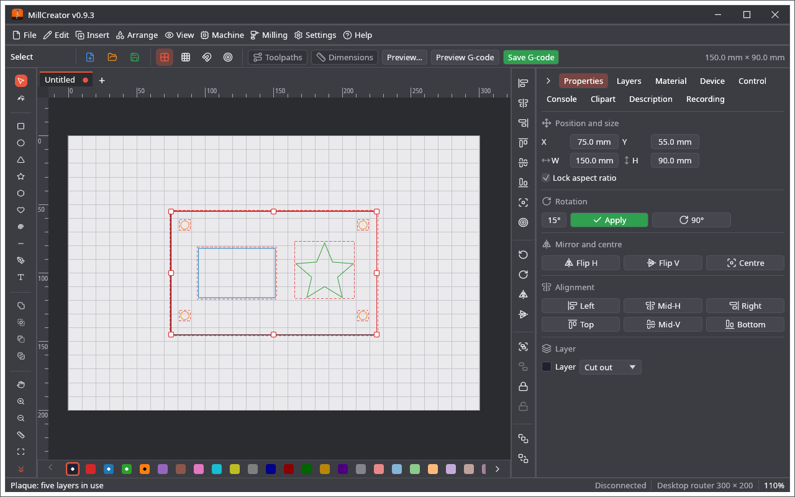
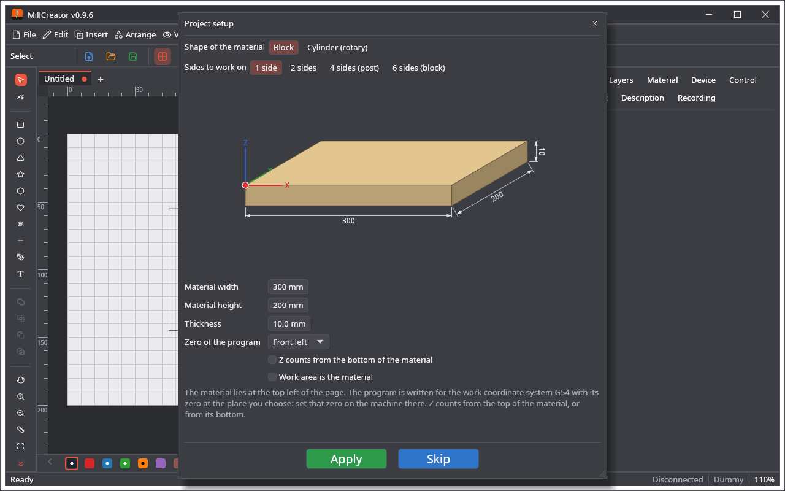
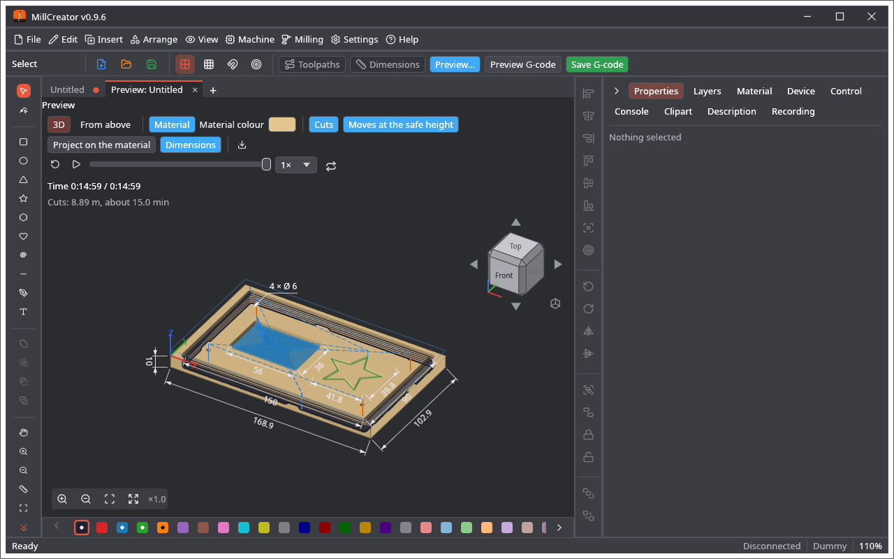
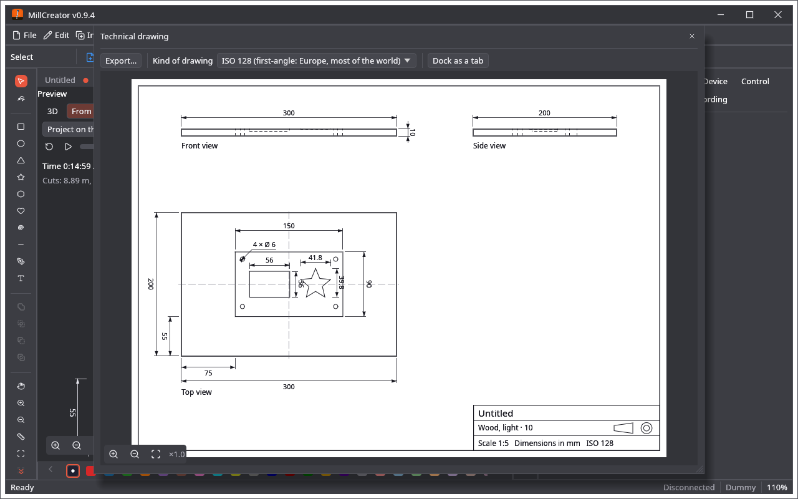

🌐 [English](Design-Tools) · [Polski](Narzedzia-projektowe) · **简体中文** · [한국어](Design-Tools-KO)

> ⚠️ 本页由英文版机器翻译而成，可能有不准确之处。如有疑问，请以[英文版](Design-Tools)为准。欢迎提出修改建议。

# 设计工具

编辑器来自 baseCreator，与 LightCreator 中的相同。

* **工具**（**Tools**，左侧）：选择、节点编辑、矩形、椭圆、三角形、星形、多边形、心形、螺旋、直线、钢笔、文本、平移、放大和缩小。字母键用于选择工具（V、N、R、E、Y、S、G、K、I、L、P、T、H、Z、X：参见[键盘快捷键](Keyboard-Shortcuts-ZH)）；插入对象的工具也位于 **插入**（**Insert**）菜单中。新图形放到当前图层上。
* **控制柄**（**Handles**）用于移动、缩放、旋转和倾斜所选内容；**排列栏**（**arrange bar**，右侧）用于对齐、分布、排序、组合、翻转和锁定。
* **属性**（**Properties**）标签页：位置和尺寸、旋转、镜像、对齐。
* **编辑**（**Edit**）菜单：**撤销**（**Undo**）、**重做**（**Redo**）、**复制**（**Copy**）、**粘贴**（**Paste**）、**再制**（**Duplicate**）、**删除**（**Delete**）、**全选**（**Select all**）。组合、锁定、顺序、对齐、布尔运算、偏移和圆角位于 **排列**（**Arrange**）菜单中。每个条目及其快捷键：[菜单](Menus-ZH)。
* **网格和吸附：** 视图菜单以及 **设置 → 视图选项…**（**Settings → View options…**）
* **导入：** **文件 → 打开…**（**File → Open…**）读取 SVG、PDF 和 Illustrator 文件（PDF 兼容的，或旧式 PostScript 类型的）以及 `.cre` 项目；也可以拖放；每个文件都在单独的标签页中打开。**文件 → 导入 → 导入 SVG…**（**File → Import → Import SVG…**，Ctrl+I）和 **导入 Adobe Illustrator / PDF / EPS / VectorCraft…**（**Import Adobe Illustrator / PDF / EPS / VectorCraft…**）把路径添加到当前打开的图纸中，每条路径放到颜色最接近的图层上（SVG 中的图片放到当前图层上）；带有 Illustrator 图层的文件会询问是按颜色还是按这些图层分配。**文件 → 导入 → 导入 DXF…**（**File → Import → Import DXF…**，或 **文件 → 打开…** 以及拖放）读取 ASCII `.dxf`（R12 及更新版本）：直线、带凸度的多段线、圆弧、圆、椭圆、样条曲线和块（包括其缩放和旋转）都作为轮廓导入，单位为毫米（会读取文件的单位），圆弧和圆作为曲线导入。相接（误差在 0.01 mm 以内）的线条会合成一条路径，因此绘制的矩形是一个闭合图形。DXF 的图层依次放到项目中尚无图形的图层上（状态栏会说明放在哪里）。不是线条的内容（文字、填充图案、尺寸标注）会被略去并列出名称；二进制 DXF 需要先另存为 ASCII。**文件 → 导入 → 导入 LightBurn / MillMage 项目…**（**File → Import → Import LightBurn / MillMage project…**）读取 LightBurn 的 `.lbrn2` / `.lbrn` 和 MillMage 的 `.mage`：矩形、椭圆、多边形、星形、带曲线的路径、组和作为轮廓的文字都会导入（LightBurn 和 MillMage 的图层在这里没有意义）。**导入 UGS 设计…**（**Import UGS design…**）读取 UGS Designer 的 `.ugsd` 文件：路径、矩形、椭圆、文字和图片，隐藏的对象也包括在内；每种切削方式（外侧、内侧、沿路径、型腔、钻孔）都成为一个图层的设置，带有其深度、进给和主轴转速，并且会把一把直径与文件中刀具直径相同的平底刀添加到刀具库中。导入会把图形添加到当前打开的图纸中（一次撤销即可全部撤回），并且只在尚无图形的地方使用文件中的图层。
* **其他程序的文件，双向支持：** DXF（当前类型和 R12，*legacy*）、Illustrator（包括旧式 PostScript 类型）、带图片的 SVG，以及 LightBurn（`.lbrn2`、`.lbrn`）和 MillMage（`.mage`）项目都可以读取，也可以按同样的格式写回。**文件 → 导出**（**File → Export**）负责写回：**导出 DXF…**（**Export DXF…**，当前类型）、**导出 DXF R12（旧版）…**（**Export DXF R12 (legacy)…**）、**导出 Adobe Illustrator…**（**Export Adobe Illustrator…**）、**导出 LightBurn 项目…**（**Export LightBurn project…**，`.lbrn2`，若你这样命名文件则为 `.lbrn`）和 **导出 MillMage 项目…**（**Export MillMage project…**），此外还有 **导出 SVG…**（**Export SVG…**）。曲线会被保留（DXF 以 0.01 mm 精度展平曲线）；图片会写入 SVG、LightBurn 和 MillMage 文件，而不写入 DXF 和 Illustrator 文件（程序会说明有多少张）。
* **剪贴画：** 包含 310 张图片的图库，另有你自己的图片和在线搜索（[与 LightCreator 中相同](https://github.com/michalsarna/LightCreator/wiki/Clipart-Gallery)）。图片以普通图形的形式放置。
* 在图形上单击 **鼠标右键** 会打开上下文菜单：复制、粘贴、再制、删除、全选、组合、取消组合、锁定、解锁、翻转、旋转、*排列*（*Arrange*）子菜单（顺序、对齐、居中、编辑节点、转换为路径）和 *图形操作*（*Shape operations*）子菜单（并集、交集、差集、异或、偏移图形、圆角、转换为曲线；它们也位于 **排列** 菜单中）；对于图片，还有 *调整图片…*（*Adjust image…*）和 *描摹图片…*（*Trace image…*）。不适用于所选内容的条目显示为灰色。
* **连接和导出（排列菜单）：** **自动连接路径…**（**Auto-join paths…**）把在容差范围内相接的所选线条连接成更长的路径，并闭合首尾相接的路径；**按容差闭合路径…**（**Close path with tolerance…**）只闭合两端距离在该范围内的路径（同一个小窗口，初始为 0.1 mm）。**导出 SVG…** 和 **导出 PLT / DXF…**（**Export PLT / DXF…**，文件 → 导出）把整张图纸写为轮廓，**将所选内容导出为 SVG…** / **为 DXF…**（**Export selection as SVG…** / **as DXF…**）为另一个程序写出所选图形（未选择任何内容时为全部图形）：SVG 保留曲线，DXF 为 R12，项目的每个图层对应一个 DXF 图层。
* **图片（位图）：** **文件 → 导入 → 导入图片…**（**File → Import → Import image…**，或把 PNG、JPG、BMP、GIF 或 WebP 文件拖放到窗口上）会打开导入对话框：旋转、翻转、亮度、对比度、伽马、自动色阶、负片和尺寸。**调整图片…**（**Adjust image…**，在属性标签页的 *图片*（*Image*）部分，或 **排列 → 调整图片…**）修改页面上的图片，**描摹图片…**（**Trace image…**，同一个按钮，或 **排列 → 描摹图片…**）把图片中的暗色（或亮色）区域转换为轮廓（阈值、斑点过滤、简化、曲线平滑），这些轮廓可以像其他图形一样铣削。放到图层上的图片会把该图层切换为 **图片**（**Picture**）操作，然后被雕刻出来（参见[图层与操作](Layers-and-Operations-ZH)）；在使用其他操作的图层上，图片只会显示，不会被铣削。**排列 → 风格描摹…**（**Arrange → Style trace…**）用 21 种风格之一（波浪线、螺旋、点画、排线、流线、一笔画……）把图片重新绘制为线条：参见[风格描摹](Style-Trace-ZH)。
* **编辑图片…**（**Edit image…**，**排列** 菜单、鼠标右键菜单，或 **图片风格**（**Picture styles**）标签页上的橙色按钮）打开所选图片的照片编辑器：**画笔**（**brush**）、**橡皮擦**（**eraser**，涂成白色）、**仿制图章**（**clone stamp**，Ctrl+单击，在 Mac 上为 Cmd+单击，指定复制来源，然后涂抹）以及对单击点周围相近灰度区域的 **填充**（**fill**），仅限灰度，可设置大小、硬度、不透明度和容差，并支持撤销和重做。滚轮用于缩放，右键或中键用于移动图片；只有按 **应用**（**Apply**）后图纸才会改变。
* **转换为图片…**（**Convert to image…**，选中图形，其中没有图片）把它们转换为一张图片：预览、分辨率（DPI）、尺寸、填充闭合图形以及线宽。**之后删除对象**（**Delete the objects afterwards**）会移除这些图形；**隐藏对象**（**Hide the objects**）只在预览中不显示它们的轮廓。
* **描摹图片**（**Trace image**）和 **风格描摹**（**Style trace**）窗口中的 **隐藏图片**（**Hide the picture**）在预览中只显示结果。
* **侧面板：** 拖动标签页可以把它放到另一个位置（顺序会被记住，在备份中也会保存）。标签页左侧的小箭头用于隐藏面板；之后会留下一条显示标签页名称的窄条，单击某个名称会打开面板并定位到该标签页。
* **标签页和窗格：** 每张打开的图纸、预览、以文本显示的项目 G-code、G-code 文件的分析以及摄像头都是 **标签页**（**tabs**）。*视图 → 分屏*（*View → Split view*）把工作区分成最多三个窗格（左右并排或上下排列；*单视图*（*Single view*）把所有标签页放回一起）；每个窗格都有自己的标签栏，没有可供选择的列表。**拖动标签页** 到另一个窗格（或在其标签栏内拖到另一个位置），或使用其菜单（右键单击）：*移动到窗格 N*（*Move to pane N*，其他窗格，以及在有空间时的新窗格）、*在单独窗口中打开*（*Open in a separate window*，适用于预览、G-code 文本和摄像头；窗口会记住其位置，**返回主窗口**（**Back to the main window**）把标签页放回去）和 *关闭标签页*（*Close tab*）。关闭窗格中的最后一个标签页会关闭该窗格，其余窗格随之合拢。任何内容都不会打开两次：打开一个已经打开的项目会显示它的标签页，并且每个项目只有一个预览、一个摄像头视图和一个 G-code 文本。另一个窗格中的图纸仅供查看，有自己的缩放；单击它会使其成为当前图纸。布局会被记住。分步说明：[窗格与标签页](Panes-and-Tabs-ZH)。
* **图层名称：** *设置 → 视图选项 → 显示图层名称*（*Settings → View options → Show layer names*，默认关闭）会在工作区下方的图层行中，把含有图形的图层名称写在其颜色旁边（过长的名称会被截断，完整名称在提示中；行满时可以横向滚动）。
* **变量名：** *设置 → 视图选项 → 显示变量名*（*Settings → View options → Show variable names*，默认关闭）会在每个可用于自定义 G-code 的字段标签旁边，以斜体加括号显示变量名，例如 *(tool_diameter)*；单击它会把 `{tool_diameter}` 复制到剪贴板，可直接粘贴到自定义 G-code 框中。
* **预览 G-code：** *保存 G-code*（*Save G-code*）旁边的按钮会生成项目的程序（经过后处理器），并在 **标签页中以文本形式**（*Preview G-code: name.nc*）显示，带有着色（G 和 M 字、坐标轴、速度、注释），并且可以编辑。标签页中的 *保存 G-code* 将其写入文件，*重新生成*（*Make again*）从项目重新生成（有编辑时，第一次单击会询问 *放弃编辑？*（*Lose the edits?*）），*分析*（*Analyse*）在 G-code 分析中显示其刀具路径。没有编辑时，文本会自动跟随项目更新（在保存、更改备注、设备或后处理器之后）。有编辑的标签页会用一个圆点标记，关闭时会询问是否保存。更多内容见 [3D 视图与 G-code](3D-View-and-G-code-ZH)。*设置 → 视图选项 → 保存后预览 G-code*（*Settings → View options → Preview G-code after saving*，默认关闭）会在每次 *保存 G-code* 后在分析中打开保存的文件。
* **Esc** 清除选择；**按两次 Esc**（半秒内再按一次 Esc）返回选择工具。
* **工作区上方的工具栏：** 工具名称、**新建**（**New**）、**打开…**（**Open…**）和 **保存**（**Save**）、网格和吸附开关，然后是 **刀具路径**（**Toolpaths**，在图纸上绘制刀具路径时为绿色）、**预览…**（**Preview…**，预览标签页）、**摄像头视图**（**Camera view**，当设备有摄像头时）、**预览 G-code**（**Preview G-code**）和 **保存 G-code**（**Save G-code**），右侧是所选内容的尺寸。工作区下方的状态栏显示程序的消息、连接、项目的设备、缩放比例和指针位置。
* 编辑器下方的 **图层栏**（**Layer bar**）：一行 64 种颜色（圆点标记含有图形的图层）；单击会把所选图形放到该图层上，双击会打开其选项。
* 工作区就是设备的工作区；单位就是设备的单位。

## 文本

选择 **文本 (T)**（**Text (T)**）并在页面上单击：会出现一段文本，并打开 **属性**（**Properties**）标签页，其中有输入文字的字段。在那里设置字体、字号、粗体和斜体、字间距和行间距以及对齐方式。**转换为曲线**（**Convert to curves**）把文本转换为可以编辑节点的图形。新文本会沿用最后修改的文本的设置。

## 排列、复制和生成（排列菜单 → *狗骨 / T 骨角…* 之后的命令）

**插入**（**Insert**）菜单包含左侧工具板中插入对象的工具（矩形、椭圆、三角形、星形、多边形、心形、螺旋、直线、折线 / 钢笔和文本；正在使用的工具会打勾），然后是插件的生成器和在线剪贴画。

* **网格阵列…**（**Grid array…**）按列和行复制所选内容（*列间距*（*Column distance*）、*行间距*（*Row distance*））；原件和副本保持选中状态。**环形阵列…**（**Circular array…**）在 *总角度*（*Total angle*）范围内把副本放在所选内容中心的周围（360° 绕满一圈，并且不会有副本落在原件上）；*旋转副本*（*Turn the copies*）让副本随位置旋转，关闭时只移动它们。最多生成 2000 个副本。
* **沿路径复制…**（**Copy along path…**）：先选择图形，**最后** 选择路径；副本沿路径每隔 *距离*（*Distance*）放置一个（第一个位于起点，如果放得下，最后一个位于终点），并可按需随路径旋转。**路径文字…**（**Text on path…**）：先选择文本，最后选择路径；文本的轮廓从 *起点*（*Start*）开始沿路径弯曲（之后文本变为轮廓，而不再是文本）。
* **按图形修剪…**（**Trim by shape…**）：先选择线条，**最后** 选择一个闭合图形；保留线条位于该图形内部（或按复选框选择外部）的部分，在与其轮廓相交处剪断。**删除重复项**（**Remove duplicates**）删除同一图层上轮廓相同的图形（所选内容，未选择任何内容时为整张图纸）。**打散**（**Break apart**）把含有多条轮廓的图形变成每条轮廓一个图形。**简化…**（**Simplify…**）去掉与线条距离在 *容差*（*Tolerance*）以内的点（含有数千个点的图纸会因此生成更短的 G-code）。
* **序列文字…**（**Serial text…**）：选择一段文本；它会按网格复制，其中的 `{n}` 递增计数（*起始编号*（*First number*）、*步长*（*Step*）、*位数*（*Digits*）、*副本数*（*Copies*）），或者使用 **读取 CSV 文件…**（**Read a CSV file…**），为文件中的每一行生成一个副本，`{1}`、`{2}`…… 被替换为对应列的内容（逗号或分号分隔）。副本是真实的图形，因此任何程序都能为它们生成 G-code。
* **条形码 / 二维码…**（**Barcode / QR code…**）把 **QR** 码（其 *尺寸*（*Size*））或 **Code 39** 条形码（大写字母、数字、`- . $ / + %` 和空格；*条宽*（*Bar width*）和 *高度*（*Height*））作为轮廓放到当前图层上。请让方块足够大，以适合刀具。
* **排样…**（**Nest shapes…**）把所选图形从页面一角开始排布到 *区域宽度*（*Area width*）× *区域高度*（*Area height*）的区域内，图形之间留有 *间距*（*Distance*）。启用 **按实际轮廓**（**By the real outlines**，默认开启）时，按图形的真实形状排布：小零件可以放进大零件的孔里，L 形可以放进另一个零件的角落，组保持为一个零件，**旋转**（**Turning**）允许零件按半圈、四分之一圈或八分之一圈旋转。**放不下的放到新板材上**（**What does not fit goes on new sheets**）把剩余部分放到新板材上：每张板材都是一个新的标签页，具有相同的图层和材料（保存后在这一张之后运行）；不启用时，放不下的图形留在原处。关闭按实际轮廓时，图形按其外框逐行排布（*允许旋转*（*Allow turning*）会把高的图形放倒）。
* **测量…**（**Measure…**）显示所选内容的尺寸、位置、面积和长度，对于两个图形还会显示它们中心之间以及外框之间的距离。窗口打开期间会跟随所选内容更新。

## 摄像头叠加（视图菜单）和描摹对话框

**视图 → 叠加来源…**（**View → Overlay from…**）把照片、平面图或扫描件放在 **图纸下方**（**载入图片…**（**Load picture…**）），或放置设备摄像头的实时画面（**启动摄像头**（**Start camera**）、**冻结画面**（**Freeze frame**）；摄像头标签页上的 **叠加**（**Overlay**）按钮也可以）。勾选 **对齐：在工作区上拖动四个角**（**Align: drag the four corners on the work area**），然后把图片的四个角拖到材料或工作区的四个角上（图片会通过透视变换随之变形），或者给出 **参考点**（**Reference points**），这些参考点随设备保存。**不透明度**（**Opacity**）、**显示叠加**（**Show overlay**）、**重置为工作区**（**Reset to work area**）、**水平翻转**（**Flip H**）、**垂直翻转**（**Flip V**）、**旋转 90°**（**Rotate 90°**）和 **移除**（**Remove**）位于同一个窗口中，**视图 → 显示摄像头叠加**（**View → Show camera overlay**）用于显示或隐藏它。图片随项目保存。在 **描摹图片**（**Trace image**）对话框中，可以用滚轮或 **放大**（**Zoom in**）、**缩小**（**Zoom out**）和 **重置视图**（**Reset view**）按钮缩放图片，绿色的 **描摹**（**Trace**）按钮生成轮廓。

## 标尺、选择和节点栏

* **标尺 (M)**（**Ruler (M)**）：工具板中位于 **缩小 (X)**（**Zoom out (X)**）之后的工具。从一点拖到另一点，或单击两个点：图纸上方的一条线会以程序的单位显示长度、ΔX、ΔY 和角度。靠近图形节点的点会直接取该节点（否则在开启吸附时取网格点）。单击图形的直线段（矩形的一条边、一条直线）会测量该线段。测量结果会保留，直到下一次测量、按 **Esc** 或切换到其他工具；图纸中的任何内容都不会改变。
* **使用工具时右键单击**（图形、钢笔、节点工具、标尺……）相当于按两次 **Esc**：返回 **选择 (V)**（**Select (V)**）且不选择任何内容；用钢笔正在绘制的线条会先被完成。使用选择工具时，右键单击仍像以前一样打开上下文菜单。
* **选中多个对象时：** 除了整个选择的边框外，每个对象还有自己的细虚线边框。
* **节点栏**（**The node bar**）在名称后显示快捷键：**尖角 (C)**（**Corner (C)**）、**转为直线 (L)**（**To line (L)**）、**转为曲线 (S)**（**To curve (S)**）、**添加节点 (I)**（**Add node (I)**）、**删除节点 (D)**（**Delete node (D)**）、**圆角 (R)**（**Round (R)**）、**断开 (B)**（**Break (B)**）。**打开 / 闭合**（**Open / close**）已被移除：**断开 (B)** 打开路径，把路径的一端拖到另一端上即可闭合路径。
* **不生成的图层**（其输出被关闭）会把其中的对象以淡出的方式显示在工作区中。

## 预览：按钮和尺寸

* 预览工具栏上的选项是 **按钮**：开启时为浅蓝色（与摄像头视图按钮相同），单击可开启或关闭。
* **尺寸**（**Dimensions**）像工程图一样显示任务的尺寸：整体的宽度和高度、每个零件的宽度和高度（有多个零件时），以及当机器零点在画面中时整体与机器零点的距离。

* **铣削：** 在 3D 中，**尺寸** 会在块料的边缘上标出其长度、宽度和厚度；从上方看时，标出图形的尺寸。**工程图**（**Technical drawing**，也可用 **铣削 → 显示工程图…**（**Milling → Show technical drawing…**））把零件打开为欧洲式图纸：前视图、侧视图和俯视图，顶面以下的切削以虚线表示，直到其图层的深度，标注材料、零件和深度的尺寸，以及包含名称、材料和比例的 A4 图纸标题栏。
* **项目设置**（**Project setup**）以倾斜视角显示材料块及其宽度、高度和厚度，并在所选位置显示程序零点及其坐标轴。

* **图片：** 除 PNG、JPEG、BMP、GIF 和 WebP 外，也可以读取 TIFF（`.tif`、`.tiff`）。

## 工作区上的尺寸、标尺和节点菜单

* **尺寸**（**Dimensions**，工作区上方工具栏中 **刀具路径**（**Toolpaths**）旁边的按钮）像工程图一样显示图纸：整体以及每条轮廓的宽度和高度（图形的外轮廓和孔各自单独标注），以及圆形的直径，相同的只标注一次（**4 × Ø 6**）。它不会改变图纸中的任何内容。
* **标尺 (M)** 会捕捉图形的节点（用方块标记）、线段的中点（用菱形标记）或圆或椭圆的圆心（用圆标记）。单击圆会显示从圆心到单击点的半径以及直径；单击椭圆会显示两个半径以及到该点的半径；单击曲线会显示其长度，当曲线是圆弧时，还会显示从圆心到单击点的半径及其长度。
* **节点编辑：** 在节点或线段上右键单击会打开节点栏的菜单；**平滑**（**Smooth**）的快捷键为 **G**，**圆角 (R)** 的半径显示在其按钮之后。
* **铣削：** 工程图可以从 **视图 → 工程图**（**View → Technical drawing**）打开（与 **视图 → 预览**（**View → Preview**）和 **视图 → 预览 G-code**（**View → Preview G-code**）一起，它们的作用与主窗口的按钮相同）。其窗口有 **导出…**（**Export…**，A4 的 PDF 页面、300 点每英寸的 PNG / JPG 图片，或当前类型或 **R12** 的 **DXF**：按打印样式的 A4 图纸，单位为毫米，包含其线条和文字；尺寸标注给出真实尺寸）；**文件 → 导出 → 工程图**（**File → Export → Technical drawing**）中有相同的格式；缩放（滚轮、缩放条、双击显示整张图纸）以及 **停靠为标签页**（**Dock as a tab**）：图纸成为工作区的一个标签页，**在单独窗口中打开**（**Open in a separate window**）再把它移出来。在预览中，**尺寸** 也会标出铣削后的图形：在 3D 中标在块料顶面上的外轮廓和孔，从上方看时像图纸上一样，并标出圆形的直径。

## 单位

* **设置 → 程序选项… → 单位**（**Settings → Program options… → Units**）选择程序显示长度所用的单位：毫米、厘米、米、英寸或英尺，或 **与设备相同**（**As the device**）。它们用于 **属性** 中的尺寸、标尺、图纸上方和预览中的 **尺寸**，以及工程图。
* **设备的单位**（毫米或英寸，在设备窗口中）是机器的单位：G-code 以这种单位编写。使用英寸的设备会得到 **G20**，所有长度和进给都以英寸表示；使用毫米的设备得到 **G21** 和毫米。请确保这是控制器使用的单位。
* 当设备使用与程序不同的单位制（英寸对毫米）时，尺寸和标尺会同时显示两者：先显示程序的单位，括号中显示机器的单位，例如 **25.4 mm [1.000"]**。
* **工程图类型**（其窗口中的 **图纸类型**（**Kind of drawing**））：**ISO 128**（第一角投影，在欧洲和世界大部分地区使用：俯视图在前视图下方，左视图在其右侧，数字沿尺寸线书写）、**ASME Y14**（第三角投影，美国和加拿大：俯视图在前视图上方，右视图在其右侧，数字始终正立）和 **JIS B 0001**（第三角投影，日本，数字沿尺寸线书写）。标题栏会注明类型并显示投影符号。

## 拖刀

使用 **拖刀**（**Drag knife**）操作的图层用装在刀座中的拖刀沿其线条切割（乙烯基贴膜、卡纸、橡胶、薄板），主轴保持静止：任务会在该图层之前以 **装上拖刀**（**Put in the drag knife**）暂停，不需要刀具。刀片库中的 **刀片**（**Knife**，30°、45° 和 60° 刀片、装在 CNC 机器刀座中的拖刀，或你自己的刀片）会一次性设置图层的刀尖偏移、**转角锐于此值时转向**（**Turn round corners sharper than**）和 **越过起点继续切割**（**Cut on past the start**），之后每一项都可以在图层上更改。**刀片库…**（**Knife library…**，也可用 **铣削 → 刀片库…**（**Milling → Knife library…**））打开刀片库：**复制**（**Copy**）从现成的刀片创建一把你自己的刀片，包括名称、数值和备注，随程序设置及其备份保存；每个转角处都会补偿偏移，先切孔，闭合线条会越过起点继续切割。拖刀以图层的深度一次切完。尚未在真实机器上试用。更多内容：[拖刀](Drag-Knife-ZH)。
