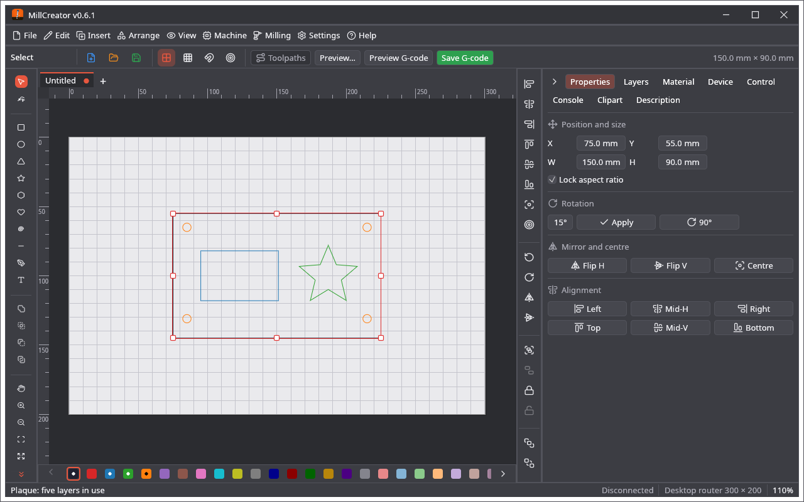
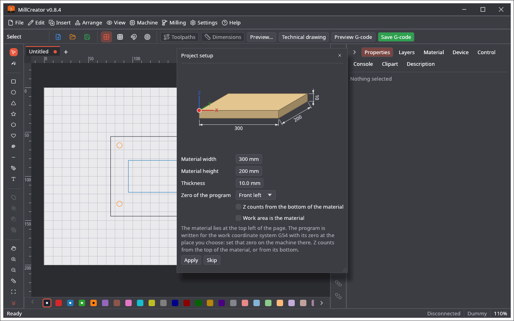
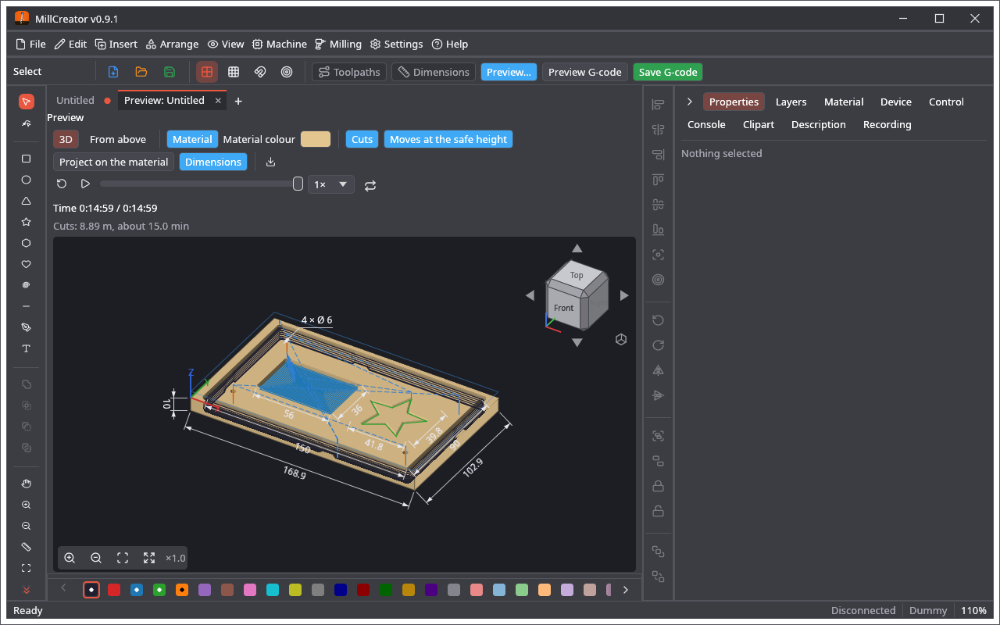
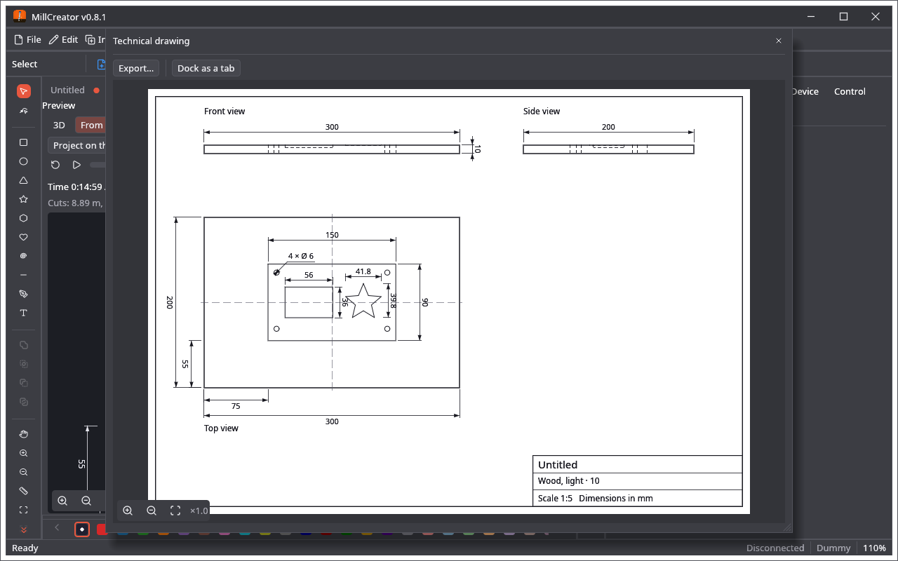

🌐 **English** · [Polski](Narzedzia-projektowe)

# Design Tools

The editor is the one of baseCreator, the same as in LightCreator.

* **Tools** (left): select, node edit, rectangle, ellipse, triangle, star, polygon, heart, spiral, line, pen, text, pan, zoom in and zoom out. A letter key chooses a tool (V, N, R, E, Y, S, G, K, I, L, P, T, H, Z, X: see [Keyboard Shortcuts](Keyboard-Shortcuts)); the tools that insert objects are also in the **Insert** menu. New shapes go to the active layer.
* **Handles** move, resize, turn and slant a selection; the **arrange bar** (right) aligns, distributes, orders, groups, flips and locks.
* **Properties** tab: position and size, rotation, mirror, alignment.
* **Edit** menu: **Undo**, **Redo**, **Copy**, **Paste**, **Duplicate**, **Delete**, **Select all**. Grouping, locking, the order, the alignment, the boolean operations, offset and round corners are in the **Arrange** menu. Every entry and its key: [Menus](Menus).
* **Grid and snapping:** View menu and **Settings → View options…**
* **Import:** **File → Open…** reads SVG, PDF and Illustrator files (PDF-compatible, or of the old PostScript kind) and `.cre` projects; drag and drop works too; each opens in a tab of its own. **File → Import → Import SVG…** (Ctrl+I) and **Import Adobe Illustrator / PDF…** add the paths to the open drawing, each on the layer nearest to its colour (the pictures of an SVG on the active layer); a file with Illustrator layers asks whether to go by colour or by those layers. **File → Import → Import DXF…** (or **File → Open…** and drag and drop) reads an ASCII `.dxf` (R12 and newer): lines, polylines with bulges, arcs, circles, ellipses, splines and blocks (with their scale and rotation) come over as outlines, in millimetres (the unit of the file is read), arcs and circles as curves. Lines that meet (within 0.01 mm) become one path, so a drawn rectangle is one closed shape. The layers of the DXF go to the layers of the project that have no shapes yet, one after the other (the status bar says where). What is not a line (text, hatches, dimensions) is left out and named; a binary DXF has to be saved as ASCII first. **File → Import → Import LightBurn / MillMage project…** reads `.lbrn2` / `.lbrn` of LightBurn and `.mage` of MillMage: rectangles, ellipses, polygons, stars, paths with curves, groups and text as outlines come over (the layers of LightBurn and MillMage mean nothing here). **Import UGS design…** reads `.ugsd` files of UGS Designer: paths, rectangles, ellipses, text and pictures, hidden objects too; each way of cutting (outside, inside, on the path, pocket, drill) becomes the settings of a layer with its depth, feed and spindle speed, and a flat bit of the file's tool diameter is added to the library. An import adds the shapes to the open drawing (one undo takes them back) and uses the layers of the file only where no shapes are yet.
* **Files of other programs, both ways:** DXF (the current kind and R12, *legacy*), Illustrator (also the old PostScript kind), SVG with its pictures, and LightBurn (`.lbrn2`, `.lbrn`) and MillMage (`.mage`) projects are read, and written back the same. **File → Export** writes them back: **Export DXF…** (the current kind), **Export DXF R12 (legacy)…**, **Export Adobe Illustrator…**, **Export LightBurn project…** (`.lbrn2`, or `.lbrn` when you name the file so) and **Export MillMage project…**, besides **Export SVG…**. Curves are kept (DXF flattens them to 0.01 mm); pictures go into SVG, LightBurn and MillMage files and are left out of DXF and Illustrator files (the program says how many).
* **Clipart:** the gallery of 310 pictures with your own and online search ([the same as in LightCreator](https://github.com/michalsarna/LightCreator/wiki/Clipart-Gallery)). A picture is placed as ordinary shapes.
* **Right mouse button** on a shape opens the context menu: copy, paste, duplicate, delete, select all, group, ungroup, lock, unlock, flip, turn, the *Arrange* submenu (order, alignment, centring, edit nodes, convert to path) and the *Shape operations* submenu (union, intersection, subtract, exclusive or, offset shape, round corners, convert to curves; they are also in the **Arrange** menu); for a picture also *Adjust image…* and *Trace image…*. The entries that do not fit the selection are grey.
* **Join and export (Arrange menu):** **Auto-join paths…** joins the selected lines that meet within a tolerance into longer paths and closes the ones that come round; **Close path with tolerance…** only closes paths whose two ends are that near (the same small window, 0.1 mm to begin with). **Export SVG…** and **Export PLT / DXF…** (File → Export) write the whole drawing as outlines, and **Export selection as SVG…** / **as DXF…** write the selected shapes (all of them when nothing is selected) for another program: the SVG keeps the curves, the DXF is R12 with a DXF layer for every layer of the project.
* **Pictures (bitmaps):** **File → Import → Import image…** (or drop a PNG, JPG, BMP, GIF or WebP file on the window) opens the import dialog: rotate, flip, brightness, contrast, gamma, auto levels, negative and size. **Adjust image…** (in the *Image* section of the Properties tab, or **Arrange → Adjust image…**) changes a picture on the page, and **Trace image…** (the same button, or **Arrange → Trace image…**) turns its dark (or light) areas into outlines (threshold, speckle filter, simplification, curve smoothing) that are milled like any other shape. A picture put on a layer switches it to the **Picture** operation and is then engraved (see [Layers and Operations](Layers-and-Operations)); on a layer with another operation it is only shown, not milled.
* **Side panel:** drag a tab to put it in another place (the order is remembered, also in a backup). The small arrow at the left of the tabs hides the panel; a narrow strip with the names of the tabs stays, and a click on a name opens the panel on that tab.
* **Tabs and panes:** every open drawing, the preview, the G-code of the project as text, the analysis of a G-code file and the camera are **tabs**. *View → Split view* divides the work area into up to three panes (side by side or one above the other; *Single view* puts all the tabs together); every pane has its own bar of tabs and no list to choose from. **Drag a tab** to another pane (or inside its bar to another place), or use its menu (right click): *Move to pane N* (the other panes, and a new one when there is room), *Open in a separate window* (the preview, the G-code text and the camera; the window remembers its place, **Back to the main window** puts the tab back) and *Close tab*. The last tab of a pane closed closes the pane, and the others close up. Nothing is opened twice: opening a project that is open already shows its tab, and there is one preview, one camera view and one G-code text for a project. A drawing in another pane is shown for looking, with a zoom of its own; a click on it makes it the active one. The layout is remembered. Step by step: [Panes and Tabs](Panes-and-Tabs).
* **Layer names:** *Settings → View options → Show layer names* (off by default) writes the name of a layer that has shapes beside its colour in the row of layers under the work area (long names are cut, the whole one is in the tip; the row scrolls sideways when it is full).
* **Variable names:** *Settings → View options → Show variable names* (off by default) shows the name of the variable in italics and brackets, for example *(tool_diameter)*, beside the label of every field that has one for the own G-code; a click on it copies `{tool_diameter}` to the clipboard, ready to be pasted into a box of own G-code.
* **Preview G-code:** the button next to *Save G-code* makes the program of the project (with the postprocessors) and shows it **as text in a tab** (*Preview G-code: name.nc*), coloured (G and M words, axes, speeds, comments) and open to edits. *Save G-code* in the tab writes it to a file, *Make again* makes it from the project again (with edits, the first click asks *Lose the edits?*), *Analyse* shows its toolpaths in the analysis of G-code. Without edits the text follows the project by itself (after a save, a change of the notes, of the device or of the postprocessors). A tab with edits is marked with a dot and asks whether to save them when it is closed. More in [3D View and G-code](3D-View-and-G-code#the-g-code-as-text-preview-g-code). *Settings → View options → Preview G-code after saving* (off by default) opens the saved file in the analysis after every *Save G-code*.
* **Esc** clears the selection; **Esc twice** (a second Esc within half a second) goes back to the Select tool.
* **The bar above the work area:** the name of the tool, **New**, **Open…** and **Save**, the grid and snapping switches, then **Toolpaths** (green while the paths of the bit are drawn over the drawing), **Preview…** (the preview tab), **Camera view** (when the device has a camera), **Preview G-code** and **Save G-code**, and on the right the size of the selection. The status bar under the work area has the messages of the program, the connection, the device of the project, the zoom and the position of the pointer.
* **Layer bar** under the editor: one row of 64 colours (a dot marks the layers with shapes); a click puts the selected shapes on that layer, a double click opens its options.
* The work area is the one of the device; the units are its units.

## Text

Choose **Text (T)** and click on the page: a text appears and the **Properties** tab opens with the field to type in. There you set the font, the size, bold and italic, the letter and line spacing and the alignment. **Convert to curves** turns the text into shapes whose nodes can be edited. A new text takes the settings of the text changed last.

## Arranging, copying and generating (Arrange menu → the commands after *Dogbone / T-bone corners…*)

The **Insert** menu has the tools of the left palette that insert objects (rectangle, ellipse, triangle, star, polygon, heart, spiral, line, polyline / pen and text; the tool in use is ticked), then the generators of plugins and the online clipart.

* **Grid array…** copies the selection in columns and rows (*Column distance*, *Row distance*); the original and the copies stay selected. **Circular array…** puts the copies round the middle of the selection over a *Total angle* (360° goes all the way round and no copy lands on the original); *Turn the copies* turns them with their place, off only moves them. At most 2000 copies are made.
* **Copy along path…**: select the shapes, then the path **last**; copies are put every *Distance* along it (the first at its start, the last at its end when it fits) and turned with the path when you want. **Text on path…**: select the text, then the path last; the outlines of the text are bent along the path from *Start* (the text is outlines afterwards, not text).
* **Trim by shape…**: select the lines, then a closed shape **last**; the parts of the lines inside it (or outside, by the check box) are kept, cut where they cross its outline. **Remove duplicates** deletes shapes with the same outline on the same layer (the selection, or the whole drawing when nothing is selected). **Break apart** turns a shape with several outlines into one shape per outline. **Simplify…** takes away the points that lie within a *Tolerance* of the line (a drawing with thousands of points makes shorter G-code).
* **Serial text…**: select a text; it is copied in a grid with its `{n}` counted up (*First number*, *Step*, *Digits*, *Copies*), or, with **Read a CSV file…**, one copy for every row of the file with `{1}`, `{2}`… replaced by its columns (commas or semicolons). The copies are real shapes, so every program makes G-code of them.
* **Barcode / QR code…** puts a **QR** code (its *Size*) or a **Code 39** barcode (capitals, digits, `- . $ / + %` and spaces; *Bar width* and *Height*) on the active layer as outlines. Make the squares big enough for the bit.
* **Nest shapes…** packs the selected shapes in rows from the corner of the page on an area of *Area width* × *Area height* (the work area at first) with a *Distance* between them; *Allow turning* lets it lay a tall shape down. It packs by the boxes of the shapes (not by their outlines) and says when they do not fit.
* **Measure…** shows the size, the position, the area and the length of the selection, and for two shapes the distance between their centres and between their boxes. It follows the selection while it is open.

## Camera overlay (View menu) and the trace dialog

**View → Overlay from…** puts a photo, a plan or a scan **under the drawing** (**Load picture…**), or the live picture of the camera of the device (**Start camera**, **Freeze frame**; also the **Overlay** button on the camera tab). Tick **Align: drag the four corners on the work area** and drag its corners onto the corners of the material or of the work area (the picture follows with a perspective transform), or give **Reference points**, which are kept with the device. **Opacity**, **Show overlay**, **Reset to work area**, **Flip H**, **Flip V**, **Rotate 90°** and **Remove** are in the same window, and **View → Show camera overlay** shows or hides it. The picture is saved with the project. In the **Trace image** dialog the picture can be zoomed with the scroll wheel or the **Zoom in**, **Zoom out** and **Reset view** buttons, and the green **Trace** button makes the outlines.

## Ruler, selection and the node bar

* **Ruler (M):** the tool after **Zoom out (X)** in the palette. Drag from one point to another, or click two points: a line over the drawing shows the length, ΔX, ΔY and the angle, in the units of the program. A point near a node of a shape takes the node itself (otherwise the grid when snapping is on). A click on a straight segment of a shape (a side of a rectangle, a line) measures that segment. The measurement stays until the next one, **Esc** or another tool; nothing in the drawing is changed.
* **Right click with a tool** (a shape, the pen, the node tool, the ruler…) works as a double **Esc**: back to **Select (V)** with nothing selected; a line being drawn with the pen is finished first. With the select tool the right click opens the context menu as before.
* **Several objects selected:** besides the frame of the whole selection, every object has a thin dashed frame of its own.
* **The node bar** shows the keys after the names: **Corner (C)**, **To line (L)**, **To curve (S)**, **Add node (I)**, **Delete node (D)**, **Round (R)**, **Break (B)**. **Open / close** is gone: **Break (B)** opens a path, and a path is closed by dropping one of its ends onto the other.
* **A layer that is not made** (its output switched off) shows its objects faded towards the work area.

## Preview: buttons and dimensions

* The options of the bar of the preview are **buttons**: light blue while they are on (as the button of the camera view), a click turns them on or off.
* **Dimensions** shows the sizes of the job as on a technical drawing: the width and height of the whole, of every part (when there are a few), and how far the whole is from the zero of the machine when the zero is in the picture.

* **Mill:** in 3D, **Dimensions** gives the length, width and thickness of the block on its edges; from above, the dimensions of the shapes. **Technical drawing** (also **Milling → Show technical drawing…**) opens the part as a drawing of the European kind: the view from the front, from the side and from above, the cuts under the top as dashed lines down to the depth of their layer, dimensions of the material, the parts and the depths, and a title block with the name, the material and the scale for an A4 sheet.
* **Project setup** shows the block of material at a slant with its width, height and thickness, and the zero of the program with its axes where it is chosen.

* **Pictures:** TIFF (`.tif`, `.tiff`) is read too, as PNG, JPEG, BMP, GIF and WebP.

## Dimensions on the work area, the ruler and the node menu

* **Dimensions** (the button next to **Toolpaths** on the bar over the work area) shows the drawing as on a technical drawing: the width and height of the whole and of every outline (the outside and the holes of a shape each by itself), and the diameters of the round ones, the same ones named once (**4 × Ø 6**). It changes nothing in the drawing.
* **Ruler (M)** takes a node of a shape (a square marks it), the middle of a segment (a diamond) or the centre of a circle or an ellipse (a circle). A click on a circle shows its radius from the centre to the point clicked and its diameter; on an ellipse both radii and the radius to the point; on a curve its length, and when the curve is an arc of a circle, the radius drawn from the centre to the point clicked and its length.
* **Node edit:** a right click on a node or a segment opens the menu of the node bar; **Smooth** has the key **G**, and the radius of **Round (R)** stands after its button.
* **Mill:** the **Technical drawing** button stands next to **Preview…** on the bar (it left the bar of the preview). Its window has **Export…** (PDF page of A4, or a PNG / JPG picture at 300 dots per inch), zoom (wheel, the zoom bar, double click for the whole sheet) and **Dock as a tab**: the drawing becomes a tab of the work area, and **Open in a separate window** takes it out again. In the preview **Dimensions** also gives the milled shapes: their outsides and holes on the top of the block in 3D, from above as on the drawing, with the diameters of the round ones.

## Units

* **Settings → Program options… → Units** chooses the units the program shows lengths in: millimetres, centimetres, metres, inches or feet, or **As the device**. They are used by the sizes in **Properties**, the ruler, the **Dimensions** over the drawing and in the preview, and the technical drawing.
* **The units of the device** (millimetres or inches, in the device window) are those of the machine: the G-code is written in them. A device in inches gets **G20** and every length and feed in inches; a device in millimetres **G21** and millimetres. Make sure they are the units the controller works in.
* When the device counts in the other system than the program (inches against millimetres), the dimensions and the ruler show both: the units of the program first, those of the machine in brackets, for example **25.4 mm [1.000"]**.
* **Kinds of technical drawing** (**Kind of drawing** in its window): **ISO 128** (first-angle projection, used in Europe and most of the world: the view from above under the front, the view from the left to the right of it, the numbers along their lines), **ASME Y14** (third-angle projection, USA and Canada: the view from above over the front, the view from the right to the right of it, the numbers always upright) and **JIS B 0001** (third-angle, Japan, the numbers along their lines). The title block names the kind and shows the sign of the projection.

## Drag knife

A layer with the operation **Drag knife** cuts along its lines with a drag knife in the holder (vinyl, card, rubber, thin sheets), the spindle still: the job stops with **Put in the drag knife** before the layer, no bit is needed. The **Knife** of the knife library (the 30°, 45° and 60° blades, a drag knife in a holder of a CNC machine, or one of your own) sets the offset of the tip, **Turn round corners sharper than** and **Cut on past the start** of the layer at once, and each of them can be changed on the layer after that. **Knife library…** (also **Milling → Knife library…**) opens the library: **Copy** makes a knife of your own from a ready-made one, with a name, the values and notes, kept with the settings of the program and in its backup; the offset is made good at every corner, the holes are cut first and a closed line is cut on past its start. The knife cuts in one pass at the depth of the layer. Not tried on a real machine yet. More: [Drag Knife](Drag-Knife).
