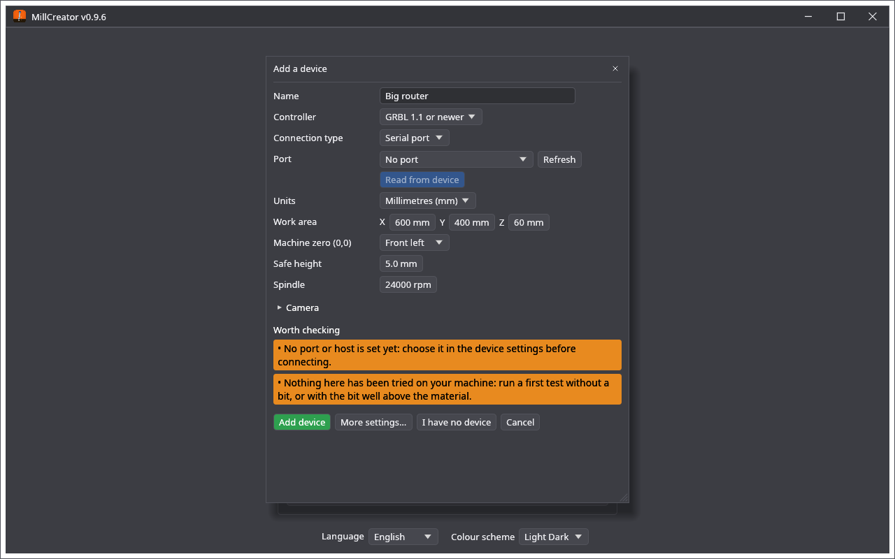

🌐 [English](Devices-and-Cameras) · [Polski](Urzadzenia-i-kamery) · [简体中文](Devices-and-Cameras-ZH) · **한국어**

> ⚠️ 이 페이지는 영어판을 기계 번역한 것으로, 부정확한 부분이 있을 수 있습니다. 의심스러우면 [영어판](Devices-and-Cameras)을 기준으로 하십시오. 수정 제안을 환영합니다.

# 장치와 카메라

> MillCreator가 동작하는 것으로 확인된 기계와 내 기계를 추가하는 방법: [TESTS_ON_DEVICES.md](https://github.com/michalsarna/MillCreator/blob/main/TESTS_ON_DEVICES.md).

**장치**(device)는 밀링 기계입니다. 장치 목록은 실행 사이에도 유지되며 모든 프로젝트에서 같습니다. 시작 화면에서 장치를 고르면 **새로 만들기**(New)와 **열기…**(Open…)가 그 장치를 사용합니다. 편집기의 장치 탭은 사용 중인 장치를 보여 주고 그 설정을 엽니다.

## 시작 화면의 버튼
첫 줄에 **장치 추가…**(Add device…), **편집…**(Edit…), **복제**(Duplicate), **가져오기…**(Import…)(엄격하게 검사: 더 새로운 형식, 잘못된 숫자, 2 MB가 넘는 파일은 거부됩니다)가 있고, 둘째 줄에 **장치 없음**(I have no device)이 있습니다. **내보내기…**(Export…)(장치 하나를 JSON 파일로)와 **삭제**(Delete)(확인을 묻습니다)는 **편집…** 창에 있습니다. 이미 쓰고 있는 이름을 가진 복사본이나 가져온 장치에는 번호가 붙습니다: `Router (2)`.

## 장치 없음
**Dummy**라는 단순한 장치를 한 번 만듭니다: 300 × 200 mm 작업 영역, Z 이동 거리 60 mm, 안전 높이 5 mm, 스핀들 1000–24000 rpm. 다른 장치처럼 목록에 남고 편집할 수 있으며, 프로젝트는 이 장치를 기계로 하여 저장됩니다. 장치가 하나도 없을 때 **새로 만들기**와 **열기…** 버튼을 눌러도 이 장치가 만들어져 사용됩니다.

## 장치 설정
**기계 → 장치 설정…**(Machine → Device settings…)(또는 시작 화면의 **편집…**)은 장치 설정을 열며, 열두 페이지로 되어 있습니다.

| 페이지 | 담고 있는 것 |
|---|---|
| 일반(General) | 이름, 컨트롤러, 단위(mm 또는 인치; 형상은 항상 mm로 저장), **기계 원점 (0,0)**(Machine zero (0,0))(앞 왼쪽, 앞 오른쪽, 뒤 왼쪽, 뒤 오른쪽), **작업 좌표**(Work coordinates)(없음 또는 G54 … G59)와 **프로그램 원점**(Zero of the program); 새 장치에는 **시작점**(Start from)(일반적인 기계 크기) |
| 기계(Machine) | 작업 영역 X, Y, Z, **안전 높이**(Safe height)(절삭 사이에 스핀들이 이동하는 높이), **재료 위 이동 속도**(Speed of moves above the material), **X, Y, Z 가속도**(Acceleration of X, Y, Z)와 **접합 편차**(Junction deviation)(0 = 알 수 없음; 이 값이 있으면 작업 시간 계산에 GRBL이 계획하는 대로 가속, 감속, 느려지는 모서리가 반영됩니다. **기계에서 읽기**(Read the machine)는 `$120` – `$122`와 `$11`에서 값을 채웁니다); 컨트롤러에서 읽은 값과 그 설정의 사본 |
| 스핀들(Spindle) | **최저 속도**(Lowest speed), **최고 속도**(Highest speed), **켠 뒤 대기**(Wait after switching on), **공구 교환기**(Tool changer) |
| G-code | 장치의 **사용자 G-code**(own G-code)(상자 여덟 개, 아래 참고), 변수, **사용자 파일 형식**(Own file format) |
| 연결(Connection) | 시리얼 포트 또는 네트워크 소켓, 포트 또는 USB ID, 보레이트, GRBL 버전, 스트리밍, 연결 후 할 일; 또는 HTTP로 연결한 Duet 보드 |
| 카메라(Camera) | 카메라 최대 여덟 대(아래 참고) |
| 회전축(Rotary) | 회전축 장치: 종류, 지름, 한 바퀴당 마이크로스텝; 켜져 있는 동안 작업 영역에는 공작물 한 바퀴마다 파란 선이 있습니다(**둘레 …**(Circumference …)). **원통**(Cylinder)을 고른 파일 → 프로젝트 설정…이 이것을 켭니다 |
| 조그(Jogging) | 조그 버튼용 X·Y 스텝과 Z 스텝, 조그 속도, **실행 전마다 프로그램 검사**(Check the program before every run) |
| 프로브(Probe) | 터치 플레이트(두께와 옆면 두께) 또는 3D 터치 프로브(Z 오프셋, 볼 지름), 실패 거리, 후퇴 거리, 속도 |
| 매크로(Macros) | 사용자 G-code 버튼, 그리고 모든 작업 전후의 G-code |
| 유지 보수(Maintenance) | 알림: 할 일과 몇 시간마다 할지, 했을 때 누르는 **완료**(Done) |
| 금지 구역(No-go zones) | 비트가 절대 들어가면 안 되는 작업 영역의 사각형과 원(클램프, 바이스). 각각 스위치와 이름이 있으며 작업 영역에 빨간색으로 그려집니다. **이 높이(Z)에서만**(Only at these heights (Z))은 구역을 그것이 서 있는 높이 범위로 제한하며, G-code의 Z처럼 재료 윗면에서 셉니다(재료 위로 15 mm 솟은 클램프는 0 – 15). 안전 높이에서의 이동은 안전 높이만큼 높은 모든 구역을 돌아가며(비트 반지름과 1 mm만큼 떨어져), 원점으로 돌아가는 길도 마찬가지입니다. 더 낮은 구역은 위로 지나갑니다. 비트(날 끝에서 위로 뻗은 가장자리)가 구역에 닿는 절삭은 작업 경고가 되며, 돌아갈 수 없는 이동(구역 안에서 시작하거나 끝나는 이동)도 마찬가지입니다. 도형을 오른쪽 클릭하면 **금지 구역으로 추가**(Add as no-go zone)가 있습니다. 각 도형이 구역(둥글면 원, 그렇지 않으면 둘러싼 사각형)이 되고 도면에서 빠집니다. 장치에 구역이 있는 동안 사이드 패널에 같은 행을 가진 **금지 구역** 탭이 생깁니다. LightCreator, PenCreator와 같은 구역, 같은 페이지입니다 |
| 메모(Notes) | 기계에 대한 자유로운 텍스트 |

컨트롤러는 GRBL(0.7부터 1.1 이상), **Smoothieware**(*GRBL 버전*(*GRBL version*) 목록에서 선택), 또는 HTTP로 연결한 **Duet / RepRapFirmware** 보드(연결 페이지의 체크 상자와 주소, 저장되지 않는 비밀번호; 기계 제어 참고)입니다. **스핀들** 페이지에는 **공구 교환기**(`T<n> M6`)도 있고, **G-code** 페이지에는 집진기용 줄이 있습니다. **연결** 페이지는 연결 방법(시리얼 포트 또는 네트워크 소켓, 보레이트, 카운팅 또는 단순 스트리밍, 연결 후 원점 복귀 또는 알람 해제)을 정하고, **회전축** 페이지는 회전축 장치(척 또는 롤러, 공작물 지름, 한 바퀴당 마이크로스텝; Y축이 공작물을 돌립니다)를 정합니다. 편집기의 **장치**(Device) 탭에는 연결, 원점 복귀, 잠금 해제, 일시 정지, 재개, 기계의 상태와 위치, 콘솔이 있습니다.

## 카메라
장치 설정의 **카메라**(Camera) 페이지에는 카메라를 최대 여덟 대까지 둘 수 있습니다(**카메라 추가**(Add a camera)). 각 카메라에는 **카메라 이름**(Camera name), **켜짐**(Switched on), **주소**(Address)(MJPEG 스트림, JPEG 스냅샷, http / https, 또는 rtsp, udp, rtp, rtmp 스트림) 또는 **카메라 번호**(Camera number)를 지정한 **이 컴퓨터의 카메라**(Camera of this computer), 그리고 **카메라 회전**(Camera rotation)(0 / 90 / 180 / 270°)이 있습니다. 그중 하나가 표시되는 카메라입니다. 장치에 켜져 있는(그리고 유효한) 카메라가 있으면 편집기의 사이드 패널에 **카메라** 탭이 생기고, 작업 영역 위에 **카메라 보기**(Camera view) 버튼이 생깁니다. 이 버튼은 화면을 작업 영역의 탭으로 엽니다(미리 보기처럼 다른 창 영역으로 끌어 옮기거나 별도 창에서 열 수 있습니다). 주소의 화면은 baseCreator의 스트림 리더를 사용하며, 컴퓨터의 카메라에는 `--features camera`로 빌드한 프로그램이 필요합니다. 카메라의 회전과 화면 조정이 적용됩니다.

**카메라 보기** 버튼은 카메라의 실시간 화면을 세 가지 방식 중 하나로 엽니다. 보기 맨 위의 세 아이콘으로 고르며, 카메라마다 기억됩니다(**보기 → 보기 옵션**(View → View options)에도 있음): **별도 창**(Separate window)(메인 창과 같은 막대를 가진 자체 창으로, 프로그램 창 밖으로 나갈 수 있습니다), **사이드 탭**(Side tab)(사이드 패널의 카메라 탭), **작업 영역의 탭**(Tab in the work area)(도면 옆). 화면은 마우스 휠이나 왼쪽 아래의 확대/축소 막대로 확대/축소되고(최대 8×), 끌면 이동하며, 더블 클릭하면 전체가 보입니다. 확대/축소 배율과 별도 창의 위치는 장치에 저장됩니다. 화면 아래에는 **오버레이**(Overlay), 사진, 동영상, 타임랩스가 있습니다. 이 보기는 LightCreator, MillCreator, PenCreator에서 같습니다.

## 프로젝트 안에서
프로젝트는 만들 때 사용한 장치의 스냅샷(이름과 작업 영역의 세 크기)을 보관합니다. 작업 영역이 다른 장치로 열면 상태 표시줄에 그렇게 표시됩니다.

**사용자 G-code (G-code 페이지).** 상자 여덟 개, 줄마다 명령 하나(최대 100자짜리 20줄; 제어 문자는 거부됩니다): **파일의 맨 처음**(Very start of the file)(주석과 헤더 앞), **프로그램 시작 시**(At the start of the program)(헤더와 작업 좌표 워드 뒤), **비트를 바꿀 때마다**(At every change of the bit)(첫 비트를 잡을 때도; 교체를 위한 일시 정지 뒤, 스핀들이 돌기 전, 예: `T1 M6` 또는 절삭유 명령), **작업을 바꿀 때마다**(At every change of the operation)(새 레이어; 그 주석 뒤, 비트를 확인하기 전), **프로그램 끝에서**(At the end of the program)(헤드가 원점으로 돌아온 뒤, `M30` 앞), **파일의 맨 끝**(Very end of the file)(`M30` 뒤), 그리고 **집진기 켜기**(Dust collector on) / **집진기 끄기**(Dust collector off)(집진기를 요청하는 레이어가 사용). 이 줄들은 프로그램이 만드는 모든 G-code에 들어갑니다: 파일, G-code 텍스트 탭, 보내는 작업, 시험 운전. 기계 자체의 명령이므로 프로그램은 검사하지 않습니다. 새 줄은 먼저 기계에 비트 없이 시험해 보십시오.

**변수, 파일의 맨 처음과 맨 끝, 파일 형식 (G-code 페이지).** 사용자 G-code의 모든 상자에서 중괄호 안의 단어는 파일을 만들 때 바뀝니다: `{project_name}`, `{project_path}`(프로젝트를 저장하기 전에는 비어 있음), `{date}`와 `{time}`(UTC), `{machine_name}`, 기계 좌표로 나타낸 절삭 전체의 상자(`{min_x}` `{max_x}` `{min_y}` `{max_y}` `{min_z}` `{max_z}`)와 그 크기(`{width}` `{height}` `{depth}`). 비트와 작업 변경에서는 `{layer_name}`, `{layer_index}`, `{total_layers}`와 레이어 비트의 변수도 쓸 수 있습니다: `{tool_number}`(교환기에서의 자리, 없으면 0), `{tool_name}`, `{tool_diameter}`, `{tool_flutes}`, 그리고 라이브러리에 있는 비트의 속도 `{tool_rpm}`, `{tool_feed}`, `{tool_plunge}`. 목록은 상자 아래에 있습니다. 모르는 이름은 빨간색으로 표시되며, 고칠 때까지 파일이 만들어지지 않습니다. *파일의 맨 처음*은 주석과 헤더 앞에 쓰이고(`%`, 프로그램 번호, 컨트롤러의 헤더용), *파일의 맨 끝*은 `M30` 뒤에 쓰입니다. **사용자 파일 형식**(Own file format)은 완성된 프로그램에 대한 마지막 처리로, G-code를 자기 방식으로 읽는 컨트롤러용입니다. 기본값은 모두 꺼져 있으며 이때 파일은 이전과 같습니다: *정수 뒤 소수점*(*Decimal point after whole numbers*)(X, Y, Z, F, P, I, J, K에서 `X1`이 `X1.`이 됨), *처음과 끝의 %*(*% at the start and end*), *드웰 워드*(*Dwell word*)(초 단위 `G4 P`, 밀리초 단위 `G4 P`, 초 단위 `G4 X`; 값이 변환됩니다), *줄 번호*(*Line numbers*)(N10, N20, … 증분 지정), *주석 제거*(*Remove comments*). 플러그인 *G-code tools*의 포스트프로세서에서 같은 기능을 켜면 상태 줄이 두 번 처리된다고 경고합니다.

**작업 좌표 (G54 … G59)와 프로그램 원점 (일반 페이지).** 기본적으로 프로그램은 이전처럼 기계 원점(*기계 원점*으로 고른 모서리)에서 셉니다. **G54 … G59**를 고르면 프로그램이 그 워드로 시작하고(그래서 기계는 사용자가 기계에서 설정한 원점, 예를 들어 재료를 터치해 잡은 원점의 작업 좌표계를 씁니다), 모든 X와 Y는 **프로그램 원점**에서 셉니다. 프로그램 원점은 X, Y로 지정한 작업 영역의 한 점입니다(작업 영역은 기계 원점 모서리에서 셉니다). 원점이 0, 0이면 숫자는 코드가 없을 때와 같고 워드만 추가됩니다. 프레임(*Frame*), 시험 운전, 작업 모두 이를 사용하며, 끝에서 원점으로 돌아가는 것과 사용자 G-code도 마찬가지입니다. Z는 바뀌지 않으며 재료 윗면에서 셉니다.

**작업 영역 위의 프로그램 원점.** 장치 설정에서 *프로그램 원점*(X, Y) 옆의 **작업 영역에서 고르기**(Pick on the work area) 버튼을 누르면 작업 영역을 다음에 클릭하는 곳이 원점이 됩니다. 도형의 모서리와 가운데, 작업 영역의 모서리에 맞춰지며 Esc로 취소합니다. 작업 좌표계(G54 … G59)가 선택되어 있는 동안 작업 영역의 원점에 **축 아이콘**(X 빨강, Y 초록, 좌표계 이름 표시)이 있습니다. 이것을 끌면 설정 필드가 즉시 따라갑니다. 고르기 한 번이나 끌기 한 번은 그 뒤 다른 것을 바꾸지 않았다면 *실행 취소*(Ctrl+Z) 한 단계입니다. 원점은 설정을 저장할 때 장치와 함께 저장됩니다.

## 카메라: RTSP, 사진, 동영상, 타임랩스

* **RTSP 스트림**(`rtsp://` 또는 `rtsps://`, 카메라가 요구하면 주소에 사용자와 비밀번호 포함)은 카메라 주소로 동작합니다. 스트림은 별도 프로그램으로 실행되는 **ffmpeg**가 디코딩합니다. ffmpeg는 프로그램 옆(패키지에 포함되어 있습니다), macOS 앱의 리소스, 그다음 시스템 PATH에서 찾습니다. 없으면 카메라 보기에 그렇게 표시됩니다. 스트림이 끊기면 몇 초마다 다시 엽니다. 비밀번호가 담긴 주소는 컴퓨터의 프로세스 목록에서 보일 수 있으므로, 보기만 할 수 있는 카메라 계정을 사용하십시오.
* **기타 스트림:** `udp://`와 `rtp://`(인코더에서 오는 MPEG-TS 또는 RTP, 멀티캐스트 포함; `udp://@:5000`은 포트에서 수신 대기)와 `rtmp://`도 ffmpeg가 같은 방식으로 읽습니다. 20초 동안 아무것도 오지 않는 스트림은 끊긴 것으로 보고 다시 엽니다. TLS 주소(`rtsps://`, `rtmps://`)는 패키지에 들어 있는 작은 ffmpeg가 지원하지 않습니다.
* **카메라 옵션**(ffmpeg가 읽는 스트림 주소 아래, 기본값은 꺼짐): **RTSP에 UDP 사용**(Use UDP for RTSP)(`rtsp://` 주소에서만; TCP보다 지연이 적지만 네트워크가 나쁘면 화면이 깨질 수 있습니다. 끄면 TCP) 및 **저지연**(Low latency)(버퍼링 없이 최신 화면을 더 빨리; 화면이 끊길 수 있습니다). 이 옵션을 바꾸면 스트림을 다시 엽니다.
* **동영상 형식**(Video format)(카메라 보기에서): **자동**(Automatic)(기본값)은 IP 카메라(rtsp, udp, rtp, rtmp)의 스트림을 들어오는 그대로 **MP4** 파일에 복사합니다. 다시 디코딩하거나 인코딩하지 않으므로 프로세서가 할 일이 거의 없고, 품질은 카메라의 품질 그대로입니다. 복사본은 카메라가 보내는 그대로의 스트림이므로 프로그램의 회전과 화면 설정이 적용되지 않습니다. 그림을 한 장씩 보내는 카메라(MJPEG 주소, 컴퓨터의 카메라)는 **AVI**(Motion-JPEG)로 녹화됩니다. **MP4**는 복사를 요청합니다(스트림이 아닌 카메라는 AVI로 녹화되며, 버튼 아래 줄에 그렇게 표시됩니다). **AVI**는 항상 Motion-JPEG 그림으로 씁니다. 복사에는 ffmpeg가 필요하며, 없으면 동영상은 AVI입니다.
* 녹화 탭의 카메라 패널에는 **사진 찍기**(Take a photo)(JPEG), **동영상 녹화**(Record video) / **녹화 중지**(Stop recording)(옆 줄에 초와 AVI의 그림 수가 표시됩니다), **타임랩스**(Time-lapse)가 있습니다: **매**(Every) N초마다 또는 **레이어마다**(After each layer)(작업의 다음 레이어가 시작될 때와 작업이 끝날 때 한 장; 프로그램에서 **시작**(Start)으로 기계에 보낸 작업이 필요합니다), 그리고 **타임랩스 시작**(Start time-lapse) / **타임랩스 중지**(Stop time-lapse). 녹화는 카메라 보기를 닫거나 숨겨도 계속됩니다.
* 사이드 패널의 **녹화**(Recording) 탭에는 장치의 카메라마다 카메라 이름이 붙은 패널이 있습니다. 각 카메라는 자체 설정으로 따로 녹화하며 설정은 카메라에 저장됩니다: **사진 찍기**, **동영상 녹화**, **타임랩스**(방식, 시작과 중지), **동영상 형식**, **폴더**(Folder), 그리고 **카메라 보기**가 열리는 방식. 녹화 중이면서 보기에 표시되지 않는 카메라는 자기 화면을 따로 읽습니다. 카메라가 둘 이상이면 파일 이름에 카메라가 들어가며(`box-Side_camera-photo-0001.jpg`), 모두 같은 폴더로 갑니다. 카메라 보기의 화면 아래에는 보이는 카메라의 버튼만 있습니다: 사진, 동영상, 타임랩스 시작과 중지.
* **헤드를 비키고 찍는 사진**(**녹화** 탭 → **비켜서 찍는 타임랩스 사진**(Time-lapse photos aside) → **사진마다 헤드 비키기**(Move the head aside for each photo)): 작업 중 타임랩스의 각 사진은 공구가 **다음에 들릴 때**를 기다리므로, N초마다 또는 레이어마다 찍는 사진이 예정보다 조금 이르거나 늦어집니다. 공구가 들리면 스핀들이 멈추고(또는 **스핀들 계속 회전**(Keep the spindle running)이면 계속 돌아, 다시 시작하지 않고 벽에 자국도 남지 않습니다), 헤드가 **위치**(Place)로 가며(기계 좌표; **현재 위치 사용**(Use the current position)은 지금 서 있는 곳을 씁니다), 프로그램은 **사진 전 대기**(Wait before the photo)만큼 기다린 뒤 그 뒤에 들어온 화면을 찍습니다. 그런 다음 헤드는 떠났던 자리 위로 돌아오고, 스핀들은 다시 속도를 올리며(장치의 회전 상승 시간), 작업이 이어집니다. 타임랩스 줄의 **들릴 때마다**(After every lift)는 들릴 때마다 사진을 찍으므로 작업이 훨씬 오래 걸립니다.
* **긴 선 나누기**(Split long lines)(같은 구역): 긴 직선 절삭을 설정한 길이 이상의 짧은 줄 2~256개로 나눠 보냅니다. 그러면 작업을 더 빨리 멈출 수 있고 진행 표시가 더 고르게 움직입니다. 경로는 그대로이며, 급속 이동과 호는 나누지 않습니다.
* **파일이 저장되는 곳.** 폴더를 고르지 않으면 **프로젝트 파일 옆의 `camera` 폴더**에 저장됩니다. 그 폴더가 이미 있으면 `camera00`, `camera01`, … 중 첫 번째 빈 폴더에 저장됩니다(실행하는 동안 나머지도 같은 폴더). 아직 저장하지 않은 프로젝트는 공유 데이터 폴더의 `camera` 폴더를 사용합니다. **폴더** 줄은 다음 파일이 갈 곳을 보여 주며, **폴더 선택…**(Choose the folder…)은 모든 것에 쓸 폴더 하나를 정합니다(동영상 형식, 타임랩스 설정과 함께 모든 프로그램에 대해 공유 데이터 폴더의 `camera_recording.json`에 보관됩니다).
* **파일 이름**은 프로젝트 파일 이름으로 시작하고 번호가 붙습니다: `box-photo-0001.jpg`, `box-video-0001.mp4`(또는 `.avi`). 타임랩스는 자체 폴더(`box-timelapse-0001`)를 가지며 그 안에 `box-frame-00001.jpg`(N초마다) 또는 `box-layer-00001.jpg`(레이어마다)가 생깁니다. 프로젝트 파일이 없으면 이름에 접두사가 없습니다(`photo-0001.jpg`).

## macOS: "No route to host"

macOS는 허용하기 전까지 프로그램이 로컬 네트워크에 접근하지 못하게 하며, 새로 빌드했거나 업데이트한 프로그램은 다시 허용해야 할 수 있습니다. 네트워크의 컨트롤러나 카메라에 연결할 수 없고 메시지가 *No route to host*라고 하면 **시스템 설정 → 개인정보 보호 및 보안 → 로컬 네트워크**(System Settings → Privacy & Security → Local Network)를 열고 프로그램을 켜십시오(터미널에서 실행했다면 터미널을 켭니다). 이미 켜져 있으면 껐다가 다시 켠 뒤 프로그램을 다시 시작하십시오.
