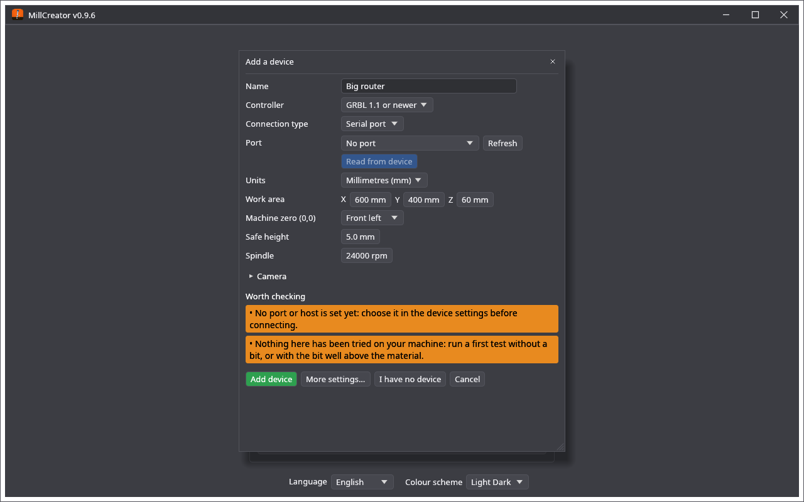

🌐 [English](Devices-and-Cameras) · [Polski](Urzadzenia-i-kamery) · **简体中文** · [한국어](Devices-and-Cameras-KO)

> ⚠️ 本页由英文版机器翻译而成，可能有不准确之处。如有疑问，请以[英文版](Devices-and-Cameras)为准。欢迎提出修改建议。

# 设备与摄像头

> 已确认 MillCreator 可以正常工作的机器，以及如何添加你的机器：[TESTS_ON_DEVICES.md](https://github.com/michalsarna/MillCreator/blob/main/TESTS_ON_DEVICES.md)。

**设备**（**device**）就是一台铣床。设备列表在每次运行之间保留，并且对所有项目都相同。启动界面用于选择设备；之后 **新建**（**New**）和 **打开…**（**Open…**）会使用该设备。编辑器的设备标签页显示当前使用的设备并可打开其设置。

## 启动界面上的按钮
第一行是 **添加设备…**（**Add device…**）、**编辑…**（**Edit…**）、**复制**（**Duplicate**）和 **导入…**（**Import…**，检查严格：较新的格式、错误的数字或超过 2 MB 的文件会被拒绝），第二行是 **我没有设备**（**I have no device**）。**导出…**（**Export…**，把一台设备导出为 JSON 文件）和 **删除**（**Delete**，会要求确认）位于 **编辑…** 窗口中。名称已被占用的副本或导入设备会获得一个编号：`Router (2)`。

## 我没有设备
一次性创建一个名为 **Dummy** 的普通设备：工作区 300 × 200 mm，Z 向行程 60 mm，安全高度 5 mm，主轴 1000–24000 rpm。它像其他设备一样保留在列表中，并且可以编辑；项目会把它作为机器一起保存。在没有任何设备时使用 **新建** 和 **打开…** 也会创建并使用它。

## 设备设置
**机器 → 设备设置…**（**Machine → Device settings…**，或启动界面上的 **编辑…**）打开设备的设置，共十二个页面：

| 页面 | 内容 |
|---|---|
| 常规（General） | 名称、控制器、单位（mm 或英寸；几何数据始终以 mm 存储）、**机器零点 (0,0)**（**Machine zero (0,0)**，左前、右前、左后、右后）、**工件坐标**（**Work coordinates**，无，或 G54 … G59）以及 **程序零点**（**Zero of the program**）；对于新设备还有 **起点**（**Start from**，常见机器尺寸） |
| 机器（Machine） | 工作区 X、Y 和 Z，**安全高度**（**Safe height**，主轴在两次切削之间移动的高度），**材料上方的移动速度**（**Speed of moves above the material**），**X、Y、Z 加速度**（**Acceleration of X, Y, Z**）和 **转角偏差**（**Junction deviation**，0 = 未知；有了这些值，任务时间的计算会按 GRBL 的规划方式考虑加速、减速和较慢的转角；**读取机器**（**Read the machine**）从 `$120` – `$122` 和 `$11` 填入这些值）；从控制器读取的值及其设置的副本 |
| 主轴（Spindle） | **最低转速**（**Lowest speed**）、**最高转速**（**Highest speed**）、**开启后等待**（**Wait after switching on**）、**换刀装置**（**Tool changer**） |
| G-code | 设备的 **自定义 G-code**（**own G-code**，八个框，见下文）、变量以及 **自定义文件格式**（**Own file format**） |
| 连接（Connection） | 串口或网络套接字、端口或 USB ID、波特率、GRBL 版本、流式传输方式、连接后执行的操作；或通过 HTTP 连接的 Duet 主板 |
| 摄像头（Camera） | 最多八个摄像头（见下文） |
| 旋转轴（Rotary） | 旋转附件：类型、直径、每转微步数；开启时，工作区在工件每绕一圈的位置显示一条蓝线（**周长 …**（**Circumference …**））。在 文件 → 项目设置…（File → Project setup…）中选择 **圆柱**（**Cylinder**）会开启它 |
| 点动（Jogging） | 点动按钮的 X 和 Y 以及 Z 的步长、点动速度、**每次运行前检查程序**（**Check the program before every run**） |
| 探针（Probe） | 对刀板（其厚度及其侧面厚度）或 3D 触发式探针（Z 偏移、测球直径）、失败距离、回退距离和速度 |
| 宏（Macros） | 自定义 G-code 按钮，以及每个任务之前和之后的 G-code |
| 维护（Maintenance） | 提醒：要做什么以及每隔多少小时做一次，完成时按 **完成**（**Done**） |
| 禁入区（No-go zones） | 工作区中刀具绝不能进入的矩形和圆形区域（压板、虎钳），每个都有开关和名称，在工作区上以红色绘制；**仅在这些高度 (Z)**（**Only at these heights (Z)**）把禁入区限制在其所处的高度范围内，从材料顶面算起，与 G-code 中的 Z 相同（高出材料 15 mm 的压板为 0 – 15）。在安全高度上的移动会绕过每个高度达到安全高度的禁入区（保持刀具半径加 1 mm 的距离），返回零点的路径也是如此；对于较低的禁入区则从上方越过。刀具（其刃部，从刀尖向上）触及禁入区的切削会成为任务的警告，无法绕行的移动（起点或终点位于禁入区内）也会成为警告。在图形上右键单击会出现 **添加为禁入区**（**Add as no-go zone**）：每个图形都会成为一个禁入区（圆形图形为圆，否则为其外接矩形），并从图纸中移除。当设备有禁入区时，侧面板中会有一个 **禁入区** 标签页，其中有相同的各行。禁入区和该页面与 LightCreator 和 PenCreator 中的相同 |
| 备注（Notes） | 关于机器的自由文本 |

控制器为 GRBL（0.7 至 1.1 及更新版本），或 **Smoothieware**（*GRBL 版本*（*GRBL version*）列表中的一个选项），或通过 HTTP 连接的 **Duet / RepRapFirmware** 主板（连接页面上的一个复选框，带地址和不会被保存的密码；参见机器控制）。**主轴**（**Spindle**）页面还有 **换刀装置**（**Tool changer**，`T<n> M6`），**G-code** 页面有用于吸尘器的代码行。**连接**（**Connection**）页面设置如何连接到控制器（串口或网络套接字、波特率、计数式或简单流式传输、连接后回原点或清除报警），**旋转轴**（**Rotary**）页面设置旋转附件（卡盘或滚轮、工件直径、每转微步数；由 Y 轴转动工件）。编辑器的 **设备**（**Device**）标签页有连接、回原点、解锁、暂停、继续、机器的状态和位置以及一个控制台。

## 摄像头
设备设置的 **摄像头**（**Camera**）页面最多可容纳八个摄像头（**添加摄像头**（**Add a camera**））：每个摄像头有 **摄像头名称**（**Camera name**）、**已开启**（**Switched on**）、**地址**（**Address**，MJPEG 流、JPEG 快照、http / https，或 rtsp、udp、rtp 或 rtmp 流）或 **本机摄像头**（**Camera of this computer**）及其 **摄像头编号**（**Camera number**），以及 **摄像头旋转**（**Camera rotation**，0 / 90 / 180 / 270°）；其中一个是被显示的摄像头。当设备有已开启（且有效）的摄像头时，编辑器的侧面板中会出现 **摄像头**（**Camera**）标签页，工作区上方会出现 **摄像头视图**（**Camera view**）按钮，它把画面作为工作区的一个标签页打开（可以拖到另一个窗格或在单独窗口中打开，与预览相同）。来自地址的画面使用 baseCreator 的流读取器；本机摄像头需要使用 `--features camera` 构建的版本。会应用摄像头的旋转和画面调整。

**摄像头视图** 按钮以三种方式之一打开摄像头的实时画面，用视图顶部的三个图标选择，并为每个摄像头分别保存（也可在 **视图 → 视图选项**（**View → View options**）中设置）：**单独窗口**（**Separate window**，一个独立窗口，带有与主窗口相同的工具栏，可以移出程序窗口）、**侧边标签页**（**Side tab**，侧面板的摄像头标签页）或 **工作区中的标签页**（**Tab in the work area**，与图纸并列）。画面可以用鼠标滚轮或其左下角的缩放条缩放（最多 8 倍），拖动可以移动，双击显示完整画面；缩放比例和单独窗口的位置随设备保存。画面下方有：**叠加**（**Overlay**）、照片、视频和延时摄影。该视图在 LightCreator、MillCreator 和 PenCreator 中相同。

## 在项目中
项目会保存其所针对设备的快照（名称和工作区的三个尺寸）。当项目在工作区不同的设备上打开时，状态栏会给出提示。

**自定义 G-code（G-code 页面）。** 八个框，每行一条命令（最多 20 行，每行 100 个字符；控制字符会被拒绝）：**文件最开头**（**Very start of the file**，在注释和文件头之前）、**程序开始时**（**At the start of the program**，在文件头和工件坐标字之后）、**每次换刀时**（**At every change of the bit**，取第一把刀时也会执行；在换刀暂停之后、主轴启动之前，例如 `T1 M6` 或冷却液命令）、**每次更换操作时**（**At every change of the operation**，新图层；在其注释之后、查看刀具之前）、**程序结束时**（**At the end of the program**，在刀头回到零点之后、`M30` 之前）、**文件最末尾**（**Very end of the file**，在 `M30` 之后），以及 **吸尘器开启**（**Dust collector on**）/ **吸尘器关闭**（**Dust collector off**，由要求使用吸尘器的图层使用）。这些代码行会写入程序生成的每一份 G-code：文件、G-code 文本标签页、发送的任务、空运行。它们是机器自己的命令，程序不会检查它们：请先在机器未装刀具的情况下试用新的代码行。

**变量、文件最开头和最末尾以及文件格式（G-code 页面）。** 在每个自定义 G-code 框中，花括号中的词会在生成文件时被替换：`{project_name}`、`{project_path}`（项目尚未保存时为空）、`{date}` 和 `{time}`（UTC）、`{machine_name}`、所有切削内容在机器坐标中的外框（`{min_x}` `{max_x}` `{min_y}` `{max_y}` `{min_z}` `{max_z}`）及其尺寸（`{width}` `{height}` `{depth}`）；在换刀和更换操作时还有 `{layer_name}`、`{layer_index}`、`{total_layers}`，以及该图层刀具的变量：`{tool_number}`（其在换刀装置中的位置，没有则为 0）、`{tool_name}`、`{tool_diameter}`、`{tool_flutes}`，以及刀具库中该刀具的速度 `{tool_rpm}`、`{tool_feed}` 和 `{tool_plunge}`。列表位于这些框的下方；未知的名称以红色显示，在修正之前不会生成文件。*文件最开头* 写在注释和文件头之前（用于 `%`、程序号或控制器的文件头），*文件最末尾* 写在 `M30` 之后。**自定义文件格式**（**Own file format**）是对完成的程序进行的最后一遍处理，适用于以自己方式读取 G-code 的控制器；所有选项默认关闭，此时文件与以前相同：*整数后加小数点*（*Decimal point after whole numbers*，`X1` 变为 `X1.`，适用于 X、Y、Z、F、P、I、J、K）、*开头和结尾加 %*（*% at the start and end*）、*暂停字*（*Dwell word*，以秒为单位的 `G4 P`、以毫秒为单位的 `G4 P` 或以秒为单位的 `G4 X`；数值会被换算）、*行号*（*Line numbers*，N10、N20、……，带步长）和 *删除注释*（*Remove comments*）。如果在插件 *G-code tools* 的后处理器中也开启了相同的功能，状态行会警告该处理被执行了两次。

**工件坐标（G54 … G59）和程序零点（常规页面）。** 默认情况下，程序从机器零点（被选为 *机器零点* 的角）开始计算，与以前相同。当你选择 **G54 … G59** 时，程序以该字开头（因此机器使用你在机器上设定了零点的工件坐标系，例如通过触碰材料设定），并且每个 X 和 Y 都从 **程序零点** 算起：程序零点是以 X、Y 给出的工作区中的一个点（工作区从机器零点所在的角算起）。零点为 0, 0 时，数字与不使用代码时相同，只是多了这个字。边框（*Frame*）、空运行和任务都使用它，结束时返回零点以及自定义 G-code 也使用它。Z 不变：它从材料顶面算起。

**在工作区上设定程序零点。** 在设备设置中，*程序零点*（X、Y）旁边的 **在工作区上拾取**（**Pick on the work area**）按钮让下一次在工作区上的单击设定零点；它会吸附到图形的角和中点以及工作区的角（Esc 取消）。选择了工件坐标系（G54 … G59）时，工作区上的零点处会显示一个 **坐标轴图标**（X 为红色，Y 为绿色，带有坐标系名称）；拖动它，设置中的字段会立即跟随变化。一次拾取或一次拖动就是 *撤销*（Ctrl+Z）的一步，只要之后没有更改其他内容。保存设置时，零点会随设备一起保存。

## 摄像头：RTSP、照片、视频和延时摄影

* **RTSP 流**（`rtsp://` 或 `rtsps://`，当摄像头要求时，在地址中包含用户名和密码）可以作为摄像头地址使用。流由 **ffmpeg** 解码，它作为单独的程序运行：程序会先在自身旁边查找（安装包自带一个），然后在 macOS 应用的资源中查找，最后在系统的 PATH 中查找。没有 ffmpeg 时，摄像头视图会给出提示。如果流中断，每隔几秒会重新打开一次。带密码的地址可以在计算机的进程列表中看到：请使用只能观看的摄像头账户。
* **其他流：** `udp://` 和 `rtp://`（来自编码器的 MPEG-TS 或 RTP，也支持组播；`udp://@:5000` 在一个端口上监听）以及 `rtmp://` 都由 ffmpeg 以同样的方式读取。20 秒内没有任何数据的流会被视为已断开并重新打开。安装包中精简版的 ffmpeg 不支持 TLS 地址（`rtsps://`、`rtmps://`）。
* **摄像头选项**（**Camera options**，位于由 ffmpeg 读取的流地址下方，默认关闭）：**RTSP 使用 UDP**（**Use UDP for RTSP**，仅适用于 `rtsp://` 地址；延迟比 TCP 小，但在网络较差时画面可能出现破损；关闭：TCP）和 **低延迟**（**Low latency**，更快获得最新画面，不进行缓冲；画面可能卡顿）。更改这些选项后会重新打开流。
* **视频格式**（**Video format**，在摄像头视图中）：**自动**（**Automatic**，默认）把 IP 摄像头（rtsp、udp、rtp、rtmp）的流按原样复制到 **MP4** 文件中。不进行任何重新解码或编码，因此处理器几乎没有负担，画质就是摄像头的画质。副本就是摄像头发送的原始流：程序的旋转和画面设置不会应用到其中。逐张提供画面的摄像头（MJPEG 地址、本机摄像头）会被录制为 **AVI**（Motion-JPEG）。**MP4** 要求进行复制（不是流的摄像头会被录制为 AVI，按钮下方的一行文字会说明这一点）；**AVI** 总是写入 Motion-JPEG 画面。复制需要 ffmpeg；没有 ffmpeg 时视频为 AVI。
* 在录制标签页上的摄像头面板中：**拍照**（**Take a photo**，JPEG）、**录制视频**（**Record video**）/ **停止录制**（**Stop recording**，旁边的一行文字计算秒数以及 AVI 的画面数）以及 **延时摄影**（**Time-lapse**）：**每隔**（**Every**）N 秒，或 **每个图层之后**（**After each layer**，在任务的下一个图层开始时以及任务结束时拍一张；需要从程序中用 **开始**（**Start**）把任务发送到机器），然后 **开始延时摄影**（**Start time-lapse**）/ **停止延时摄影**（**Stop time-lapse**）。摄像头视图关闭或隐藏时，录制会继续进行。
* 侧面板的 **录制**（**Recording**）标签页为设备的每个摄像头提供一个面板，以摄像头名称命名。每个摄像头独立录制，并各自保存自己的设置：**拍照**、**录制视频**、**延时摄影**（方式及其开始和停止）、**视频格式**、**文件夹**（**Folder**），以及其 **摄像头视图** 的打开方式。正在录制但不是视图中所显示的摄像头会读取自己的画面。有多个摄像头时，文件名中包含摄像头名称（`box-Side_camera-photo-0001.jpg`），所有文件都放在同一个文件夹中。摄像头视图的画面下方只有它所显示的摄像头的按钮：拍照、视频、开始和停止延时摄影。
* **移开刀头拍照**（**Photos with the head moved aside**，**录制** 标签页 → **延时摄影时移到一旁拍照**（**Time-lapse photos aside**）→ **每次拍照时把刀头移到一旁**（**Move the head aside for each photo**））：在任务期间，延时摄影的每张照片都会等待刀具的 **下一次抬起**，因此每隔 N 秒或每个图层之后的照片会比预定时间稍早或稍晚。抬刀时主轴停止（或在启用 **保持主轴运转**（**Keep the spindle running**）时继续运转：不会重新启动，也不会在侧壁上留下痕迹），刀头移到 **位置**（**Place**，机器坐标；**使用当前位置**（**Use the current position**）取其当前所在位置），程序等待 **拍照前等待**（**Wait before the photo**）的时间，然后使用在此之后得到的画面。之后刀头回到离开处的上方，主轴重新达到转速（设备的加速时间），任务继续进行。延时摄影一行中的 **每次抬刀后**（**After every lift**）会在每次抬刀时拍一张照片：任务会花费长得多的时间。
* **拆分长线条**（**Split long lines**，同一部分中）：长的直线切削会被拆分为 2 至 256 条较短的线发送，每条至少为所设长度。这样任务可以更快停止，进度也更均匀地推进。路径保持不变；快速移动和圆弧保持完整。
* **文件保存位置。** 未选择文件夹时，文件保存到 **项目文件旁边的 `camera` 文件夹** 中；如果该文件夹已经存在，则保存到 `camera00`、`camera01`、…… 中第一个可用的文件夹（并在本次运行的其余时间使用同一个文件夹）。尚未保存的项目使用共享数据文件夹中的 `camera` 文件夹。**文件夹**（**Folder**）一行显示下一个文件的保存位置，**选择文件夹…**（**Choose the folder…**）为所有内容设置一个文件夹（与视频格式和延时摄影设置一起，为所有程序保存在共享数据文件夹中的 `camera_recording.json` 中）。
* **文件名** 以项目文件的名称开头并编号：`box-photo-0001.jpg`、`box-video-0001.mp4`（或 `.avi`）；延时摄影有自己的文件夹（`box-timelapse-0001`），其中为 `box-frame-00001.jpg`（每隔 N 秒）或 `box-layer-00001.jpg`（每个图层之后）。没有项目文件时，文件名没有前缀（`photo-0001.jpg`）。

## macOS："No route to host"

macOS 会阻止程序访问本地网络，直到它们获得允许，新构建或更新的程序可能需要再次获得允许。如果无法连接到网络上的控制器或摄像头，并且消息为 *No route to host*，请打开 **系统设置 → 隐私与安全性 → 本地网络**（**System Settings → Privacy & Security → Local Network**）并开启该程序（如果你从终端启动它：开启终端）。如果它已经开启，请将其关闭再打开，然后重新启动程序。
