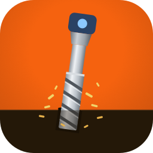
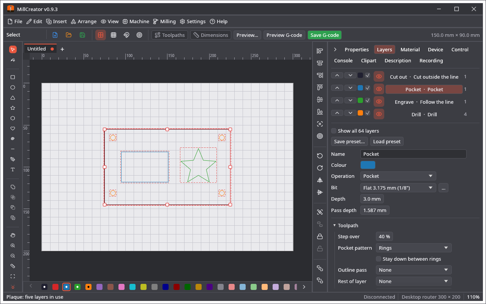

🌐 [English](Home) · [Polski](Home-PL) · [简体中文](Home-ZH) · **한국어**

> ⚠️ 이 페이지는 영어판을 기계 번역한 것으로, 부정확한 부분이 있을 수 있습니다. 의심스러우면 [영어판](Home)을 기준으로 하십시오. 수정 제안을 환영합니다.

# MillCreator

CNC 밀링 작업을 설계하고 준비하는 오픈 소스 소프트웨어로, Rust로 작성되었습니다. macOS, Windows, Linux에서 도형을 그리거나 가져오고, 각 레이어에 작업과 비트를 지정하고, 작업을 3D로 확인하고 G-code를 작성합니다. [LightCreator](https://github.com/michalsarna/LightCreator)(레이저)의 자매 프로그램이며 [baseCreator](https://github.com/michalsarna/baseCreator)를 통해 같은 창, 편집기, 파일을 사용합니다.

## 어디서 시작할까요

| 하고 싶은 일 | 바로 가기 |
|---|---|
| 프로그램 설치 | [설치](Installation-KO) |
| 첫 작업 준비 | [빠른 시작](Quick-Start-KO) |
| 도형 그리기, 편집, 가져오기 | [디자인 도구](Design-Tools-KO) |
| 그림을 스타일 있는 선으로 조각(점묘, 꼬불선, 해칭…) | [스타일 트레이스](Style-Trace-KO) |
| 드래그 나이프로 자르기, 나이프 라이브러리 | [드래그 나이프](Drag-Knife-KO) |
| 작업 영역 정리: 창 영역, 탭, 창 | [창 영역과 탭](Panes-and-Tabs-KO) |
| 내 기계와 카메라 추가 | [장치와 카메라](Devices-and-Cameras-KO) |
| 무엇을 어떻게 가공할지 지정 | [레이어와 작업](Layers-and-Operations-KO) |
| 비트 선택 또는 정의 | [비트 라이브러리](Bit-Library-KO) |
| 재료 설정 | [재료](Material-KO) |
| 작업을 3D로 보기, G-code 내보내기 | [3D 보기와 G-code](3D-View-and-G-code-KO) |
| 기계 조작: 조그, 원점 설정, 프로빙, 펌웨어, 보정 | [기계 제어](Machine-Control-KO) |
| 메뉴 항목과 그 기능 찾기 | [메뉴](Menus-KO) |
| 단축키 익히기 | [키보드 단축키](Keyboard-Shortcuts-KO) |
| LightCreator와 프로젝트 공유 | [프로젝트 파일](Project-File-KO) |
| 새 작업의 재료와 원점 설정 | [빠른 시작](Quick-Start-KO) (프로젝트 설정) |
| 화면 모습 보기 | [스크린샷](Screenshots-KO) |
| 설정 파일 찾기 | [설정과 파일](Settings-and-Files-KO) |
| 코드에 대해 읽기 | [아키텍처](Architecture-KO) |
| 무엇이 테스트되었는지 알기 | [안전과 제한 사항](Safety-and-Limitations-KO) |

## 테스트된 장치

이 프로그램은 다음 기계에서 시험했으며 정상적으로 동작합니다.

| 장치 | 종류 | 컨트롤러 |
|---|---|---|
| TwoTrees TTC450Pro | CNC 밀 | GRBL |

다른 기계에서도 동작하나요? [이슈](https://github.com/michalsarna/MillCreator/issues)로 알려 주시면 목록에 추가합니다.
기계를 추가하는 방법이 담긴 목록: [TESTS_ON_DEVICES.md](https://github.com/michalsarna/MillCreator/blob/main/TESTS_ON_DEVICES.md).

## 한눈에 보기

* **장치:** 내 기계들(작업 영역, Z 이동 거리, 안전 높이, 스핀들 범위, 카메라)을 한 목록에서 관리합니다. **장치 없음**(I have no device)을 누르면 Dummy라는 대체 장치가 만들어집니다.
* **레이어:** 64개의 레이어가 있으며, 각각 작업(선 바깥쪽/안쪽 절단, 선 따라가기, 링 또는 래스터 방식 포켓, 잔여 포켓, 면 가공, 드릴, 보링, 모따기, 도그본 슬롯, 인레이를 포함한 V-카빙, 그림과 3D 릴리프), 비트, 깊이, 패스 깊이, 이송 속도, 스핀들 속도, 고정 탭, 램프 또는 헬릭스, 하향 또는 상향 절삭, 남길 여유량, 절삭유를 가집니다. 설정은 프리셋으로 저장할 수 있습니다.
* **비트:** 기성 비트와 직접 만든 비트의 라이브러리(장치마다 보관), 일곱 가지 종류, 각 치수를 어디서 재는지 보여 주는 그림, 가져오기와 내보내기.
* **재료:** 세 가지 색의 목재, 금속, 원하는 색의 플라스틱, 그리고 두께.
* **3D 보기:** 재료 블록, 절삭 부분, 안전 높이에서의 이동. 회전, 확대/축소, 초기화가 가능하며 슬라이더로 작업을 재생합니다.
* **G-code:** GRBL 방식이며, 비트 교체를 위한 일시 정지 또는 공구 교환기용 `T… M6`, 사용자 지정 줄(시작, 끝, 비트 또는 작업 변경), 작업 좌표계, 재료 위의 원점을 지원합니다. Mach3 / Mach4 / UCCNC와 LinuxCNC는 플러그인으로 지원합니다.
* **기계:** GRBL(0.7부터 1.1 이상), Smoothieware, HTTP로 연결한 Duet, LinuxCNC(파일). 조그, 프로빙, 구멍 중심 찾기, 오버라이드, 저장된 위치, 절삭유를 지원합니다.
* **그리기:** DXF, SVG, PDF, Illustrator, LightBurn, MillMage, UGS 가져오기, DXF, Illustrator, LightBurn, MillMage 내보내기, 배열, 경로를 따라 복사, 경로 위의 텍스트, 트리밍, 네스팅, QR 코드와 바코드, 일련번호 텍스트, STL / OBJ / 3MF 모델을 릴리프로 사용.
* **LightCreator와 공유:** 편집기, 클립아트 그림 310개, SVG / PDF / Illustrator 및 LightBurn 가져오기, `.cre` 프로젝트 파일, 38개 언어(공유 텍스트), 18가지 색 구성표.

> ⚠️ **안전:** 밀링 기계는 위험합니다. 새 작업은 재료 위 허공에서 먼저 시험하고, 눈과 귀 보호구를 착용하고, 공작물을 고정하고, 작동 중인 기계를 절대 방치하지 마십시오. [안전과 제한 사항](Safety-and-Limitations-KO)을 참고하십시오.

최신 릴리스: **v1.1.1** · [릴리스](https://github.com/michalsarna/MillCreator/releases) · [이슈](https://github.com/michalsarna/MillCreator/issues) · 라이선스: [MIT](https://github.com/michalsarna/MillCreator/blob/main/LICENSE) 또는 [Apache-2.0](https://github.com/michalsarna/MillCreator/blob/main/LICENSE-APACHE) 중 선택
