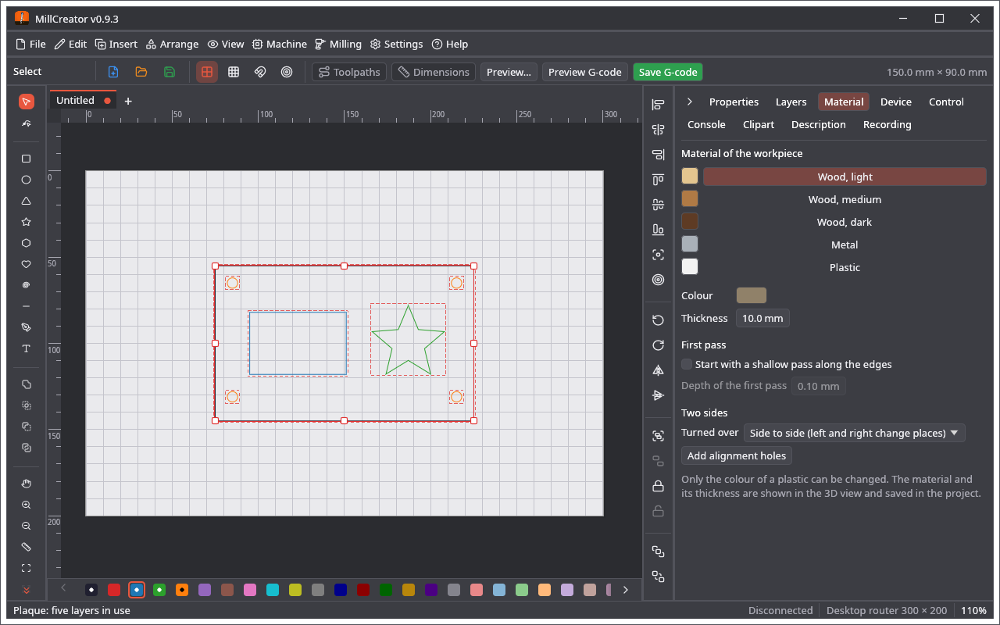
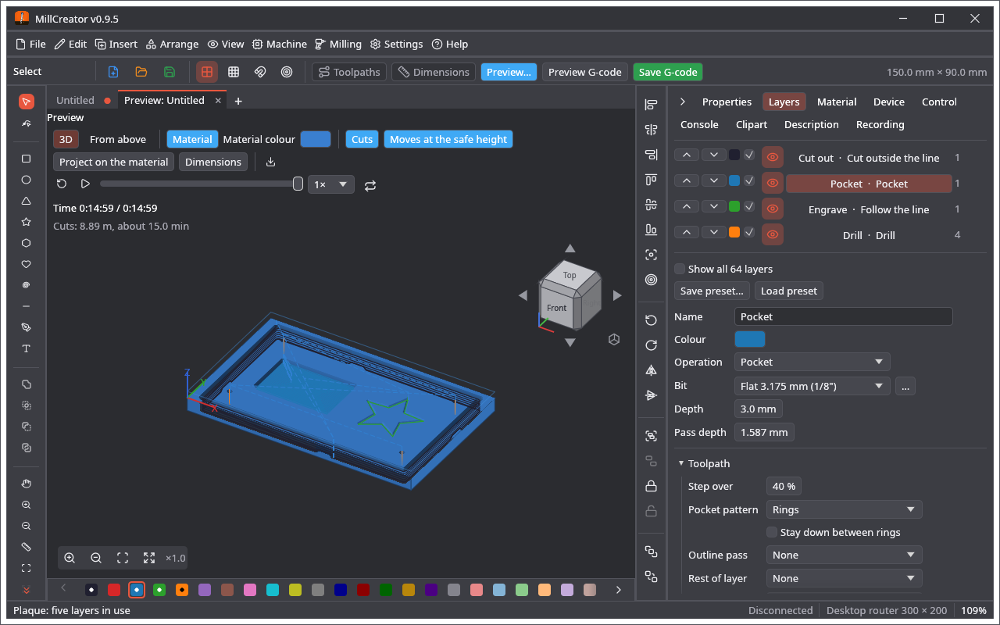

🌐 [English](Material) · [Polski](Material-obrabiany) · [简体中文](Material-ZH) · **한국어**

> ⚠️ 이 페이지는 영어판을 기계 번역한 것으로, 부정확한 부분이 있을 수 있습니다. 의심스러우면 [영어판](Material)을 기준으로 하십시오. 수정 제안을 환영합니다.

# 재료

**재료**(Material) 탭(**공작물 재료**(Material of the workpiece) 아래)은 공작물을 설정하며, 3D 보기가 이를 보여 주고 프로젝트가 보관합니다.

| 재료 | 색 |
|---|---|
| **목재, 밝은색**(Wood, light) | 모래색 |
| **목재, 중간색**(Wood, medium) | 갈색 |
| **목재, 어두운색**(Wood, dark) | 짙은 갈색 |
| **금속**(Metal) | 회색 |
| **플라스틱**(Plastic) | 기본값은 흰색, **원하는 어떤 색이든** |

색을 바꿀 수 있는 것은 플라스틱뿐이며, 나머지 재료는 고유한 색을 유지합니다. **두께**(thickness)(0.1~500 mm)는 원자재의 두께입니다. 재료 윗면이 Z = 0이며, 두께보다 깊은 레이어는 보고됩니다. **파일 → 프로젝트 설정…**(File → Project setup…)(파일 → 새로 만들기 후에 열립니다)은 조각의 **크기**, 조각에서 **X와 Y 원점의 위치**, **Z를 바닥에서 셀지** 여부(빠른 시작 참고), 또는 회전축 장치의 **원통**(지름과 길이; 장치의 회전축이 켜집니다)도 기록합니다. 재료는 이송 속도나 회전 속도에 영향을 주지 않으며, 그 값은 비트와 레이어가 가집니다.

**첫 패스.** **첫 패스**(First pass) 구역에서 *가장자리를 따라 얕은 패스로 시작*(*Start with a shallow pass along the edges*)을 켜고 **첫 패스 깊이**(Depth of the first pass)(기본값 0.1 mm)를 지정합니다. 그러면 모든 레이어는 먼저 자를 가장자리를 그 깊이로만 한 번 지나가 재료 윗면(베니어, 라미네이트, 코팅)을 깨끗하게 끊은 뒤 평소 패스를 합니다. 윤곽과 *선 따라가기*는 선을 따라, 포켓은 가장자리를 따라서만(영역 전체가 아니라) 이 패스를 하고, 드릴에는 없습니다. 모든 비트에서 동작합니다. 첫 패스보다 깊지 않은 레이어에는 추가 패스가 없습니다. 이 설정은 프로젝트에 저장됩니다.

**양면.** 레이어는 **아래 (뒤집음)**(Bottom (turned over)) 면에 있을 수 있습니다(레이어 설정의 *면*(*Side*)). **양면**(Two sides) 구역의 **뒤집는 방향**(Turned over)은 재료를 어떻게 뒤집는지 정합니다: **좌우로**(side to side)(왼쪽과 오른쪽이 바뀜) 또는 **앞뒤로**(end to end)(뒤와 앞이 바뀜), 프로젝트 설정의 조각 중심선을 기준으로 합니다(조각이 없으면 작업 영역 기준, 경고 표시). **정렬 구멍 추가**(Add alignment holes)는 그 선 위, 양 끝에서 10 mm 안쪽에 3 mm 구멍 두 개를 첫 빈 레이어에 놓습니다(그 레이어는 위면의 드릴 레이어가 되고, 깊이는 두께에 2 mm를 더해 희생판까지 들어갑니다). 그러면 제어 탭에 **절삭할 면**(Side to cut)이 생깁니다. 위면을 그 레이어와 구멍과 함께 깎고, 구멍에 핀을 꽂고, 재료를 뒤집은 다음 아래면을 고르십시오. 아래면의 레이어만 재료를 뒤집은 대로 뒤집혀 깎입니다. 미리 보기, 3D 보기, 시간, G-code(`(Bottom side: …)` 주석 포함)는 선택한 면을 따릅니다.

