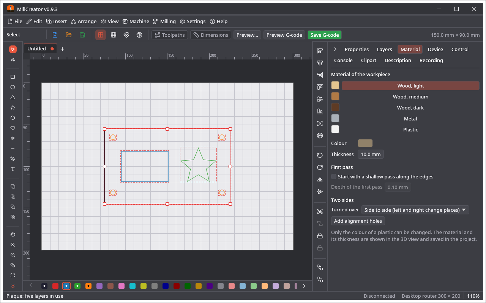
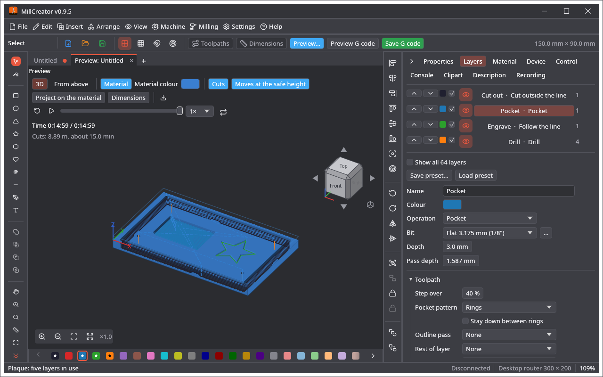

🌐 [English](Material) · [Polski](Material-obrabiany) · **简体中文** · [한국어](Material-KO)

> ⚠️ 本页由英文版机器翻译而成，可能有不准确之处。如有疑问，请以[英文版](Material)为准。欢迎提出修改建议。

# 材料

**材料**（**Material**）标签页（在 **工件材料**（**Material of the workpiece**）下）设置工件，3D 视图会显示它，项目会保存它。

| 材料 | 颜色 |
|---|---|
| **浅色木材**（**Wood, light**） | 沙色 |
| **中色木材**（**Wood, medium**） | 棕色 |
| **深色木材**（**Wood, dark**） | 深棕色 |
| **金属**（**Metal**） | 灰色 |
| **塑料**（**Plastic**） | 默认为白色，**可选择任意颜色** |

只有塑料的颜色可以更改；其他材料保持其自身的颜色。**厚度**（**thickness**，0.1 至 500 mm）是坯料的厚度：材料顶面为 Z = 0，比厚度更深的图层会被报告。**文件 → 项目设置…**（**File → Project setup…**，在 文件 → 新建 之后打开）还会记录材料块的 **尺寸**、X 和 Y 的 **零点在其上的位置** 以及 **Z 是否从底部算起**（参见快速入门），或者旋转附件上的 **圆柱**（其直径和长度；设备的旋转轴会被开启）。材料对进给或速度没有影响；这些由刀具和图层决定。

**首次加工。** 在 **首次加工**（**First pass**）部分中开启 *先沿边缘进行一次浅切*（*Start with a shallow pass along the edges*），并给出 **首次加工深度**（**Depth of the first pass**，默认为 0.1 mm）。这样每个图层都会先沿其要切削的边缘以这一深度走一次，使材料顶面（贴面、层压板、涂层）干净地断开，然后再进行正常的走刀。轮廓和 *沿线加工*（*Follow the line*）沿其线条进行首次加工，型腔只沿其边缘进行（而不是覆盖整个区域），钻孔则没有首次加工；它适用于所有刀具。不比首次加工更深的图层不会获得额外的走刀。该设置保存在项目中。

**双面。** 图层可以位于 **底面（翻转后）**（**Bottom (turned over)**）一侧（图层设置中的 *面*（*Side*））。**双面**（**Two sides**）部分中的 **翻转方式**（**Turned over**）说明材料如何翻转：**左右翻转**（**side to side**，左右互换位置）或 **前后翻转**（**end to end**，前后互换位置），绕项目设置中材料块的中线翻转（没有设置材料块时绕工作区中线，并给出警告）。**添加对位孔**（**Add alignment holes**）在这条线上、距两端 10 mm 处放置两个 3 mm 的孔，放在第一个空图层上（该图层被设为顶面的钻孔图层，深度为材料厚度加 2 mm，钻入垫板）。之后控制标签页上会出现 **加工面**（**Side to cut**）：先切削顶面及其图层和孔，在孔中插入定位销，把材料翻转过来并选择底面：只切削底面的图层，并按材料的翻转方式进行翻转。预览、3D 视图、时间和 G-code（带有 `(Bottom side: …)` 注释）都会跟随所选的面。

