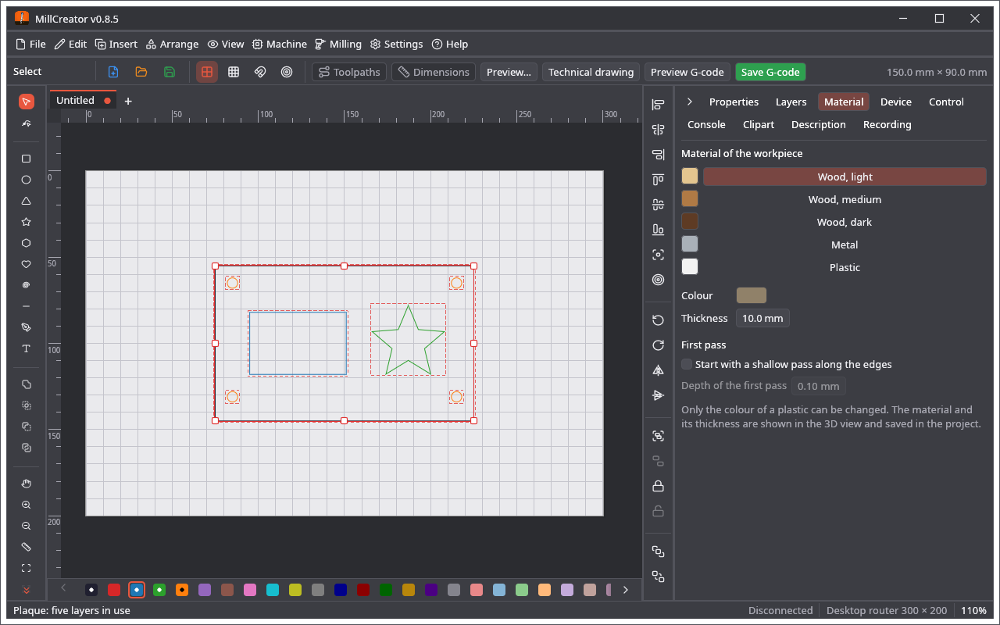
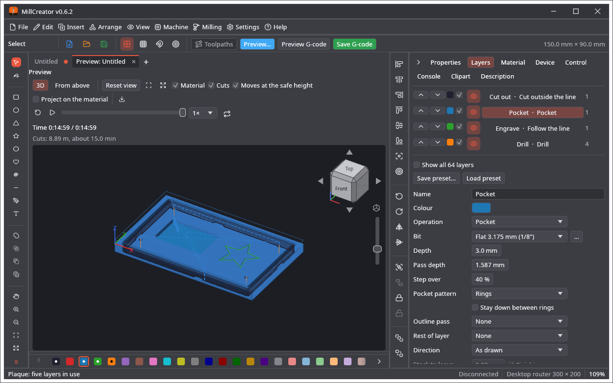

🌐 [English](Material) · **Polski**

# Materiał

Karta **Materiał** (pod nagłówkiem **Materiał obrabianego przedmiotu**) ustawia obrabiany przedmiot, który pokazuje widok 3D i który zapamiętuje projekt.

| Materiał | Kolor |
|---|---|
| **Drewno, jasne** (Wood, light) | piaskowy |
| **Drewno, średnie** (Wood, medium) | brązowy |
| **Drewno, ciemne** (Wood, dark) | ciemnobrązowy |
| **Metal** | szary |
| **Tworzywa** (Plastic) | domyślnie biały, **dowolny wybrany kolor** |

Tylko kolor plastiku można zmienić; pozostałe materiały mają swój kolor. **Grubość** (0,1 do 500 mm) to grubość materiału: wierzch materiału to Z = 0, a warstwa głębsza niż grubość jest zgłaszana. **Plik → Ustawienia projektu…** (otwiera się po Plik → Nowy) zapisuje też **wymiary** kawałka, **gdzie jest zero X i Y** na nim i czy **Z liczy się od spodu** (patrz Szybki start), albo **walec** na obrotnicy (jego średnicę i długość; obrotnica urządzenia zostaje włączona). Materiał nie wpływa na posuwy ani obroty; niosą je frezy i warstwy.

**Pierwsze przejście.** W sekcji **Pierwsze przejście** włącz *Zacznij od płytkiego przejścia wzdłuż krawędzi* i podaj **Głębokość pierwszego przejścia** (domyślnie 0,1 mm). Każda warstwa najpierw przechodzi wtedy raz wzdłuż krawędzi, które będzie ciąć, tylko na tę głębokość, co czysto przełamuje wierzch materiału (okleinę, laminat, powłokę), a potem wykonuje zwykłe przejścia. Profil i *Podążanie za linią* mają je wzdłuż swojej linii, kieszeń tylko wzdłuż krawędzi (nie po całym obszarze), wiercenie go nie ma; działa z każdym frezem. Warstwa nie głębsza niż pierwsze przejście nie dostaje dodatkowego przejścia. Ustawienie zapisuje się w projekcie.

**Dwie strony.** Warstwa może być na stronie **Spód (po odwróceniu)** (jej *Strona* w ustawieniach warstwy). **Odwracanie** w sekcji **Dwie strony** mówi, jak materiał jest odwracany: **na boki** (lewo i prawo zamieniają się) albo **wzdłuż** (tył i przód zamieniają się), wokół środkowej linii kawałka z ustawień projektu (bez nich — obszaru roboczego, z ostrzeżeniem). **Dodaj otwory bazujące** wstawia dwa otwory 3 mm na tej linii, 10 mm od końców, na pierwszej pustej warstwie (staje się warstwą wiercenia na wierzchu, na grubość i 2 mm w płytę ofiarną). Karta Sterowanie ma wtedy **Strona do frezowania**: wyfrezuj wierzch z jego warstwami i otworami, włóż kołki w otwory, odwróć materiał i wybierz spód: frezowane są tylko warstwy spodu, odwrócone tak jak materiał. Podgląd, widok 3D, czas i G-code (z komentarzem `(Bottom side: …)`) idą za wybraną stroną.

