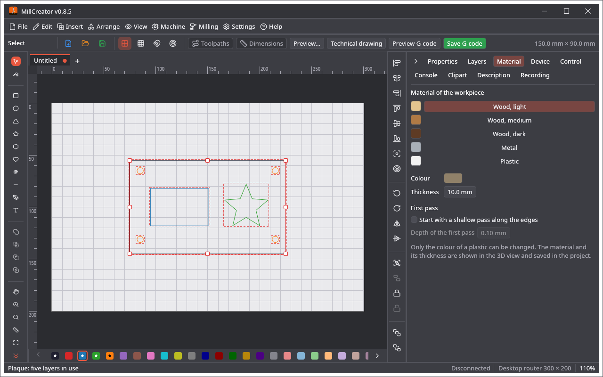
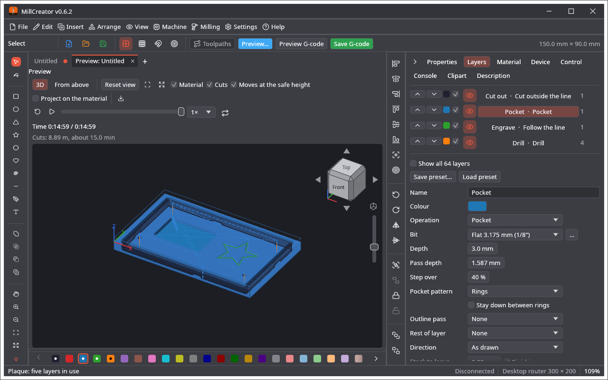

🌐 **English** · [Polski](Material-obrabiany)

# Material

The **Material** tab (under **Material of the workpiece**) sets the workpiece, which the 3D view shows and the project keeps.

| Material | Colour |
|---|---|
| **Wood, light** | sand |
| **Wood, medium** | brown |
| **Wood, dark** | dark brown |
| **Metal** | grey |
| **Plastic** | white by default, **any colour you choose** |

Only the colour of a plastic can be changed; the other materials keep their own colour. The **thickness** (0.1 to 500 mm) is the thickness of the stock: the top of the material is Z = 0, and a layer deeper than the thickness is reported. **File → Project setup…** (it opens after File → New) also records the **size** of the piece, **where the zero of X and Y is** on it and whether **Z counts from the bottom** (see Quick Start). The material has no effect on feeds or speeds; the bits and layers carry those.

**First pass.** In the section **First pass** switch on *Start with a shallow pass along the edges* and give the **Depth of the first pass** (0.1 mm by default). Every layer then first goes once along the edges it will cut, only that deep, which breaks the top of the material cleanly (veneer, laminate, coating), and then does its normal passes. A profile and *Follow the line* get it along their line, a pocket along its edge only (not over the whole area), drilling gets none; it works with every bit. A layer that is not deeper than the first pass gets no extra pass. The setting is saved in the project.

**Two sides.** A layer can be on the **Bottom (turned over)** side (its *Side* in the layer settings). **Turned over** in the section **Two sides** says how the material is turned: **side to side** (left and right change places) or **end to end** (back and front change places), round the middle line of the piece of the project setup (the work area without one, with a warning). **Add alignment holes** puts two holes of 3 mm on that line, 10 mm in from the ends, on the first empty layer (made a Drill layer of the top side, the thickness and 2 mm deep, into the spoilboard). The Control tab then has **Side to cut**: cut the top with its layers and the holes, put pins in the holes, turn the material over and choose the bottom: only the layers of the bottom are cut, turned over as the material is. The preview, the 3D view, the time and the G-code (with a `(Bottom side: …)` comment) follow the side chosen.

