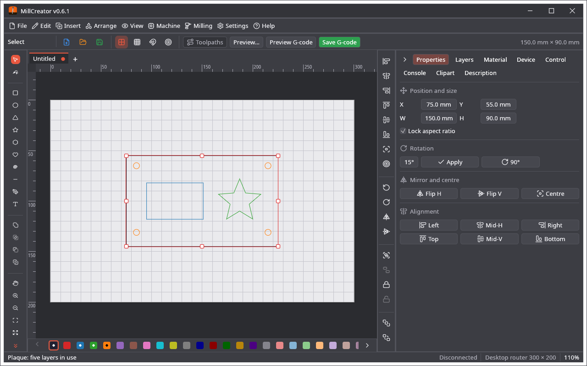
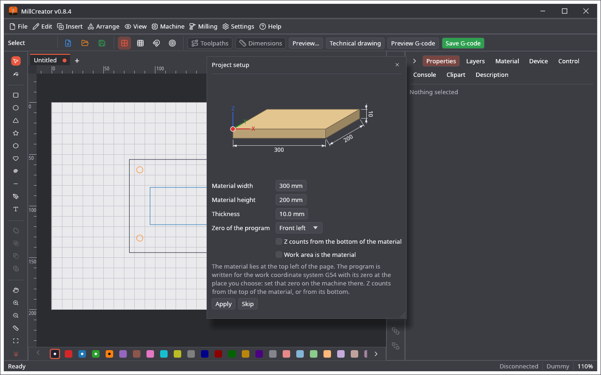
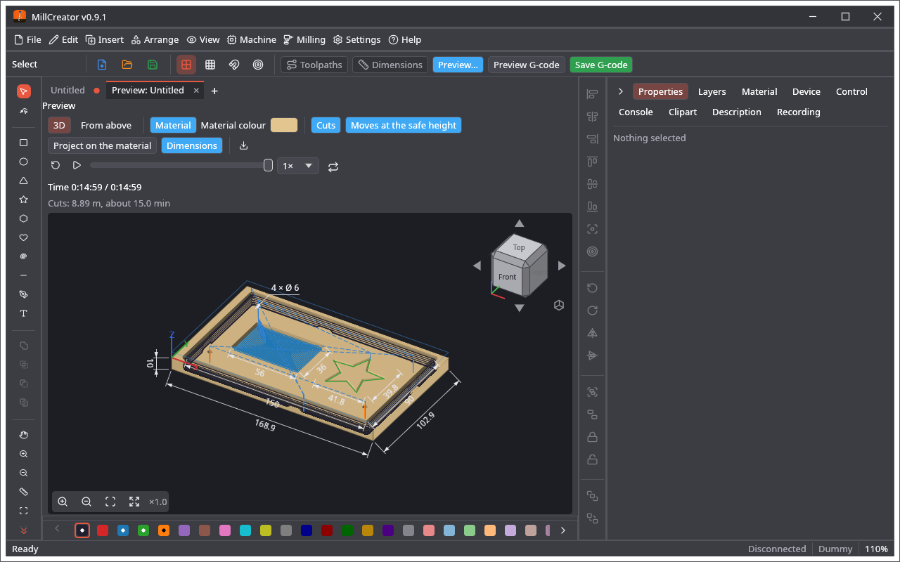
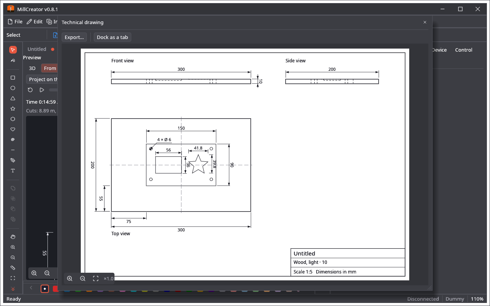

🌐 [English](Design-Tools) · **Polski**

# Narzędzia projektowe

Edytor jest edytorem baseCreatora, takim samym jak w LightCreatorze.

* **Narzędzia** (po lewej): zaznaczanie, edycja węzłów, prostokąt, elipsa, trójkąt, gwiazda, wielokąt, serce, spirala, linia, pióro, tekst, przesuwanie widoku, powiększanie i pomniejszanie. Klawisz litery wybiera narzędzie (V, N, R, E, Y, S, G, K, I, L, P, T, H, Z, X: zob. [Skróty klawiszowe](Skroty-klawiszowe)); narzędzia, które wstawiają obiekty, są też w menu **Wstawianie**. Nowe kształty trafiają na aktywną warstwę.
* **Uchwyty** przesuwają, zmieniają rozmiar, obracają i pochylają zaznaczenie; **pasek ułożenia** (po prawej) wyrównuje, rozmieszcza, porządkuje, grupuje, odbija i blokuje.
* Karta **Właściwości** (Properties): położenie i rozmiar, obrót, odbicie, wyrównanie.
* Menu **Edycja** (Edit): **Cofnij**, **Ponów**, **Kopiuj**, **Wklej**, **Powiel**, **Usuń**, **Zaznacz wszystko**. Grupowanie, blokowanie, kolejność, wyrównanie, operacje logiczne, przesunięcie obrysu i zaokrąglanie rogów są w menu **Rozmieść** (Arrange). Każda pozycja i jej klawisz: [Menu](Menu).
* **Siatka i przyciąganie:** menu Widok i **Ustawienia → Opcje widoku…**
* **Import:** **Plik → Otwórz…** wczytuje SVG, PDF i Illustratora (zgodnego z PDF albo starego rodzaju w PostScripcie) oraz projekty `.cre`; działa też przeciąganie pliku; każdy z nich otwiera się w osobnej karcie. **Plik → Importuj ▸ Importuj SVG…** (Ctrl+I) i **Importuj Adobe Illustrator / PDF…** dodają ścieżki do otwartego rysunku, każdą na warstwę o najbliższym kolorze (obrazy z SVG na aktywną warstwę); plik z warstwami Illustratora pyta, czy układać według koloru, czy według tych warstw. **Plik → Importuj ▸ Importuj DXF…** (albo **Plik → Otwórz…** i przeciągnięcie pliku) wczytuje ASCII `.dxf` (R12 i nowsze): linie, polilinie z łukami (bulge), łuki, okręgi, elipsy, krzywe splajnowe i bloki (ze skalą i obrotem) jako kontury, w milimetrach (jednostka pliku jest odczytywana), łuki i okręgi jako krzywe. Linie, które się stykają (z dokładnością 0,01 mm), stają się jedną ścieżką, więc narysowany prostokąt to jeden zamknięty kształt. Warstwy DXF trafiają na warstwy projektu, na których nie ma jeszcze kształtów, jedna po drugiej (pasek stanu mówi, gdzie). To, co nie jest linią (tekst, kreskowanie, wymiary), jest pomijane i nazwane; binarny DXF trzeba najpierw zapisać jako ASCII. **Plik → Importuj ▸ Importuj projekt LightBurn / MillMage…** wczytuje `.lbrn2` / `.lbrn` LightBurna i `.mage` MillMage'a: prostokąty, elipsy, wielokąty, gwiazdy, ścieżki z krzywymi, grupy i tekst jako kontury (warstwy LightBurna i MillMage'a nic tu nie znaczą). **Importuj projekt UGS…** wczytuje pliki `.ugsd` z UGS Designera: ścieżki, prostokąty, elipsy, tekst i obrazy, także ukryte obiekty; każdy sposób cięcia (na zewnątrz, w środku, po ścieżce, kieszeń, wiercenie) staje się ustawieniem warstwy z głębokością, posuwem i obrotami, a frez płaski o średnicy z pliku trafia do biblioteki. Import dodaje kształty do otwartego rysunku (jedno cofnięcie je usuwa) i używa warstw z pliku tylko tam, gdzie nie ma jeszcze kształtów.
* **Pliki innych programów, w obie strony:** DXF (obecny i R12, *legacy*), Illustrator (także stary w PostScripcie), SVG z obrazami oraz projekty LightBurna (`.lbrn2`, `.lbrn`) i MillMage'a (`.mage`) są wczytywane i tak samo zapisywane. **Plik → Eksportuj** zapisuje je z powrotem: **Eksportuj DXF…** (obecny rodzaj), **Eksportuj DXF R12 (starszy)…**, **Eksportuj Adobe Illustrator…**, **Eksportuj projekt LightBurn…** (`.lbrn2`, albo `.lbrn`, gdy tak nazwiesz plik) i **Eksportuj projekt MillMage…**, obok **Eksportuj SVG…**. Krzywe zostają (DXF spłaszcza je do 0,01 mm); obrazy trafiają do plików SVG, LightBurna i MillMage'a, a z DXF i Illustratora są pomijane (program mówi, ile).
* **Clipart:** galeria 310 obrazków z własnymi i wyszukiwaniem w sieci ([taka sama jak w LightCreatorze](https://github.com/michalsarna/LightCreator/wiki/Galeria-clipartow)). Obrazek jest wstawiany jako zwykłe kształty.
* **Prawy przycisk myszy** na kształcie otwiera menu kontekstowe: kopiuj, wklej, powiel, usuń, zaznacz wszystko, grupuj, rozgrupuj, zablokuj, odblokuj, odbij, obróć, podmenu *Rozmieść* (kolejność, wyrównanie, centrowanie, edycja węzłów, zamiana na ścieżkę) i podmenu *Operacje na kształtach* (suma, część wspólna, odejmowanie, różnica symetryczna, przesunięcie obrysu, zaokrąglanie rogów, zamiana na krzywe; są też w menu **Rozmieść**); dla obrazu także *Dostosuj obraz…* (Adjust image…) i *Wektoryzacja obrazu…* (Trace image…). Pozycje, które nie pasują do zaznaczenia, są szare.
* **Łączenie i eksport (menu Rozmieść):** **Połącz ścieżki automatycznie…** łączy zaznaczone linie, które stykają się w granicach tolerancji, w dłuższe ścieżki i zamyka te, które zamykają się same; **Zamknij ścieżkę z tolerancją…** tylko zamyka ścieżki, których oba końce są tak blisko (to samo małe okno, na początek 0,1 mm). **Eksportuj SVG…** i **Eksportuj PLT / DXF…** (Plik → Eksport) zapisują obrysy całego rysunku, a **Eksportuj zaznaczenie jako SVG…** / **Eksportuj zaznaczenie jako DXF…** zapisują zaznaczone kształty (wszystkie, gdy nic nie jest zaznaczone) dla innego programu: SVG zachowuje krzywe, DXF to R12 z warstwą DXF dla każdej warstwy projektu.
* **Obrazy (bitmapy):** **Plik → Importuj ▸ Import obrazu…** (albo upuszczenie pliku PNG, JPG, BMP, GIF lub WebP na okno) otwiera okno importu: obrót, odbicie, jasność, kontrast, gamma, automatyczne poziomy, negatyw i rozmiar. **Dostosuj obraz…** (Adjust image…; w sekcji *Obraz* karty **Właściwości** albo **Rozmieść → Dostosuj obraz…**) zmienia obraz na stronie, a **Wektoryzacja obrazu…** (Trace image…; ten sam przycisk albo **Rozmieść → Wektoryzacja obrazu…**) zamienia jego ciemne (lub jasne) obszary na kontury (próg, filtr plamek, uproszczenie, wygładzanie krzywych), które będą frezowane jak każdy inny kształt. Obraz położony na warstwie przełącza ją na operację **Obraz** i jest wtedy grawerowany (zobacz [Warstwy i operacje](Warstwy-i-operacje)); na warstwie z inną operacją jest tylko pokazywany, nie frezowany. **Rozmieść → Obrysuj w stylu…** rysuje obraz na nowo liniami w jednym z 19 stylów (wężyki, spirala, puentylizm, kreskowanie, linie przepływu, jedna ciągła linia…): zobacz [Obrysuj w stylu](Obrys-w-stylu).
* **Panel boczny:** przeciągnij zakładkę, żeby ustawić ją w innym miejscu (kolejność jest zapamiętywana, także w kopii zapasowej). Mała strzałka po lewej stronie zakładek chowa panel; zostaje wąski pasek z nazwami zakładek, a kliknięcie nazwy otwiera panel na tej zakładce.
* **Zakładki i panele:** każdy otwarty rysunek, podgląd, G-code projektu jako tekst, analiza pliku G-code i kamera to **zakładki**. *Widok → Podziel widok* dzieli obszar roboczy na najwyżej trzy panele (obok siebie albo jeden nad drugim; *Jeden widok* zbiera wszystkie zakładki razem); każdy panel ma własny pasek zakładek, bez listy do wyboru. **Przeciągnij zakładkę** do innego panelu (albo w obrębie paska w inne miejsce) albo użyj jej menu (prawy przycisk): *Przenieś na panel N* (inne panele i nowy, gdy jest miejsce), *Otwórz w osobnym oknie* (podgląd, tekst G-code i kamera; okno pamięta miejsce, **Wróć do głównego okna** przywraca zakładkę) oraz *Zamknij kartę*. Zamknięcie ostatniej zakładki panelu zamyka panel, a pozostałe się zsuwają. Nic nie otwiera się dwa razy: otwarcie projektu, który już jest otwarty, pokazuje jego zakładkę, a podgląd, widok kamery i tekst G-code projektu jest po jednym. Rysunek w innym panelu jest pokazany do oglądania, z własnym przybliżeniem; kliknięcie robi z niego aktywny rysunek. Układ jest zapamiętywany. Krok po kroku: [Panele i karty](Panele-i-karty).
* **Nazwy warstw:** *Ustawienia → Opcje widoku… → Pokaż nazwy warstw* (domyślnie wyłączone) wpisuje nazwę warstwy, na której są kształty, obok jej koloru w rzędzie warstw pod obszarem roboczym (długie nazwy są skracane, pełna jest w podpowiedzi; rząd przewija się poziomo, gdy brakuje miejsca).
* **Nazwy zmiennych:** *Ustawienia → Opcje widoku… → Pokaż nazwy zmiennych* (domyślnie wyłączone) pokazuje kursywą w nawiasie nazwę zmiennej, np. *(tool_diameter)*, obok etykiety każdego pola, które ma ją dla własnego G-code; kliknięcie kopiuje `{tool_diameter}` do schowka, gotowe do wklejenia w pole własnego G-code.
* **Podgląd G-code:** przycisk **Podgląd G-code** (Preview G-code) obok **Zapisz G-code** robi program projektu (z postprocesorami) i pokazuje go **jako tekst w zakładce** (*Podgląd G-code: nazwa.nc*), pokolorowany (słowa G i M, osie, prędkości, komentarze) i otwarty do edycji. **Zapisz G-code** w zakładce zapisuje go do pliku, **Wygeneruj ponownie** robi go od nowa z projektu (gdy są zmiany, pierwsze kliknięcie pyta *Stracić zmiany?*), **Analizuj** pokazuje jego ścieżki w analizie G-code. Bez ręcznych zmian tekst sam idzie za projektem (po zapisie, po zmianie notatek, urządzenia albo postprocesorów). Zakładka ze zmianami ma kropkę i przy zamykaniu pyta, czy je zapisać. Więcej w [Widoku 3D i G-code](Widok-3D-i-G-code#g-code-jako-tekst-podgląd-g-code). *Ustawienia → Opcje widoku… → Podgląd G-code po zapisaniu* (domyślnie wyłączone) otwiera zapisany plik w analizie po każdym **Zapisz G-code**.
* **Esc** czyści zaznaczenie; **dwa razy Esc** (drugi Esc w ciągu pół sekundy) wraca do narzędzia **Zaznaczanie** (Select).
* **Pasek nad obszarem roboczym:** nazwa narzędzia, **Nowy**, **Otwórz…** i **Zapisz**, przełączniki siatki i przyciągania, potem **Ścieżki** (Toolpaths; zielone, gdy drogi freza są rysowane na rysunku), **Podgląd…** (karta podglądu), **Widok z kamery** (gdy urządzenie ma kamerę), **Podgląd G-code** i **Zapisz G-code**, a po prawej rozmiar zaznaczenia. Pasek stanu pod obszarem roboczym ma komunikaty programu, połączenie, urządzenie projektu, powiększenie i położenie wskaźnika.
* **Pasek warstw** pod edytorem: jeden rząd 64 kolorów (kropka oznacza warstwy z kształtami); kliknięcie przenosi zaznaczone kształty na tę warstwę, podwójne kliknięcie otwiera jej opcje.
* Pole robocze to pole urządzenia; jednostki to jego jednostki.

## Tekst

Wybierz **Tekst (T)** i kliknij na obszarze roboczym: pojawia się tekst, a karta **Właściwości** otwiera się z polem do pisania. Ustawisz tam czcionkę, rozmiar, pogrubienie i kursywę, odstępy między literami i wierszami oraz wyrównanie. **Zamień na krzywe** robi z tekstu kształty, których węzły można edytować. Nowy tekst bierze ustawienia ostatnio zmienianego.

## Układanie, kopiowanie i generowanie (menu Rozmieść → polecenia po *Narożniki dogbone / T-bone…*)

Menu **Wstawianie** (Wstawianie) zawiera narzędzia lewej palety, które wstawiają obiekty (prostokąt, elipsa, trójkąt, gwiazda, wielokąt, serce, spirala, linia, linia łamana / pióro i tekst; używane narzędzie jest zaznaczone), a potem generatory wtyczek i clipart z internetu.

* **Tablica siatkowa…** kopiuje zaznaczenie w kolumnach i wierszach (*Odstęp kolumn*, *Odstęp wierszy*); oryginał i kopie zostają zaznaczone. **Tablica kołowa…** układa kopie wokół środka zaznaczenia na *Kąt całkowity* (360° to pełny okrąg i żadna kopia nie wypada na oryginale); *Obracaj kopie* obraca je razem z miejscem, bez tego tylko je przesuwa. Powstaje najwyżej 2000 kopii.
* **Kopiuj wzdłuż ścieżki…**: zaznacz kształty, a **na końcu** ścieżkę; kopie stoją co *Odległość* wzdłuż niej (pierwsza na początku, ostatnia na końcu, jeśli się zmieści) i można je obracać zgodnie ze ścieżką. **Tekst na ścieżce…**: zaznacz tekst, a na końcu ścieżkę; kontury tekstu są wyginane wzdłuż ścieżki od *Start* (potem to kontury, nie tekst).
* **Przytnij kształtem…**: zaznacz linie, a **na końcu** kształt zamknięty; zostają części linii wewnątrz niego (albo na zewnątrz, polem wyboru), przecięte tam, gdzie przecinają jego kontur. **Usuń duplikaty** usuwa kształty o tym samym konturze na tej samej warstwie (zaznaczone, a gdy nic nie jest zaznaczone, cały rysunek). **Rozdziel** zamienia kształt z kilkoma konturami w osobne kształty. **Uprość…** usuwa punkty leżące w granicach *Tolerancja* od linii (rysunek z tysiącami punktów daje krótszy G-code).
* **Tekst seryjny…**: zaznacz tekst; zostaje skopiowany w siatce z odliczanym `{n}` (*Pierwsza liczba*, *Krok*, *Cyfry*, *Kopie*) albo, z **Wczytaj plik CSV…**, po jednej kopii na wiersz pliku, z `{1}`, `{2}`… zastąpionymi jego kolumnami (przecinki lub średniki). Kopie są prawdziwymi kształtami, więc każdy program robi z nich G-code.
* **Kod kreskowy / QR…** kładzie na aktywnej warstwie jako kontury kod **QR** (*Rozmiar*) albo kod kreskowy **Code 39** (wielkie litery, cyfry, `- . $ / + %` i spacje; *Szerokość kreski* i *Wysokość*). Zrób kwadraciki dość duże dla freza.
* **Rozmieść kształty (nesting)…** układa zaznaczone kształty w rzędach od rogu strony na obszarze *Szerokość obszaru* × *Wysokość obszaru* (na początku obszar roboczy) z odstępem *Odległość*; *Pozwól obracać* pozwala położyć wysoki kształt. Układa według prostokątów kształtów (nie ich konturów) i mówi, gdy się nie mieszczą.
* **Pomiar…** pokazuje rozmiar, położenie, pole i długość zaznaczenia, a dla dwóch kształtów odległość między ich środkami i między ich prostokątami. Podąża za zaznaczeniem, dopóki jest otwarte.

## Obraz w tle (menu View) i okno wektoryzacji

**Widok → Nakładka z…** kładzie zdjęcie, plan albo skan **pod rysunkiem** (**Wczytaj obraz…**) albo obraz na żywo z kamery urządzenia (**Włącz kamerę**, **Zatrzymaj klatkę**; także przycisk **Nakładka** na karcie kamery). Zaznacz wyrównywanie i przeciągnij cztery narożniki obrazu na narożniki materiału albo obszaru roboczego (obraz podąża za nimi z przekształceniem perspektywicznym) albo podaj **Punkty odniesienia**, które zostają przy urządzeniu. Przezroczystość (krycie), pokazywanie, powrót do obszaru roboczego, odbicia, obrót i usuwanie są w tym samym oknie, a **Widok → Pokaż nakładkę z kamery** pokazuje ją lub ukrywa. Obraz jest zapisywany w projekcie. W oknie **Wektoryzacja obrazu** obraz można przybliżać kółkiem myszy albo przyciskami **Powiększ**, **Pomniejsz** i **Resetuj widok**, a zielony przycisk **Wektoryzuj** tworzy kontury.

## Linijka, zaznaczenie i pasek węzłów

* **Linijka (M):** narzędzie po **Pomniejsz (X)** w palecie. Przeciągnij od jednego punktu do drugiego albo kliknij dwa punkty: linia nad rysunkiem pokazuje długość, ΔX, ΔY i kąt, w jednostkach programu. Punkt blisko węzła kształtu bierze sam węzeł (w przeciwnym razie siatkę, gdy przyciąganie jest włączone). Kliknięcie prostego odcinka kształtu (boku prostokąta, linii) mierzy ten odcinek. Pomiar zostaje do następnego, **Esc** albo zmiany narzędzia; w rysunku nic się nie zmienia.
* **Prawy przycisk z narzędziem** (kształt, pióro, edycja węzłów, linijka…) działa jak podwójne **Esc**: wraca do **Zaznaczania (V)** bez zaznaczenia; linia rysowana piórem jest najpierw kończona. Przy narzędziu zaznaczania prawy przycisk otwiera menu podręczne jak dotąd.
* **Kilka zaznaczonych obiektów:** oprócz ramki całego zaznaczenia każdy obiekt ma własną cienką, przerywaną ramkę.
* **Pasek węzłów** pokazuje klawisze po nazwach: **Narożnik (C)**, **Na linię (L)**, **Na krzywą (S)**, **Dodaj węzeł (I)**, **Usuń węzeł (D)**, **Zaokrąglij (R)**, **Rozdziel (B)**. Nie ma już **Otwórz / zamknij**: **Rozdziel (B)** otwiera ścieżkę, a zamyka się ją, upuszczając jeden koniec na drugi.
* **Warstwa, która nie jest wykonywana** (z wyłączonym wyjściem), pokazuje swoje obiekty wyblakłe w stronę koloru obszaru roboczego.

## Podgląd: przyciski i wymiary

* Opcje paska podglądu to **przyciski**: jasnoniebieskie, gdy są włączone (jak przycisk widoku z kamery), kliknięcie włącza je albo wyłącza.
* **Wymiary** pokazuje wymiary zadania jak na rysunku technicznym: szerokość i wysokość całości, każdej części (gdy jest ich kilka) i odległość całości od zera maszyny, gdy zero jest w obrazie.

* **Mill:** w 3D **Wymiary** podaje długość, szerokość i grubość bryły na jej krawędziach; z góry wymiary kształtów. **Rysunek techniczny** (także **Frezowanie → Pokaż rysunek techniczny…**) pokazuje element jak rysunek europejski: widok z przodu, z boku i z góry, cięcia pod powierzchnią jako linie przerywane do głębokości ich warstwy, wymiary materiału, części i głębokości oraz tabliczkę z nazwą, materiałem i skalą dla arkusza A4.
* **Ustawienia projektu** pokazują bryłę materiału w rzucie ukośnym z jej szerokością, wysokością i grubością oraz zero programu z osiami w wybranym miejscu.

* **Obrazy:** wczytywany jest też TIFF (`.tif`, `.tiff`), tak jak PNG, JPEG, BMP, GIF i WebP.

## Wymiary na obszarze roboczym, linijka i menu węzłów

* **Wymiary** (przycisk obok **Ścieżek** na pasku nad obszarem roboczym) pokazuje rysunek jak na rysunku technicznym: szerokość i wysokość całości i każdego obrysu (zewnętrznego i otworów kształtu, każdego osobno) oraz średnice okrągłych, te same nazwane raz (**4 × Ø 6**). W rysunku nic się nie zmienia.
* **Linijka (M)** bierze węzeł kształtu (oznaczony kwadratem), środek odcinka (romb) albo środek okręgu lub elipsy (kółko). Kliknięcie okręgu pokazuje jego promień od środka do klikniętego punktu i średnicę; elipsy oba promienie i promień do punktu; krzywej jej długość, a gdy krzywa jest łukiem okręgu, promień wodzący od środka do klikniętego punktu i jego długość.
* **Edycja węzłów:** prawy klik na węźle albo odcinku otwiera menu z poleceniami paska węzłów; **Gładki** ma klawisz **G**, a promień **Zaokrąglij (R)** stoi za tym przyciskiem.
* **Mill:** przycisk **Rysunek techniczny** stoi obok **Podglądu…** na pasku (zniknął z paska podglądu). Jego okno ma **Eksportuj…** (strona PDF A4 albo obraz PNG / JPG w 300 dpi), powiększanie (kółko, pasek powiększenia, podwójne kliknięcie pokazuje cały arkusz) i **Zadokuj jako kartę**: rysunek staje się kartą obszaru roboczego, a **Otwórz w osobnym oknie** wyjmuje go z powrotem. W podglądzie **Wymiary** podaje też wyfrezowane kształty: ich obrysy zewnętrzne i otwory na górze bryły w 3D, z góry jak na rysunku, ze średnicami okrągłych.

## Jednostki

* **Ustawienia → Opcje programu… → Jednostki** wybiera jednostki, w których program pokazuje długości: milimetry, centymetry, metry, cale albo stopy, albo **Jak w urządzeniu**. Używają ich rozmiary we **Właściwościach**, linijka, **Wymiary** na rysunku i w podglądzie oraz rysunek techniczny.
* **Jednostki urządzenia** (milimetry albo cale, w oknie urządzenia) to jednostki maszyny: w nich jest zapisany G-code. Urządzenie w calach dostaje **G20** i wszystkie długości oraz posuwy w calach; urządzenie w milimetrach **G21** i milimetry. Upewnij się, że to jednostki, w których pracuje sterownik.
* Gdy urządzenie liczy w innym systemie niż program (cale wobec milimetrów), wymiary i linijka pokazują oba: najpierw jednostki programu, w nawiasie jednostki maszyny, na przykład **25.4 mm [1.000"]**.
* **Rodzaje rysunku technicznego** (**Rodzaj rysunku** w jego oknie): **ISO 128** (rzutowanie europejskie, Europa i większość świata: widok z góry pod widokiem z przodu, widok z lewej po prawej stronie, liczby wzdłuż linii wymiarowych), **ASME Y14** (rzutowanie amerykańskie, USA i Kanada: widok z góry nad widokiem z przodu, widok z prawej po prawej stronie, liczby zawsze poziomo) i **JIS B 0001** (rzutowanie amerykańskie, Japonia, liczby wzdłuż linii). Tabliczka podaje rodzaj i pokazuje znak rzutowania.

## Nóż wleczony

Warstwa z operacją **Nóż wleczony** tnie wzdłuż swoich linii nożem wleczonym w uchwycie (folia, karton, guma, cienkie arkusze), przy stojącym wrzecionie: zadanie zatrzymuje się przed warstwą z komunikatem **Put in the drag knife**, frez nie jest potrzebny. **Nóż** z biblioteki noży (ostrza 30°, 45° i 60°, nóż wleczony w uchwycie maszyny CNC albo własny) ustawia naraz przesunięcie czubka, **Obracaj na narożach ostrzejszych niż** i **Tnij dalej za początkiem** warstwy, a potem każdą z tych wartości można zmienić na warstwie. **Biblioteka noży…** (także **Frezowanie → Biblioteka noży…**) otwiera bibliotekę: **Kopiuj** tworzy własny nóż z gotowego, z nazwą, wartościami i notatkami, zapisywany z ustawieniami programu i w jego kopii zapasowej; przesunięcie jest korygowane na każdym narożu, otwory są cięte najpierw, a zamknięta linia jest cięta dalej za swój początek. Nóż tnie jednym przejściem na głębokość warstwy. Jeszcze nie sprawdzone na prawdziwej maszynie. Więcej: [Nóż wleczony](Noz-wleczony).
