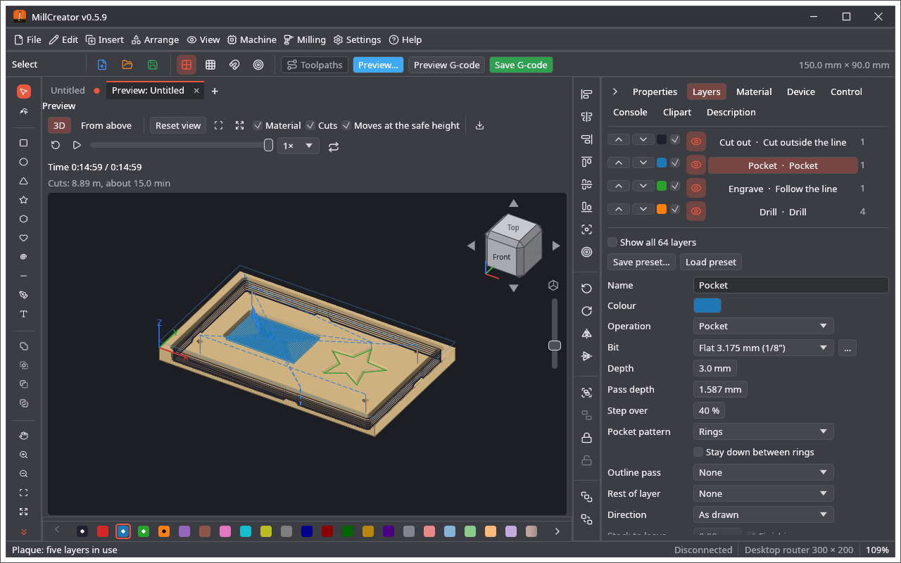
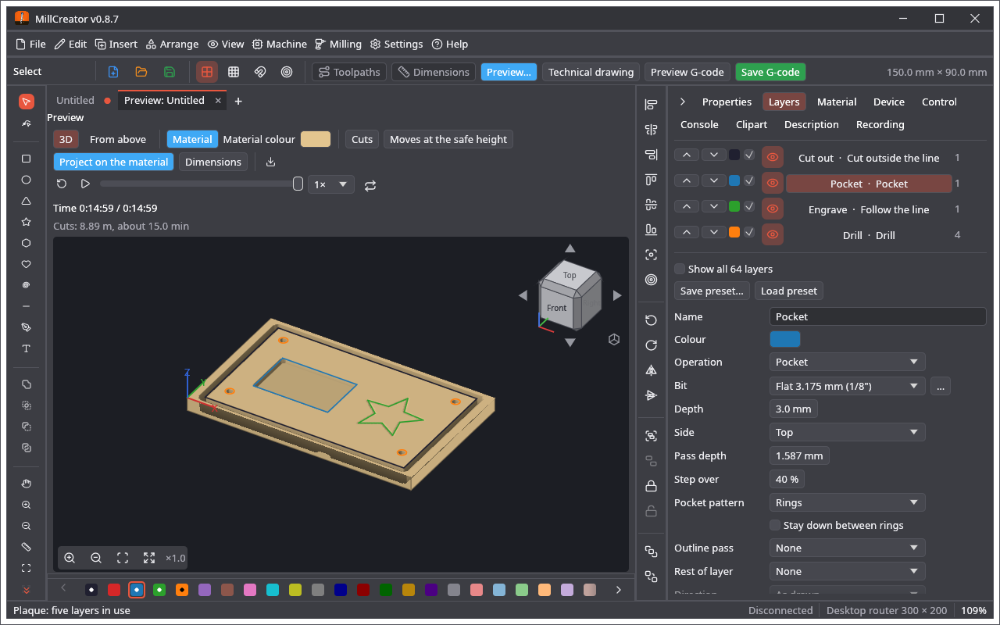
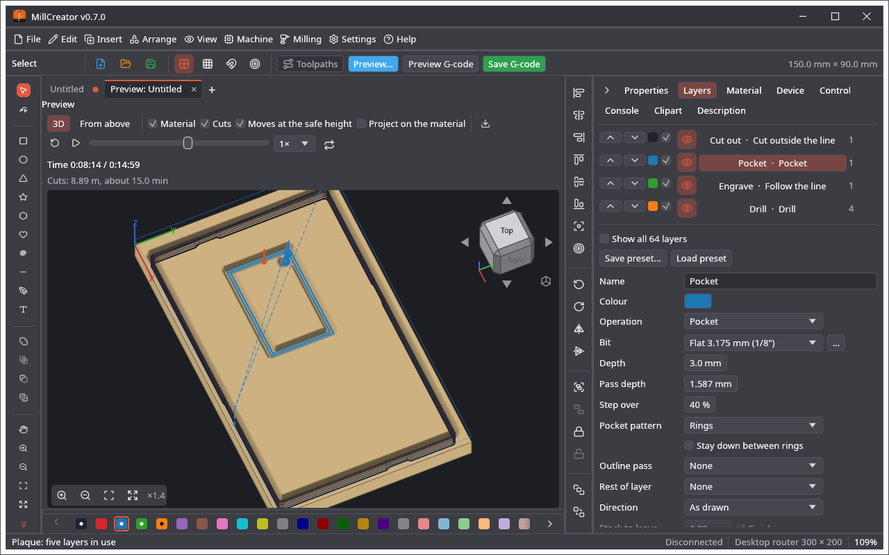

🌐 [English](3D-View-and-G-code) · **Polski**

# Widok 3D i G-code

## Ścieżki
Z kształtów, warstw, frezów i urządzenia program tworzy ruchy maszyny. Współrzędne są współrzędnymi obszaru roboczego: X w prawo, Y od ciebie (rysunek jest odwracany, bo edytor liczy Y w dół), Z = 0 na wierzchu materiału i ujemne pod nim (albo, po **Ustawieniach projektu** z **Z liczone od spodu materiału**, wysokość nad jego spodem).

* **Profile** idą wokół kształtu w odległości promienia freza, przejściami w dół do głębokości warstwy; kolejne przejście następuje bez podnoszenia freza.
* **Kieszenie** są wybierane pierścieniami od obrysu do środka, co rozstaw przejść, albo rastrem (zob. [Warstwy i operacje](Warstwy-i-operacje)).
* **Podążanie za linią** (Follow the line) idzie wzdłuż linii i z powrotem, przejście po przejściu.
* **Wiertło** (Drill) wierci porcjami o głębokość przejścia i wychodzi na powierzchnię między nimi.
* Między cięciami frez wznosi się na **bezpieczną wysokość** i porusza się tam z prędkością ruchów nad materiałem, potem schodzi szybko na 1 mm nad powierzchnię i wchodzi z posuwem wcięcia.

**Ścieżki** (Toolpaths, zielony przycisk na pasku nad obszarem roboczym) rysują cięcia na rysunku kolorem ich warstwy, a ruchy nad materiałem szaroniebiesko; ponowne naciśnięcie je ukrywa. Ścieżki idą za każdą zmianą rysunku.

## Podgląd
**Podgląd…** (Preview…, przycisk nad obszarem roboczym) albo **Frezowanie → Widok 3D zadania…** (Ctrl+Shift+P) otwiera kartę **Podgląd** z tytułem *Podgląd: nazwa projektu*. To karta obszaru roboczego jak rysunki: przeciągnij ją do innego panelu albo kliknij ją prawym przyciskiem i wybierz **Otwórz w osobnym oknie** (**Wróć do głównego okna** ją odkłada). Jej krzyżyk ją zamyka. Podgląd idzie za aktywnym rysunkiem i po każdej zmianie projektu tworzy program od nowa.

Pokazuje tylko obszar zadania, **o 10 % większy niż zadanie** w każdym kierunku, jako blok wybranego materiału o jego grubości.

| Element | Co robi |
|---|---|
| **3D** / **Z góry** (From above) | obraz 3D albo plan zadania widziany prosto z góry (nie da się go obracać) |
| Pasek powiększenia w lewym dolnym rogu (przybliż, oddal, **Resetuj widok**, **Dopasuj do wszystkich obiektów**) albo dwuklik | powiększenie; powrót do pierwszego widoku dopasowanego do obszaru roboczego; dopasowanie do wszystkich obiektów |
| **Materiał**, **Cięcia**, **Ruchy na bezpiecznej wysokości** | pokazują lub ukrywają każdą część; niebieska ramka to bezpieczna wysokość |
| **Kolor materiału** | kolor materiału w widoku, bez zmiany materiału projektu (**Automatyczny** wraca do jego własnego koloru; zapamiętywany z ustawieniami widoku) |
| **Projekt na materiale** | kształty rysunku na wierzchu materiału, w kolorze ich warstwy (tylko pokazywane warstwy); na początku wyłączone |
| ikona pobierania | **Eksportuj sfrezowany element jako STL…** (zob. niżej) |
| przeciąganie lewym przyciskiem | obraca widok |
| przeciąganie prawym lub środkowym | przesuwa obraz |
| kółko myszy | powiększa |
| animacja | **Z powrotem na początek**, **Odtwarzaj** / **Pauza**, suwak, **Szybkość animacji** (od 0,25× do 25×) i **Powtarzaj**; zadanie jest pokazane do suwaka, z zaznaczonym frezem |

**Materiał** to materiał tak, jak jest frezowany: rowki po frezach są wyżłobione w jego wierzchu do miejsca, do którego doszedł suwak, z prawdziwym kształtem każdego freza (frez V poszerza się z głębokością). **Cięcia** dokładają nad nim ścieżki freza, kolorem ich warstwy. Pod przyciskami: **Czas** do suwaka i całkowity, długość cięć z szacunkiem czasu oraz ostrzeżenia zadania (warstwa bez freza, głębiej niż materiał albo skok maszyny, obroty poza zakresem, poza obszarem roboczym, linia za mała dla freza…).

Wyżłobiony blok to obraz na siatce (gęstszej dla małego zadania), a czas to szacunek z posuwów, nie symulacja sterownika.

**Eksportuj sfrezowany element jako STL…** zapisuje materiał z rowkami, do miejsca, do którego doszedł suwak (na końcu: całe zadanie), jako binarny model STL w milimetrach. **Frezowanie → Eksportuj relief jako STL…** to drugi eksport: sam relief obrazu.

**Przy przystawce obrotowej** (ustawienia urządzenia → Obrotowy, włączona) podgląd pokazuje przedmiot jako **walec** wzdłuż X: Y programu to droga dookoła jego powierzchni, więc rysunek jest nawinięty na walec, środkiem zadania do góry, a cięcia i ruchy na bezpiecznej wysokości idą po powierzchni. Cięcia schodzą w stronę osi. Obraz obejmuje cały obwód, więc zadanie wyższe niż obwód pokazuje to samo miejsce dwa razy (i program ostrzega). Sfrezowany element nie jest eksportowany jako STL przy przystawce obrotowej (byłaby to płaska płyta).

## G-code jako tekst: Podgląd G-code

**Podgląd G-code** (Preview G-code, obok **Zapisz G-code** nad obszarem roboczym) robi program projektu, przez włączone postprocesory, i pokazuje go **jako tekst w karcie** (*Podgląd G-code: nazwa.nc*), bez zapisywania pliku. To ten sam program, który zapisuje **Eksportuj G-code…**, zaczynający się od `(MillCreator: nazwa projektu)`. Projekt ma jedną taką kartę; ponowne naciśnięcie przycisku ją pokazuje.

* Tekst jest **pokolorowany** (słowa G i M, osie, prędkości i narzędzia, numery linii, komentarze) i **można go ręcznie edytować**. Karta z ręcznymi zmianami ma kropkę, a na jej pasku stoi *Zmieniony ręcznie*.
* **Zapisz G-code** w karcie zapisuje tekst taki, jaki jest, do pliku.
* **Wygeneruj ponownie** (Make again) robi go od nowa z projektu. Gdy są ręczne zmiany, pierwsze kliknięcie pyta **Stracić zmiany?**, a drugie go robi.
* **Analizuj** (Analyse) pokazuje ścieżki tekstu w analizie G-code.
* Dopóki nie ma ręcznych zmian, tekst **sam idzie za projektem**, pół sekundy po ostatniej zmianie: gdy projekt jest zapisany, gdy zmienia się tekst karty **Opis** (notatki), gdy zmienia się ustawienie urządzenia (także jego własny G-code) i gdy postprocesor zostaje włączony lub wyłączony. Ręczne zmiany nigdy przez to nie przepadają; zmiany rysunku pojawiają się po następnym zapisie albo po **Podgląd G-code** lub **Wygeneruj ponownie**.
* Zamknięcie karty z ręcznymi zmianami pyta **Zapisać pracę przed zamknięciem?**: **Zapisz**, **Odrzuć** albo **Anuluj**.

Kartę można przenieść do innego panelu albo do osobnego okna, jak podgląd.

## Eksport G-code
**Zapisz G-code** (przycisk nad obszarem roboczym), **Frezowanie → Eksportuj G-code…** (Ctrl+E) albo **Plik → Eksportuj ▸ Eksportuj G-code…** pyta o plik (`nazwa.nc`; można wybrać `.gcode` i `.ngc`) i zapisuje program. Pasek stanu mówi, dokąd trafił, i powtarza ostrzeżenia zadania. Z **Ustawienia → Opcje widoku… → Podgląd G-code po zapisaniu** (domyślnie wyłączone) zapisany plik otwiera się potem w analizie G-code.

Plik jest w stylu GRBL:

* komentarze nagłówka `(MillCreator: nazwa)` i `(Device: nazwa)`, potem po jednym wierszu `(Note: …)` na każdy wiersz karty **Opis** projektu (nawiasy i średniki są zamieniane, żeby komentarz został cały; najwyżej 60 wierszy po 100 znaków);
* `G21 G90 G17`, słowo układu współrzędnych roboczych (`G54` … `G59`), gdy jest wybrany, i własny G-code urządzenia na początek;
* dla każdej warstwy komentarz `(Layer: nazwa)`; wrzeciono jako `M3 S…` i, gdy rusza, czekanie urządzenia `G4 P…`; `G0` dla ruchów nad materiałem i `G1` z posuwem dla zagłębiania i cięć;
* **komentarze, które mówią, gdzie co się zaczyna i kończy** (żeby plik dało się czytać, a przerwane zadanie znaleźć): `(Job: …)` z liczbą warstw, ruchów i długością cięcia; pod każdym `(Layer: nazwa)` jego część zadania i operacja, głębokość i jej kroki, posuwy, wrzeciono i frez; `(Contour 2 of 5 start: … mm round)` / `(Contour 2 end)`, `(Line …)`, `(Hole …)`, `(Picture …)`, `(Depth 1 of 3: … mm)`, ściana, wybieranie i przejście wykańczające kieszeni, rzeźbienie V i jego pierścienie, pierwsze płytkie przejście, `(Element 1 of 4 start)` przy **Element po elemencie**, `(End of layer …)` i `(End of the job)`. Komentarz ma najwyżej 70 znaków (program wysyłający, który liczy 128 znaków bufora GRBL, nie wyśle dłuższej linii). **Usuń komentarze** w ustawieniach urządzenia pomija je wszystkie;
* na końcu: w górę na bezpieczną wysokość, `M5`, powrót nad zero, własny G-code urządzenia na koniec i `M30`.

Gdy kolejna warstwa używa innego freza, plik zatrzymuje się na `M0 (Change the bit to: …)` po wyłączeniu wrzeciona. Przy **zmieniaczu narzędzi** zmiana to zamiast tego `T<n> M6` (frez potrzebuje **Numeru w zmieniaczu** w bibliotece). **Chłodziwo** (`M7` / `M8`, `M9`) i linie **odkurzacza** idą za warstwami. Przy **ustawieniach projektu** program liczy od wybranego zera (w `G54`, chyba że urządzenie ma inny kod); przy *Z liczone od spodu materiału* każde Z to wysokość nad spodem. Własny G-code urządzenia, sam początek i sam koniec pliku, jego zmienne i **Format pliku dla sterowania** są na stronie **G-code** ustawień urządzenia ([Urządzenia i kamery](Urzadzenia-i-kamery)). **Postprocesor** z wtyczki (na przykład Mach3 / Mach4 / UCCNC albo LinuxCNC z *G-code dialects*) przepisuje plik na końcu. Zadanie uruchomione przyciskiem **Start** jest wysyłane bez postprocesorów.

Ruchy każdej operacji są w pliku i w podglądzie dokładnie takie, jak zapisane: rampy, helisy, mostki, pierścienie rzeźbienia V na swoich głębokościach.

## Analiza G-code
**Plik → Pokaż plik G-code…** (także na ekranie startowym i przez upuszczenie pliku G-code na okno) otwiera dowolny plik G-code w analizie G-code, w karcie nazwanej jak plik (**Podgląd G-code** · nazwa): jego ścieżkę, płasko albo w 3D, gdy zmienia się Z, **Pokaż przejazdy**, **Kolor według wysokości**, długość cięcia i czas. Przeciąganie przesuwa (w 3D: obraca; przeciąganie prawym przyciskiem albo z Shiftem przesuwa), kółko powiększa, Esc ją zamyka.
